# RFC #54477：权重热更新（direct reload）实现与 vllm-ascend 适配方案

> 本文讲两件事：① RFC #54477 的权重更新重构的实现过程与每一步的设计依据；② vllm-ascend 的方案三（按已合入 PR 组联合适配）各组的做法与验收。
>
> 图只放在关键处：每个关键机制一张流程图或时序图，紧跟其后的是读图说明；代码只保留决定行为的那几行（节选）。

---

## 1. 背景：layerwise 重载的局限

RL 训练每一轮都会产出一份新权重 B。推理侧正在服务、**并且已经捕获过计算图**的模型必须从 A 换成 B，且换完之后的状态要与"独立冷加载 B"一致。

旧做法（layerwise reload）是**逐层重建**：把每层重新加载、重新后处理、重新塞回原地址。它有三个绕不开的毛病：

- **每轮都要新建临时参数**，重建过程本身还要重跑后处理，成本高且容易走偏；
- **派生对象仍指向被丢弃的临时参数**，不报错，但输出用旧值或已释放内存；
- **层与层之间的顺序靠 loader 上报**，半层权重被 finalize 就是静默的数值错位。

RFC 最初（Rev 1）想用"给 PWAL 分类、更新时跳过一部分后处理"来省成本；Rev 2 放弃了这个方向——**跳过 PWAL 会让 MLA 这类派生数据继续读旧权重**。Rev 2 的结论是：

> 更新完成的模型必须等价于"用新 checkpoint 冷启动"，**同时**保留已捕获的图所引用的地址。

两条同时成立才叫权重热更新。下面按一次完整更新的执行顺序展开。

---

## 2. RFC 的实现流程

### 2.1 会话边界与状态机

RL 对外只有三段 API：`start_weight_update → update_weights × N → finish_weight_update`。传输渠道（HCCL / NPU IPC / M2N / 磁盘）与"转换"是两件事，渠道只负责把 checkpoint 格式的张量送到 loader 门口。

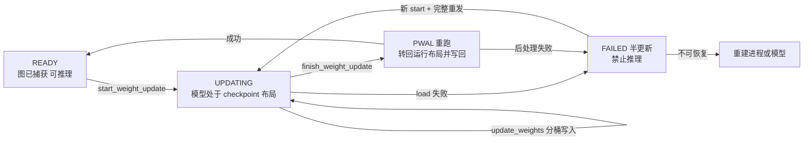

读图要点：

- **begin 到 finish 成功之间不能推理**。这期间模型里的字节是 checkpoint 格式，kernel 读它得到的是完全错误的数——不是"慢一点"，是"错"。
- 失败进入 `FAILED` 后**没有回滚**：direct reload 不保存快照。唯一修复路径是"结束旧会话 → 新开一次完整更新 → 完整重发 → 成功 finish"。
- **失败不能重试同一个 finish**：它可能已经把一部分模块处理过了，重试无法收敛。

### 2.2 冷启动：在 PWAL 之前记录 checkpoint 布局

冷启动一共四步：加载、记录、后处理、捕获计算图。记录只在冷启动做一次，之后每一轮更新都复用它。

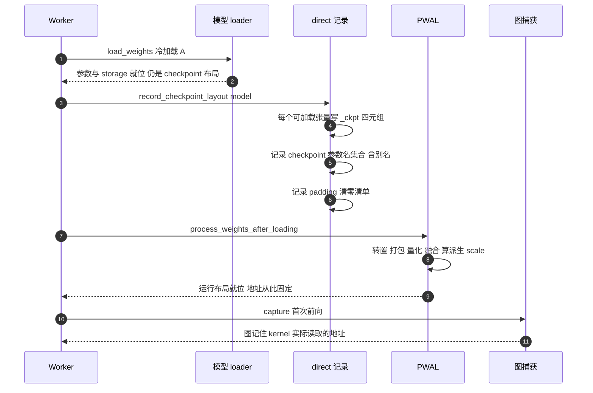

四条决定设计形状的要点：

1. **记录必须在 PWAL 之前**。PWAL 之后的张量已经不是 checkpoint 布局，再记录就记错了参照系。记录的不是"文件里的形状"，而是"本地分片后的可加载形状"——TP 切片、名称映射仍由模型自己的 `load_weights` 负责。
2. **`_ckpt` 挂在张量自己身上**，不挂在模块字典里：张量会被 PWAL 换成新对象，模块字典会失效；`_ckpt` 跟着"被记录的那个对象"走，正好对应"这个对象还能不能按 checkpoint 方式写"。
3. **按对象去重、按名字记全**：别名（tie 权重、共享 embedding/lm_head）只记一次，但每个名字都要记，因为 PWAL 可能替换掉其中任意一个。
4. **图捕获的是地址**，不是参数名、不是 Python 对象。所以"参数看起来换好了"根本不算数。

`_ckpt` 是四元组，每个字段都有用途：

| 字段 | 用途 | 少了它会怎样 |
| --- | --- | --- |
| `owner`（模型身份对象） | 区分"本模型记录的"与"别的模型共享来的"（draft 复用 target 的 `lm_head`） | 会把 draft 的更新当成 target 的，写坏未发送的数据 |
| `(shape, stride, dtype, offset)` | begin 时按它重建 checkpoint 视图 | 不知道要恢复成什么布局 |
| `attrs`（loader 元数据） | 后处理可能改 `_output_dim/_packed_dim`，begin 要还原 | loader 用错的切分参数写入，静默错位 |
| `storage` 指针 | 判断 storage 是否被搬过（被 `set_` 进融合 buffer） | offset 用错，#65281 修的就是这个 |

### 2.3 一轮更新的全链路时序

这是主图，后面每节都是把其中一段放大。

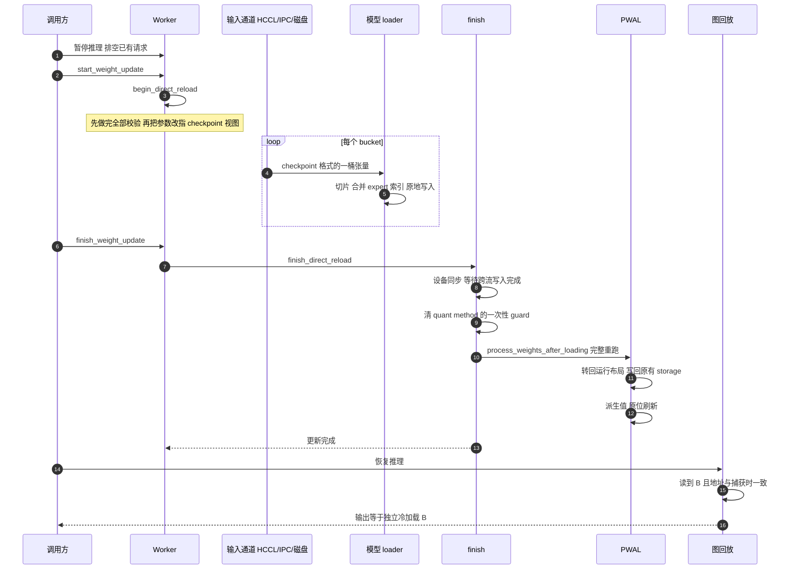

读图要点：

- **begin 之前全部校验完**：一旦 begin 返回，模型就进入"不能推理"状态，所以任何可能失败的检查（参数被换过、storage 装不下、共享参数布局变了）必须在此之前做完。
- **load 用的是模型自己的 loader**，没有"direct 专用 loader"。分片、TP 切片、tie、专家索引、dtype 转换一份都不重写——这保证更新路径与冷启动路径是同一份代码。代价是调用方**必须把每个模块的完整 checkpoint 张量发全**。
- **finish 是"完整重跑"而不是"增量补几处"**：PWAL 本身非幂等（一次量化、一次融合、一次吸收），只有整段重跑才能保证结果等于冷启动。
- **同步点在 finish 开头**：接收端可能在别的 stream 上写，不同步就开始后处理会读到半份数据。

### 2.4 同一块 storage 的四种视角

把镜头对准**一块 storage**：同一段显存，在不同阶段用的是不同的"解释方式"。

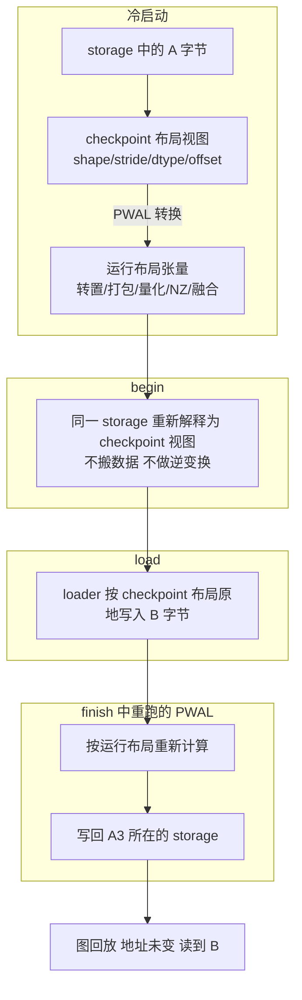

逐条读：

- **A2 → A3 是"格式变换"**：可能改 shape/stride、改字节数（padding）、甚至换 storage（变大装不下）。这一步由 PWAL 完成。
- **A3 → B1 是"零成本重解释"**：只新建视图让 loader 有位可写，数据没动，所以此刻图读到的值是错的——这就是"不能推理"的原因。
- **C1 写的是 checkpoint 布局的字节**：如果 B1 建错（本该恢复成转置布局，却直接用了运行布局），shape 全对、数值全错。
- **最后一步（写回）必须落到 A3 那块 storage**，否则图读旧地址；**重算出来的派生值也必须写回图正在读的那个对象**。

### 2.5 三条失效链与统一修法

一次更新链路里任何一处做错，最终都会落到下面三条支路之一。

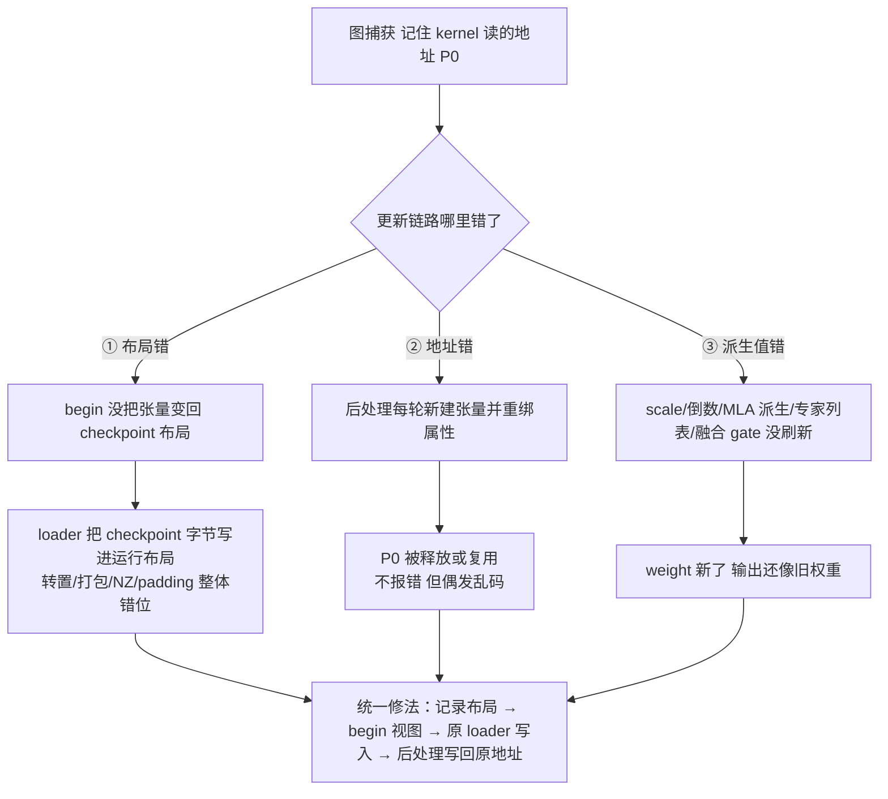

**地址错这条最值得强调**：shape 对、dtype 对、程序不崩，只是数值不对，而且只在某些轮次某些 shape 触发。所以方案里所有"写回"都要求落到**旧 storage**，落不进去就报错，绝不静默换址。

### 2.6 begin 的校验与视图恢复

begin 是一次更新的入口：它要在改动模型之前，把所有可能失败的条件判完。

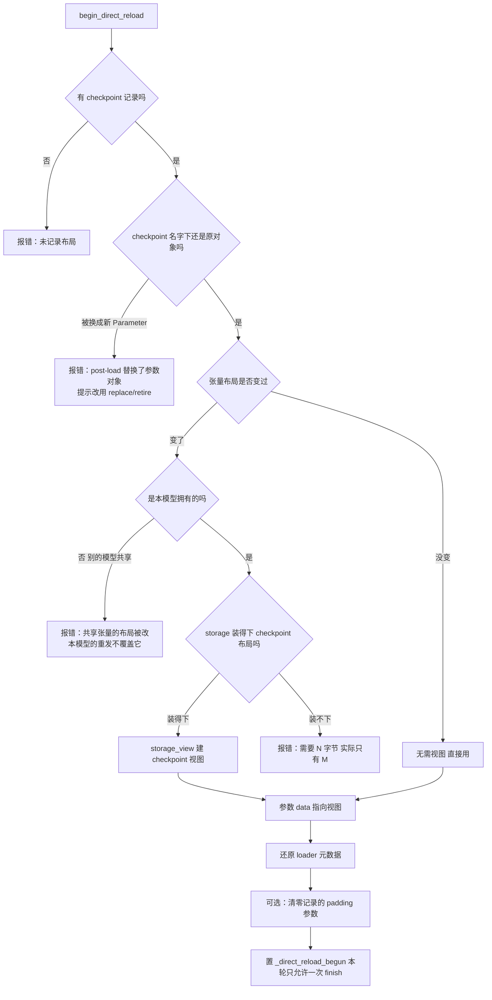

四类拒绝都有明确含义与正确做法：

| 拒绝 | 含义 | 正确做法 |
| --- | --- | --- |
| 无记录 | 这个模型没走 direct 冷启动 | 先按直连方式冷启动一次 |
| 参数对象被换 | PWAL 里 `del` 或新建了 `Parameter` | 改用 `replace_parameter` / `retire_parameter` |
| 共享张量被改布局 | draft 复用了 target 的参数，而 draft 的更新不重发它 | 让共享方各自拥有，或在 target 侧更新 |
| 容量不足 | PWAL 把张量缩小了（打包/pad 后字节数变小） | 用独立加载区（Ascend 的 ND staging 就是这种） |

容量判定用了一个很小但关键的技巧：**用 stride 计算真实跨度**而不是 `numel`，这样"转置后的非连续布局"和"带空洞的 padded 视图"都能算对；再叠加 offset 修正（storage 被搬过时用当前 offset），就是 #65281 的内容。

### 2.7 PWAL 的保址写回

后处理天然想"算一个新张量、赋给属性"。direct 要求它写回旧地址，于是上游把常见模式收敛成五个工具：`replace_parameter`、`storage_view`、`refill_derived`、`retire_parameter`、`move_parameter`。核心就一条判定：**新张量能否塞进旧 storage**。

| 场景 | 冷启动（保守） | direct（放宽） | 放宽后的效果 |
| --- | --- | --- | --- |
| 后处理让权重变大（MoE padding） | 放不下 → 换 storage | 允许用 storage 剩余空间 | 冷启动那次换到更大的 storage，之后每轮都放得下，地址从第一轮起就稳定 |
| 带空洞的视图（如 FP8 padding） | 要求"无空洞" | 只要求"不自重叠" | padding 视图也能原位写回 |
| 权重被清空（numel=0） | 不允许 | 允许 | checkpoint 字节留在 storage 里给下一轮用 |
| 更新中每轮都放不下 | — | 报错或改固定缓冲 | 绝不允许地址每轮漂移 |

所以 **"保址"不是"从不换地址"，而是"从第一轮开始地址稳定"**：冷启动时换一次 storage 完全可以接受，因为图还没捕获。

### 2.8 后处理的整段重跑与遍历顺序

冷启动和更新结束都要跑后处理。旧实现里"跑哪些、按什么顺序、跑几次"是分散的：各模型自己写转发、各层签名不一致（有的要 `act_dtype`）。#57678 把它统一成一条遍历：

| 顺序 | 谁 | 规则 |
| --- | --- | --- |
| 1 | 每个量化层（per-layer pass） | 先跑 quant method 自身的后处理 |
| 2 | deferred attention 层 | attention pass |
| 3 | 其余 module（children-first） | **子模块先于父模块**；共享子模块只跑一次，且先于所有父模块；根模块最后 |
| 跳过 | quant method 实例、被 quant 拥有的子模块、deferred attention 层 | 前面已经处理过，再跑就是重复 |

配套的签名变化：`process_weights_after_loading(self)` 无参化，attention 层在构造时把 `act_dtype` 存成 `self.act_dtype`，内部再传给 backend impl。原代码里"`act_dtype` 只为匹配签名而存在、本身未用"这类妥协也一并删掉。

**同时必须删掉各模型自己写的转发**（VL wrapper 转发给 language_model、某些模型在 hook 里自己 `for module in self.modules()`）。否则"统一遍历 + wrapper 转发"= 双调：子模块跑两遍，第二遍对已经转换过的权重再转换一次。这是 Ascend 侧 G2 最容易踩的坑。

### 2.9 finish 的一次性语义与失败会话

`_direct_reload_begun` 在 finish 开头就被 `pop` 掉，所以**失败后重试同一个 finish 会直接报"finish without a begin"**。这是刻意的：失败时可能"前 6 个模块已经后处理、后 7 个还是 checkpoint 布局"，重试无法收敛。

失败时还必须**结束旧会话**（清 active、重置更新目标），否则下一次 `start` 会被"已经有一个更新在进行中"挡住，会话就卡死到进程重启：

```python
# finish 失败：direct 已消费 begin，只能开新一轮完整更新
try:
    self.weight_transfer_engine.finish_weight_update()
except BaseException:
    if direct_reload_enabled():
        self._end_weight_update()      # 清 active + reset 更新目标
    raise
self._end_weight_update()
```

**没有回滚**是设计选择，不是遗漏：direct reload 不保存快照，修复靠"下一次完整更新"。所以"失败后能重新 start"是硬需求。

### 2.10 padding 与 meta 的初始化

MoE 的专家权重常被 pad 到对齐尺寸。padding 不是 checkpoint 数据，loader 不会写它，但 kernel 会按整块读。冷启动时它是 0；更新后如果保留旧值或随机值，数值就可能错。三条规则：

1. **selector 的判定**：只有"维度对不上"（hidden/intermediate 大于 unpadded 版本，或 TP shard 带 padding）时才需要清；**per-expert 标量（`(E,)`、`(E, ≤2)`）不是 padding 的对象**，混进去会把真实数据清零。
2. **清零会擦掉 checkpoint 区域**，所以清零之后调用方**必须完整重发这些参数的有效区**——"begin 清零"与"必须全量发送"是绑定的。
3. **meta 物化要补 0**：`materialize_meta_tensor` 原本用 `empty_strided` 得到未初始化内存，padding 会留垃圾，改成 `empty_strided(...).zero_()`。

这条对 Ascend 影响很大：Ascend 的 padding 发生在 **scheme 的后处理里**（`_maybe_pad_weight`、`F.pad`、TP padding），不在 `moe_config` 上，所以 G3 要自己实现等价的 selector（见 4.4.5）。

### 2.11 上游要求与调用方责任

这几条**不是已合入代码能自动保证的**，必须由调用方和测试承担：

| 责任 | 具体要求 |
| --- | --- |
| 发送格式 | 按 checkpoint 名称发 checkpoint 格式；不能发推理端已经转置/NZ/融合后的格式 |
| 发送完整性 | 一轮必须覆盖所有"PWAL 会改布局或非幂等"的模块；未发送的字节会被当成 checkpoint 再处理一次 |
| 暂停推理 | begin 到 finish 成功之间不能推理；已合入代码没有覆盖所有服务入口的 pending 拒绝 |
| 缓存有效性 | 更新影响 KV/prefix cache 时由调用方处理；不承诺"带历史请求的在线无缝切换" |
| 失败处置 | 失败后停止服务，走"新开完整更新"；不可恢复则重建 |

---

## 3. 12 个已合入 PR 的分组与边界

| 组 | 组内唯一归属 | 在流程中的位置 | 关键符号 |
| --- | --- | --- | --- |
| G1 同图重载基础 | #62407 | 冷加载后的参数身份；每次 load 的入口 | `retire_parameter`、`move_parameter`、`replace_parameter` |
| | #64336 | 会话状态机、全链路、失败语义 | `record_checkpoint_layout`、`begin_direct_reload`、`finish_direct_reload`、`reset_weight_update_target` |
| | #64692 | 派生值刷新与写回 | `refill_derived`、constants 保持 |
| | #65281 | begin 的 offset 修正 | `_checkpoint_views` 的 `storage.data_ptr() != ckpt[3]` 分支 |
| G2 统一加载收尾 | #57678 | 遍历顺序与去重 | `finalize_model_weights`、`children_first`、无参签名 |
| | #64357 | finish 的位置 | 模型级 hook 从 bucket 内移到加载末尾 |
| | #65914 | 统一 finish | 删除 `refresh_derived_weights` 与 forward 兜底 |
| | #64886 | 历史中间实现 | 已被 #65914 替代，不重新引入 |
| G3 sleep/wake | #64352 | begin 的 padding 流程 | `padding_fill_params()`、`_ckpt_padding_fill` |
| | #64691 | 一轮结束后的清理 | 释放可释放的设备缓存 |
| | #66010 | Level-2 sleep | allocation 选择器、分 tag wake |
| G4 后端参考 | #65296 | 后端内部，不进协议 | ROCm preshuffle scale 的 `detach` + `refill_derived` |

**未合入的项决定方案的"边界"**（不是方案的一部分，但不能假装不存在）：

| 未合入 | 缺什么 | 对方案的影响 |
| --- | --- | --- |
| #65799 | 整轮完整性检查（缺参数/shard/expert 时拒绝） | 完整性靠调用方与测试 |
| #66002 | 模型 opt-in 与"已知静默路径"拒绝 | 哪些模型支持要人肉维护 |
| #65347 | "更新后与冷启动按位一致"的测试体系 | 验收体系要自建 |
| #65487 / #65353 | packed 接收对齐、gated MXFP4 | 相关组合不写入支持声明 |
| #65562 / #65802 / #66118 等 | dummy KV scale、online quant、indexer/MLA 独立加载 | 对应场景显式排除 |

---

## 4. vllm-ascend 适配方案（方案三）

### 4.1 方案定位、两仓分工与实施顺序

Ascend 侧的方案有三种组织方式，方案三选第三种：

| 方案 | 组织方式 | 优点 | 问题 |
| --- | --- | --- | --- |
| 一、按上游 PR 适配 | 一个 PR 一个适配提交 | 来源清晰、便于回滚 | 重复处理依赖；容易漏"上游没改但 NPU 必须改"的路径 |
| 二、按功能适配 | 8 个功能包、6 步实施 | 覆盖 Ascend 特有缺口 | 前期要设计支持范围与验收矩阵 |
| **三、按已合入 PR 组联合适配（本文）** | 只继承已合入实现，按 PR 组联合交付 | 不引入未合入能力，边界清楚，可联合验收 | 需要额外维护"无上游 PR 的 NPU 等价实现"的归属 |

三条硬规则：

1. **只继承已合入**主仓实现；未合入 PR、fork 原型、draft/MTP 专项不纳入；
2. 每个 PR **只归一个主组**，组间只引用依赖；
3. **"只继承已合入"≠"只改上游同名文件"**：Ascend 自有 worker/scheme/attention/allocator 里的必要等价实现，同样是本方案的责任。

第 3 条最容易被漏：上游 PR 清单里没有"强制 NZ 运行区""CaMem allocation 选择器""Mandap 融合投影"，但它们都在 direct 的必经路径上。

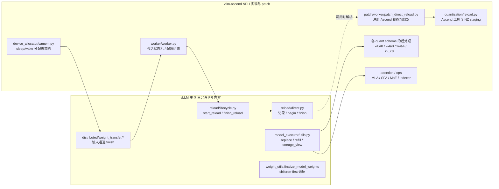

三条接入原则：

- **vLLM 侧只保留 PR 内容**：本地适配要么进 Ascend 的 patch 机制，要么在 Ascend 侧重写。验收方式：`git diff --name-only` 是 PR 文件白名单的子集 + 逐文件 SHA256 与上游一致。
- **patch 必须登记**：目标、原因、关联 PR、移除计划、作用范围，写进 Ascend 的 `patch/__init__.py`；否则下次升级没人知道它为什么存在。
- **公共 helper 用"运行期绑定"接入**：`direct._checkpoint_views` 在调用时按模块全局名解析，Ascend 在 worker 初始化时替换它，就能同时覆盖磁盘 reload 与 transfer engine 两条入口。

**实施顺序**（组间与组内的语义依赖，不是"可任意顺序 apply"的声明）：

1. 先固定配套基线，核对哪些已合入项在目标 pin 内，缺的按 PR 顺序回补；
2. G1：参数身份 → direct core → 派生工具 → **offset 修复必须在 core 之后**（它改的是 `_checkpoint_views` 里的一段逻辑）；
3. G2：模型级 hook 位置 → 无参遍历接口 → 统一 finish（旧的独立刷新只在旧栈需要，不作为最终接口）；
4. G3：**padding 依赖 G1 的 begin** → sleep/wake 依赖 worker 与 allocator 接口 → 收尾清理；
5. 每个 release 记录精确 commit/patch 顺序、`git apply --check`、干净基线重放后的 tree 与台账。

### 4.2 G1：同图重载基础

#### 4.2.1 目标与输入输出

让同一个模型反复接收 checkpoint 权重，转换后的运行权重与派生值仍然放在原图读取的位置。要解决的是"Parameter 看起来更新了，原图却读旧 storage 或旧派生值"。

| 项 | 内容 |
| --- | --- |
| 总体位置 | 冷启动记录、begin、分桶 load、finish 内的转换与写回 |
| 输入 | 已记录的本地布局、当前参数/storage、新 checkpoint 的完整必要张量 |
| 处理 | 保住加载身份；恢复 shape/stride/dtype/offset；loader 分片写入；派生值原位刷新 |
| 输出 | 下一轮仍可加载的参数；图/kernel 从有效地址读到 B 的数据 |

#### 4.2.2 组内成员与分工

| 成员 | 上游作用 | Ascend 侧要做的事 |
| --- | --- | --- |
| #62407 | 保留被 PWAL 消费、改名或退休的参数的加载语义 | 保住 Parameter、名称/别名、loader：`del` → `retire_parameter`，新建 Parameter → `replace_parameter`，改名 → `move_parameter` |
| #64336 | direct begin/load/finish、视图恢复、worker 失败会话收尾 | 继承公共 core；**独立 NPU worker 的失败会话语义**；配置约束与引擎入口 |
| #64692 | 派生 tensor、scale、constants 每轮原位刷新 | 复用工具，处理 NPU 专家列表、倒数 scale、一次性量化 guard |
| #65281 | 参数搬到新 storage 后按当前 offset 恢复视图 | 继承公共修复，核对 NPU 搬移/切片路径 |

**联合的必要性**：只保住名字而转置后换了 storage，图仍读错；只保住 weight 地址而不刷新倒数/MLA 派生权重，数值仍旧；只刷新派生值而丢了 loader 属性，下一轮又写不进去。四项共同构成"可反复加载 + 原图有效"。

#### 4.2.3 存储形态决定处置方式

G1 的工作可以归成一张判定图：**拿到一个运行时对象，先问它是什么，再决定怎么处理**。

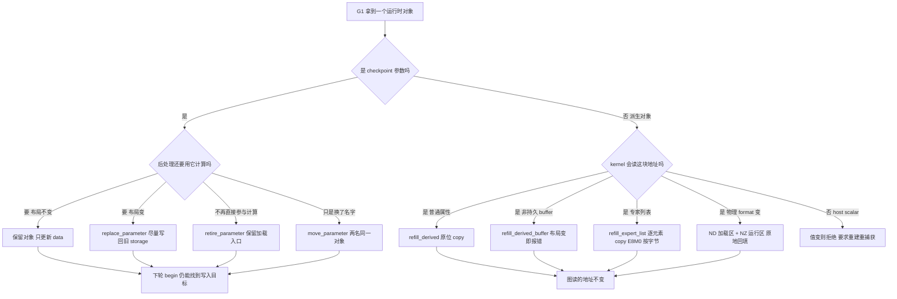

读图要点：

- **左半支是"参数身份"**：能不能下轮再写、写进去是不是原位，取决于这里选哪种处置。
- **右半支是"派生对象"**：它们不是 checkpoint 数据，begin 不会给它们建视图，所以只能靠后处理**主动原位刷新**；布局一变就必须报错，因为图引用的就是这块地址。
- **host scalar 是唯一"只能拒绝"的**：它被烘焙进 kernel 入参，改值不会让已捕获的图重新读它。

#### 4.2.4 G1 的一次更新时序

把 begin、load、finish 三个环节换成 Ascend 的实际处理，就得到下面这条时序。

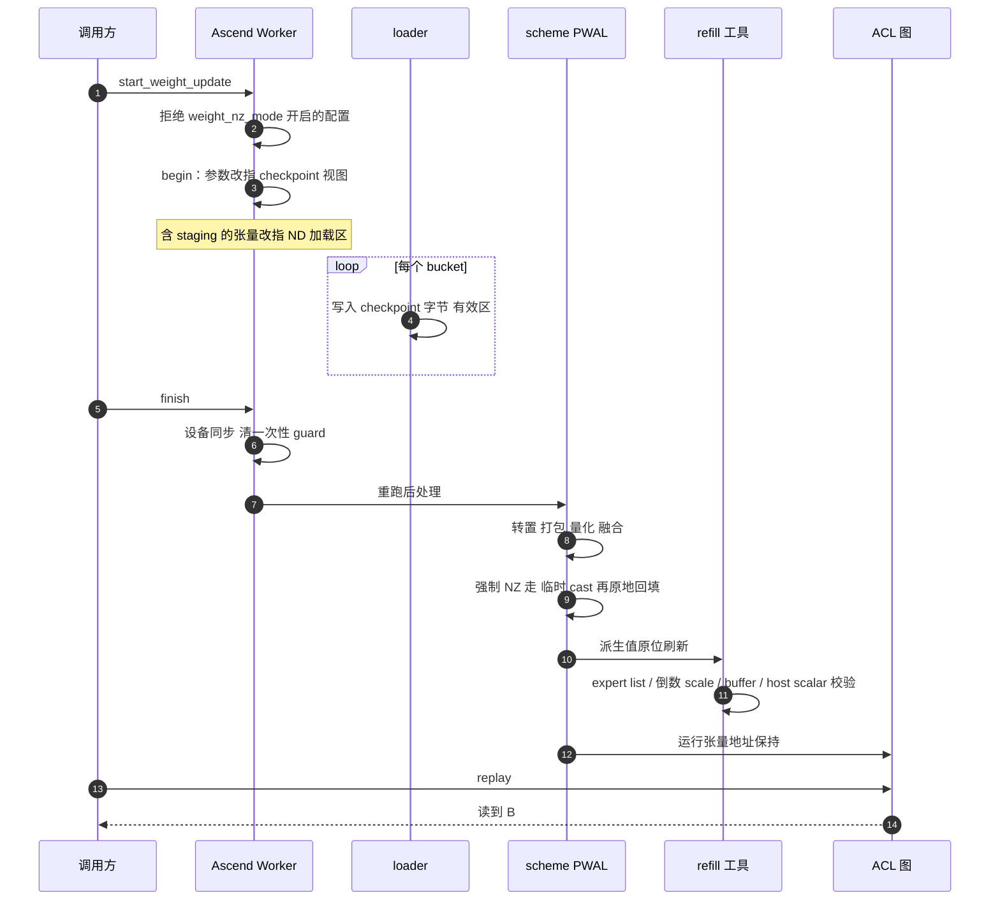

这张图与 2.3 的主图差别只有三处，正好是 G1 的三个改造点：**begin 里多一层 Ascend 视图规划器**、**PWAL 里强制 NZ 要"临时 cast + 原地回填"**、**派生值要经过 Ascend 的 refill 工具**。

#### 4.2.5 关键实现

**(1) 参数身份与专家列表**

```python
# 原：新建列表 + 删除源参数（下一轮无法再加载，图也丢引用）
layer.w13_weight_list = [w.clone() for w in layer.w13_weight.data.unbind(dim=0)]
del layer.w13_weight

# 新：列表原地回填 + 源参数退休
for name in ("w13_weight", "w2_weight"):
    weights = list(getattr(layer, name).data.unbind(dim=0))
    refill_expert_list(layer, f"{name}_list", [w.clone() for w in weights])
retire_parameter(layer, "w13_weight")
retire_parameter(layer, "w2_weight")
```

三个 refill 工具的区别必须分清：

| 工具 | 布局变化时的处理 | 适用对象 |
| --- | --- | --- |
| `refill_derived` | 允许 `setattr` 换对象（调用方保证图契约） | 普通派生属性 |
| `refill_expert_list` | **报错**（元素被图引用，换地址就是错） | 专家列表及其元素 |
| `refill_derived_buffer` | direct 下**报错** | 非持久 buffer |

```python
def refill_expert_list(layer, name, tensors):
    old = getattr(layer, name, None)
    if old is None or not direct_reload_enabled():
        setattr(layer, name, tensors)
        return
    if len(old) != len(tensors) or any(_layout(a) != _layout(b) for a, b in zip(old, tensors)):
        raise ValueError(f"{name}: expert runtime layout changed; reload the model and recapture graphs")
    for target, source in zip(old, tensors):
        # E8M0 是编码而非数值，CANN copy 不支持全部 MX dtype：按字节保真
        if target.dtype == torch.float8_e8m0fnu:
            target.view(torch.uint8).copy_(source.view(torch.uint8))
        else:
            target.copy_(source)
```

**(2) 派生值不注册为 Parameter**

```python
# 原：派生 scale 注册成 Parameter，且与 checkpoint 参数别名 → begin 会互相踩
layer.fak_descale = torch.nn.Parameter(fa_k_scale, requires_grad=False)

# 新：拥有独立 storage 的派生属性，原位刷新
refill_derived(layer, "fak_descale", fa_k_scale.clone())
refill_derived(layer, "fak_descale_reciprocal", 1.0 / reciprocal_scale)
```

必须这样改的原因：派生量一旦是 Parameter 就会进 `_loadable_tensors`，begin 会给它建 checkpoint 视图——但它根本不是 checkpoint 数据，loader 会往"派生量的视图"里写字节，两边互相踩。

**(3) 一次性 guard 的清理**

Ascend 的 scheme 里有 `_mxfp4_transformed` / `_mxfp8_transformed` 这类"只转换一次"的标记。上游 finish 只清 quant method 的 `_already_called_process_weights_after_loading`，Ascend 的标记不会被清——后果是**整段后处理被跳过，模型静默停在 checkpoint 布局**。

```python
def process_quant_weights(scheme, layer):
    if direct_reload_enabled():
        if getattr(layer, "_already_called_process_weights_after_loading", False):
            return                      # 同一轮内重复调用直接跳过
        layer.__dict__.pop("_mxfp4_transformed", None)
        layer.__dict__.pop("_mxfp8_transformed", None)
    scheme.process_weights_after_loading(layer)
    if direct_reload_enabled():
        layer._already_called_process_weights_after_loading = True
```

三条规则：只在 direct 模式生效（layerwise 保持原语义）；只清 Ascend 自己设的标记（不无差别清同名属性）；同轮重复调用要去重。

**(4) host scalar 的拒绝策略**

FlatQuant 的 `clip_ratio` 是算子入参的 host float，已经被图烘焙。改 tensor 不生效，改 host 值也不会让已捕获的图重新读它。

```python
def get_flatquant_clip_ratio(layer):
    value = layer.clip_ratio.item()
    if direct_reload_enabled() and hasattr(layer, "aclnn_clip_ratio") and value != layer.aclnn_clip_ratio:
        raise ValueError("direct reload cannot change FlatQuant clip_ratio; rebuild the model and recapture graphs")
    return value
```

原则：**值不变则放行，值变化则显式拒绝**，让调用方走"重建模型 + 重新捕获"。宁可拒绝，不可静默错。

**(5) 强制 NZ：ND 加载区 + NZ 运行区**

这是 Ascend 最特殊的一块。背景是三个事实叠在一起：

- RL 场景要求 `weight_nz_mode=0`（走 ND），但 Ascend 的**部分内核只接受 FRACTAL_NZ**，会在后处理里**无条件** `npu_format_cast`；
- 每次 cast 都新建一块 NZ storage 再 `attr.data = tensor` → **地址每轮都变**，图读旧地址；
- 而这个参数同时是 loader 的写入目标（checkpoint 参数），begin 时必须有一块**按 checkpoint 布局的 ND 区**可写。

两个需求冲突，所以方案是**两块区并存**：ND 区只给 loader 写，NZ 区只给图读，后处理负责把 ND 转成 NZ 并回填。

```python
def refill_nz_weight(layer, name):
    source = getattr(layer, name).data
    if direct_reload_enabled():
        # 用 set_/as_strided 重建的张量可能继承 storage 的原描述，
        # 先 clone 成连续 ND，让 cast 按最终运行 shape 进行
        source = source.clone(memory_format=torch.contiguous_format)
    tensor = torch_npu.npu_format_cast(source, ACL_FORMAT_FRACTAL_NZ)   # 临时 NZ
    refill_runtime_parameter(layer, name, tensor)                        # 回填固定运行区

def refill_runtime_parameter(layer, name, tensor):
    if not direct_reload_enabled():
        getattr(layer, name).data = tensor
        return
    parameter = getattr(layer, name)
    ckpt = getattr(parameter, "_ckpt", None)
    if ckpt is not None and not hasattr(parameter, "_direct_reload_staging"):
        # 这个参数同时是 loader 写入目标：另开一块 ND 加载区
        shape, stride, dtype, offset = ckpt[1]
        parameter._direct_reload_staging = torch.empty_strided(
            shape, stride, dtype=dtype, device=parameter.device)
    buffers = layer.__dict__.setdefault("_reload_runtime_buffers", {})
    old = buffers.get(name)
    if old is None:
        buffers[name] = tensor
    else:
        if _layout(old) != _layout(tensor):
            raise ValueError(f"{name}: runtime layout changed; rebuild and recapture graphs")
        if old.device.type == "npu" and torch_npu.get_npu_format(old) != torch_npu.get_npu_format(tensor):
            raise ValueError(f"{name}: physical format changed; rebuild and recapture graphs")
        old.copy_(tensor)      # NZ → NZ 原地回填，地址不变
        tensor = old
    getattr(layer, name).data = tensor
```

四个"看起来能省、实际不可行"的做法（都在真机上验证过）：

| 想省掉的做法 | 不可行的原因 |
| --- | --- |
| 直接在 NZ storage 上建 ND 视图给 loader 写 | NPU 的 `set_(storage)` 视图会**继承 storage 的 NZ 描述**，专家切片 loader 无法把它当 ND 用 |
| 用 `npu_format_cast` 的返回值判断"是否已是 NZ" | 这套 CANN 上某些视图会"原地址返回 ND"，格式查询不可靠，只能以 `data_ptr` 为准 |
| 每轮新建 NZ 张量再赋值 | 地址每轮漂移，图读旧地址（就是 2.5 的地址错） |
| NZ → NZ 也先 clone 再赋值 | 多余一次全量拷贝；`copy_` 在同布局 NZ→NZ 下既保址又保值 |

代价要说清：**强制 NZ 的权重 2× 常驻**（NZ 运行区 + ND 加载区），每轮还有一次 clone 的瞬时峰值。方案接受这个代价，因为替代方案（每轮换地址）是正确性问题。

**(6) Ascend 实现的接入方式**

vLLM 侧不允许改非 PR 内容，所以用**运行期替换**：

```python
# vllm_ascend/patch/worker/__init__.py
if getattr(vllm_envs, "VLLM_RELOAD_MODE", None) == "direct":
    import vllm_ascend.patch.worker.patch_direct_reload  # noqa: F401
```

```python
# vllm_ascend/quantization/reload.py
_UPSTREAM_CHECKPOINT_VIEWS = vllm_direct._checkpoint_views   # 只捕获一次，避免套娃

def checkpoint_views(model):
    # 没有任何 staging（普通 ND 模型）→ 直接走原 PR 实现，零改动
    if not any(getattr(t, "_direct_reload_staging", None) is not None
               for _, t in vllm_direct._loadable_tensors(model)):
        return _UPSTREAM_CHECKPOINT_VIEWS(model)
    ...  # 有 staging：校验 owner / 布局 / device，然后返回 (t, staging)

def install_direct_reload_patch():
    vllm_direct._checkpoint_views = checkpoint_views
```

两个好处：**零侵入**（vLLM 文件一个字节不改，可逐文件哈希证明）与**渐进**（不用 staging 的模型完全走上游路径）。

#### 4.2.6 覆盖矩阵与验收

G1 的验收不是"跑通一个模型"，而是**每个类/分支 × 每种存储形态都有结论**：

| 存储形态 | 要回答的问题 | 判定口径 |
| --- | --- | --- |
| checkpoint 参数 | 下轮还能不能按原名写 | 对象/名字/loader 属性都在 |
| 派生属性 | 是否原位刷新 | `data_ptr` 与冷启动基准一致 |
| 非持久 buffer | 是否保址 | 同上，布局变化即报错 |
| 专家列表 | 元素地址是否变 | 逐元素比较，布局变化即报错 |
| 一次性 guard | 每轮是否被清 | 第二轮确实重跑了后处理 |
| host scalar | 变化时是否拒绝 | 明确抛错，不是静默 |
| 物理 format（NZ） | 是否仍是图读的那块 | `copy_` 后 `data_ptr` 不变 |

| 验收层 | 必须证明 |
| --- | --- |
| 契约单测 | Parameter/别名/loader 保留；缺失 shard/expert/scale 报错；E8M0 编码按字节保真 |
| NPU 层级 | 真实算子 + 原图 + 非均匀 A/B + 多轮重载；派生值与 host scalar；**撤掉修复能触发反例** |
| 模型闭环 | A→A 不漂移；A→B→A 对照独立冷 A/B；原图对象与 capture 次数稳定 |
| 失败路径 | 走真实 Worker 入口：finish 失败 → 会话结束 → 新 start 可开 → 完整重发后恢复 |
| 不变量观察 | 具名消费者的 `data_ptr`、offset、shape/stride/dtype/device/format、数值 |

最后一条容易被忽略：**指针集合相同不代表正确**（两个对象互换后集合不变），**地址不变也不代表值对**（丢了值照样错）。观察器必须按"具名对象 + 字段 + 数值"一起比。

#### 4.2.7 G1 的边界与处理规则

这些是方案的一部分——不在支持范围的路径必须有**明确处理规则**，而不是"没测过"：

| 路径 | 方案结论 | 处理规则 |
| --- | --- | --- |
| W4A8-MXFP4（线性与 mega MoE） | 未接入 ND staging，仍走 `.data = cast` | direct 模式下**显式拒绝**，不进静默错误 |
| W4A16-MXFP4 / packed-FP4 | 已有算子问题（连续性要求、`aclnnNpuFormatCast` 不支持回恢复格式）不扩修 | 只补重载保址，问题原样记录 |
| MLA-MLAPO / SFA-PROLOG_V3 | 后处理每轮重绑 impl 属性，属"派生属性未原位刷新" | 方案要求改用 `refill_derived` 严格变体（布局变化即报错）；不改则声明不支持 |
| A5 MegaMoe 共享专家融合 | 需 `enable_fused_mc2==3` + MXFP，当前目标硬件不可达 | 记录为"目标配置不可达"，不作为已支持 |
| 310P | 有独立 PWAL 与硬件差异 | 排除，并写清文件与范围依据 |
| 真实 HCCL / 多卡 | 属传输路径 | 需要独立证据，磁盘 bucket 不能替代 |
| 强制 NZ 的内存 | 2× 常驻 + 每次 clone 峰值 | 按 EP 切分给出估算，必要时"finish 后释放加载区" |

### 4.3 G2：统一加载收尾

#### 4.3.1 目标与成员

多个 bucket 只是写入阶段；一轮结束后要**统一、有序、不重复**地跑完收尾，并且**没有 forward 里临时补建**的路径。

| 项 | 内容 |
| --- | --- |
| 总体位置 | 冷启动加载完毕后、每轮 `finish_weight_update` 内 |
| 输入 | 本轮新权重、模型模块树、quant methods |
| 处理 | 统一 finish；必要量化转换；无参 hook 遍历；去掉被替代的独立刷新/forward 兜底 |
| 输出 | 本轮后处理完整结束，运行态可推理；保址由 G1 的工具提供 |

| 成员 | 上游作用 | Ascend 侧要做的事 |
| --- | --- | --- |
| #57678 | 无参 hook 签名；children-first + 去重 + 跳过 quant 实例/quant 拥有的子模块/deferred attention；删除 wrapper 转发；保证"量化 transform 归一化早于 attention 吸收" | ①迁移 Ascend 侧带 `act_dtype` 的签名（`mla_v1`、`sfa_v1`、`attention_v1`、`dsa_v1`、`mla_cp`、`models/layer/attention/layer.py` 等，首步盘点给全集），把 `act_dtype` 存到构造期；②删除 Ascend VL wrapper 的转发；③核对共享 quant method 实例不会被子模块二次处理；④核对 quantized 层子模块由 quant method 自己覆盖 |
| #64357 | 模型级 hook 挪到整体加载末尾 | 核对 Ascend 自定义模型/loader 是否有"bucket 内提前 finalize"的旧补丁 |
| #65914 | 所有更新路径统一 finish；删除 `refresh_derived_weights` 与 forward 兜底 | ①确认所有入口都走同一 finish；②删除依赖旧 refresh 的适配；③把 forward 里的惰性补建移进后处理 |
| #64886 | 曾经的 kernel-format 派生刷新 | 已被 #65914 替代，不重新引入 |

#### 4.3.2 调度判定：顺序、跳过与风险点

一轮收尾的调度顺序可以写成一张判定图：谁先跑、谁跳过、哪里会出问题。

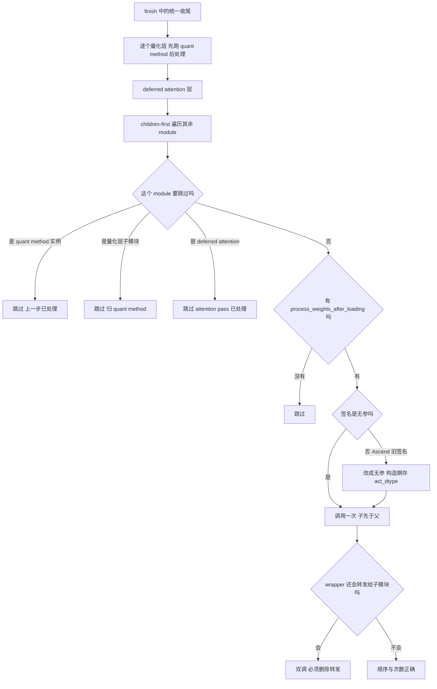

读图要点：

- 前两步（quant per-layer、attention）**不是** children-first 遍历的一部分，它们由 loader 更早的 pass 完成；
- 遍历时跳过三类：quant method 实例、被 quant 拥有的子模块、deferred attention 层；
- 两个红点都在 Ascend 侧：**旧签名**（不改就 `TypeError`）与**wrapper 转发**（不删就双调）。

#### 4.3.3 双调的成因与时序

双调不是理论风险，它由 wrapper 里一个转发调用直接产生。

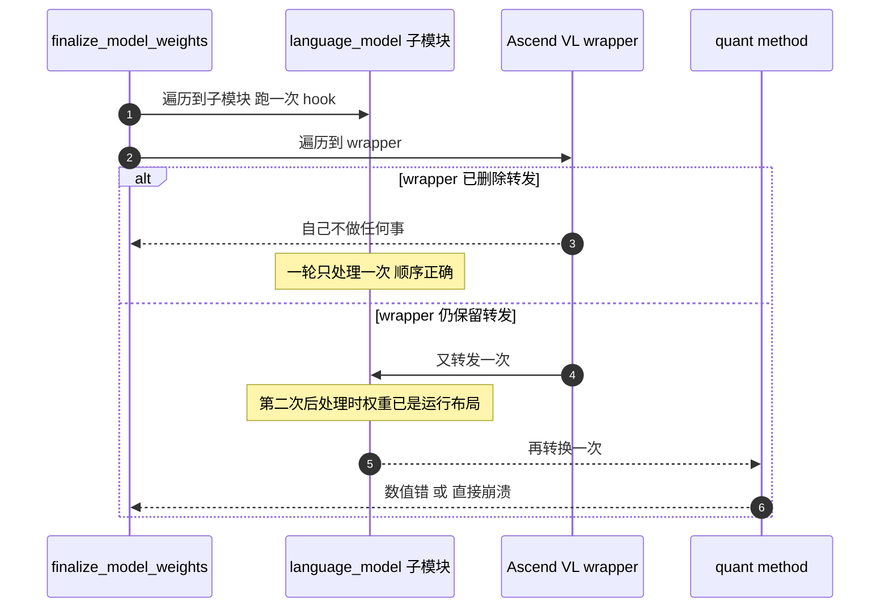

三种典型表现：

| 表现 | 原因 |
| --- | --- |
| `TypeError: missing 1 required positional argument: 'act_dtype'` | 旧签名还在，统一遍历按无参调用 |
| 数值错但不报错 | 双调：第二次对已转换的权重再转换一次 |
| 某些模块没跑 | wrapper 删了转发，但统一遍历因"quant 拥有的子模块"跳过了它 |

#### 4.3.4 改造清单与首步盘点

| 类别 | 具体位置 | 改法 |
| --- | --- | --- |
| 签名 | attention 层与 impl 的 `process_weights_after_loading(self, act_dtype)` | 改无参，构造期存 `self.act_dtype` |
| 转发 | Ascend VL wrapper 显式调 `language_model.process_weights_after_loading()` | 删除，交给统一遍历 |
| 自建遍历 | 某些模型在 hook 里自己 `for module in self.modules()` | 删除（统一遍历已覆盖） |
| 惰性补建 | `indexer_kpool` 的 `if self._key_weight is None`、`sfa_v1` 的 dummy cache、`mla_v1` 的 `_prolog_v3_weights` | 移到后处理，forward 只读不建 |
| 旧刷新 | 依赖 `refresh_derived_weights` 的适配 | 删除，改用 `refill_derived` |

**首步交付物是 hook 接口盘点表**，没有它就不要动签名：每个有后处理的类 → 是否有 `quant_method` → 谁调用它（loader 遍历 / wrapper / 自己 forward）→ 签名 → 每轮调用次数 → 产出是否被图引用。表里每条都要给出"改 / 不改 / 理由"，并区分 **module hook**（必须无参）与 **backend impl 方法**（带 dtype 并不天然错误，关键看谁调用）。

#### 4.3.5 G2 的验收

多种合法 bucket 切分结果一致；hook 顺序与次数符合统一实现（子先于父、共享只一次）；checkpoint-format 与 kernel-format 两条路径都正确收尾；direct 下连跑两轮，断言第二次 forward 不新建任何 kernel 可见张量。

### 4.4 G3：sleep/wake 权重交换

#### 4.4.1 目标与成员

RL 共卡时释放推理设备内存，训练后唤醒并重发参数，同时保留 checkpoint 不会重建的非参数状态；并确定 padding 与更新后资源状态。

| 项 | 内容 |
| --- | --- |
| 总体位置 | sleep、wake weights、begin 的 padding 清零、更新后同步清理、wake KV |
| 输入 | 模型 storage、allocator 分配、保留参数策略、tags、新权重 |
| 处理 | 分配级保留/丢弃、原址恢复、padding 清零、重发新权重、结束同步清理 |
| 输出 | 需要的运行状态有效，被丢弃的参数重载后可用，原图继续推理 |

| 成员 | 上游作用 | Ascend 侧要做的事 |
| --- | --- | --- |
| #64352 | begin 清零记录的 padded MoE 参数 | Ascend 的 padding 在 scheme 后处理里（`_maybe_pad_weight`、`F.pad`、TP padding）→ 实现 Ascend 版 selector，保证"清零后有效区完整重发" |
| #64691 | 更新结束同步并清理可释放设备缓存 | HCCL 继承公共路径；核对 NPU device/stream 与 `torch.npu.empty_cache`，避免与 CaMem 冲突 |
| #66010 | sleep2 只丢"允许重写的纯参数 allocation"；混合块整块备份；别名按 storage；分 tag wake | Ascend 是自研 `CaMemAllocator` → 逐项对齐判定与生命周期 |

#### 4.4.2 sleep/wake 的 allocation 判定

sleep 到 wake 的每个判定都发生在 allocation 粒度上，而不是参数粒度上。

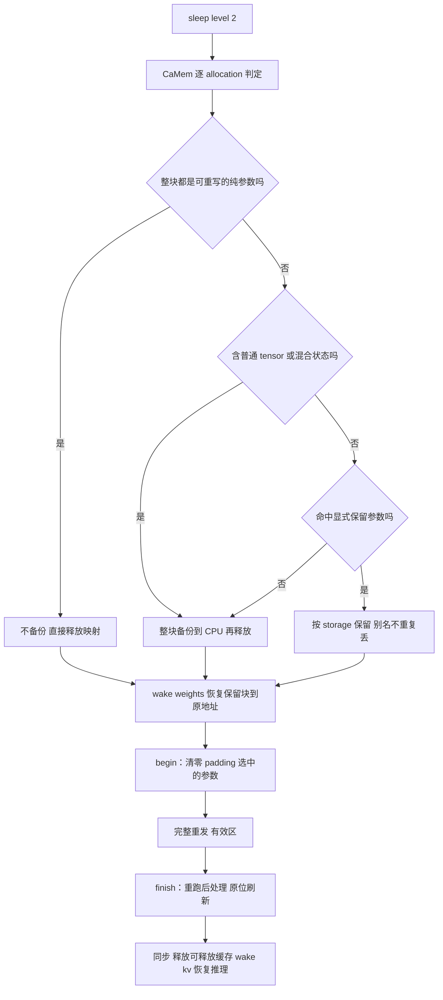

四个容易判错的点：

| 判定 | 上游语义 | Ascend 要对齐什么 |
| --- | --- | --- |
| 纯参数块 | 允许丢弃，wake 后必须重发 | CaMem 需给出"整块都是参数"的识别口径 |
| 混合块 | 整块备份，不能因含参数就丢 | 备份粒度、CPU 侧开销 |
| 别名 | 按 storage 处理，不能按名字 | CaMem 是否记录 storage 级归属 |
| tag 与重复 sleep | 每个 tag 各自的恢复条件 | 重复 sleep/wake 的幂等性、跨 tag 组合 |

还有个容易忽略的时序事实：**wake 之后、finish 之前的派生值是上一轮的旧值**，直到 finish 重跑 PWAL 才按新权重刷新。这也是"finish 必须完整重跑"的另一个理由。

#### 4.4.3 allocation 级时序

把上面的判定展开成时间线，就是下面这条时序。

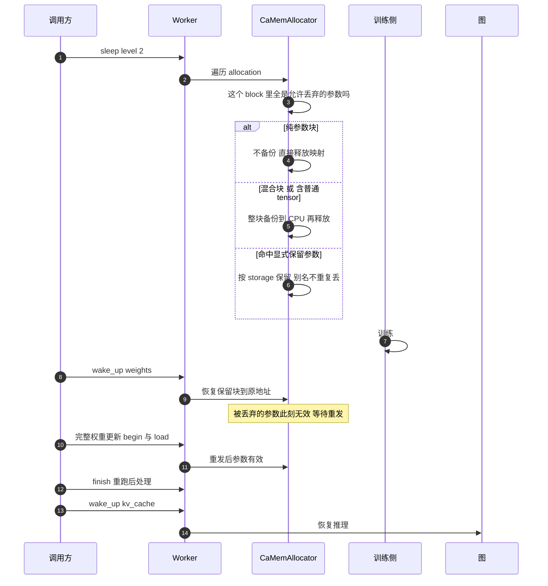

#### 4.4.4 padding selector 的 Ascend 版本

上游的 selector 挂在 `RoutedExperts` 上：

```python
def padding_fill_params(self) -> list[str]:
    c = self.moe_config
    inter = c.intermediate_size_per_partition
    if not (c.hidden_dim > (c.hidden_dim_unpadded or c.hidden_dim)
            or inter > (c.intermediate_size_per_partition_unpadded or inter)
            or c.tp_shard_with_padding):
        return []
    return [n for n, p in self._parameters.items()
            if p is not None and p.ndim > 1 and p.numel() > 2 * p.shape[0]]
```

Ascend 不能照抄，三个原因：

1. Ascend 的 padding 在 **scheme 的后处理里**（`_maybe_pad_weight` 等），`moe_config` 上不一定有 unpadded 字段；
2. Ascend 的 TP padding 在 scheme 内做，需要 scheme 自己回答"pad 了哪些参数、pad 了多少"；
3. 强制 NZ 参数的 padding 在 NZ 布局下，清零要在 **staging** 上做，否则会清到运行区。

方案要求：每个会 pad 的 scheme 实现 `padding_fill_params()`（或登记"N/A 及理由"），结果并进 begin 的清零清单。

#### 4.4.5 接口对齐与验收

| 接口/策略 | 需逐项对齐 | 必需证据 |
| --- | --- | --- |
| 参数 storage 筛选 | 命名别名、显式 retain、共享 storage、可重写范围 | 相同 storage 不能因别名被误丢 |
| allocation/block 快照 | 纯参数/混合/未知块、inactive block 与 offset | NPU 实际 snapshot 与 allocator 记录匹配 |
| offload/discard tags | weights/runtime/graph/KV 各自策略 | 每个 tag 的备份/映射/推迟唤醒行为 |
| pool/回调生命周期 | 同 tag 多次进入、release、重复 sleep/wake | 所有 pool 被持有并正确释放 |
| worker 与 sleep manager | 旧私有保存字段、全局 buffer 重注册、同步顺序 | 不与 allocator 重复备份 |
| HCCL/NPU IPC | device/stream、engine 生命周期、缓存清理 | 目标通道证据；未测记未测 |

**验收**：sleep2 下 A→B→A + 原图 + 独立冷 B + padding + 内存曲线；真实 HCCL/IPC 与多卡各自需要证据（磁盘 bucket 不能替代）；重复 sleep/wake、跨 tag 组合、失败后重开都要有用例。

### 4.5 G4：ROCm 已合入项参考

G4 只有 #65296，作用是"来源完整性"：它修的是 ROCm preshuffle scale 被误注册成 checkpoint Parameter 的问题，属于后端内部实现，**不改变 begin/load/finish 协议**。

| 成员 | 上游作用 | Ascend 处理 |
| --- | --- | --- |
| #65296 | DeepSeek-V4 ROCm preshuffle scale 用 `detach` + `refill_derived`，维护正确的派生身份 | 继承公共源码时保留实现；NPU 不经过该路径，记录不适用原因 |

若 NPU 出现同类风险（scale 被误注册成 Parameter），按 G1 的契约处理，主归属仍在 G1，不把 #65296 算成第四个 NPU 功能。

### 4.6 验收口径与交付台账

三组共用三道门槛：

| 门槛 | 最低要求 |
| --- | --- |
| 静态盘点 | 对目标完整基线扫描 `process_weights_after_loading*` 及其 helper、子类、构造/forward 持有的运行状态；AST 命中不等于错误，白名单必须给理由 |
| NPU 不变量 | 冷启动 PWAL 后的基准 vs 每轮 finish 后的具名对象：参数/别名、list 与元素、impl 缓存、storage 基址、`data_ptr`、offset、shape/stride/dtype/device/format、host scalar、数值 |
| API 与模型 | 正常 start/update/finish；finish 异常的会话处理；异常后新完整更新；layerwise 对照不受影响；磁盘/inplace 与 transfer 分别验证；必验 NZ 用例不得用恒等 cast 替代 |

每个 release 必带的五张台账：

| 台账 | 最低字段 |
| --- | --- |
| source-ledger | repo/PR/merge_commit/merged_at、是否在 verified pin 内、祖先检查、应用顺序、处理结果 |
| hunk-map | patch SHA256、文件、hunk 头、上游 PR/符号或 NPU-local、前置组、理由、测试 |
| model-correspondence | 上游模型文件/符号、target/draft/后端、Ascend 等价实现、可达配置、结论/证据 |
| scheme-storage-coverage | scheme/分支 × 存储形态 × 是否换地址 × 结论 × 证据 |
| call-path-matrix | worker.start/finish、HCCL/IPC/M2N、磁盘 inplace、guard 清理点、失败重开、真实通信是否运行 |

---

## 5. 附录

### 5.1 术语

| 术语 | 含义 |
| --- | --- |
| PWAL | `process_weights_after_loading`，加载后处理：转置、量化、打包、融合、算派生 scale |
| checkpoint 布局 | loader 要写入的本地 shape/stride/dtype/offset 与加载属性；不等于完整文件里未分片张量的形状 |
| 保址 | 保住图/kernel 真正读取的 storage 与地址；只保住参数名或 Python 对象不够 |
| 派生张量 | 由权重算出、被 kernel 直接读、但不是 checkpoint 参数的张量 |
| staging（ND 加载区） | 为强制 NZ 权重额外保留的、供 loader 写入的 ND 缓冲区 |
| retired 参数 | 标记退休的源参数：保留注册与数据、可再加载、被 kernel 参数枚举跳过 |
| NZ / ND | Ascend 的 FRACTAL_NZ 物理排布 / 普通 ND 排布 |

### 5.2 上游 PR 索引

| PR | 主题 | 组 |
| --- | --- | --- |
| [#62407](https://github.com/vllm-project/vllm/pull/62407) | 参数身份、别名、loader 语义 | G1 |
| [#64336](https://github.com/vllm-project/vllm/pull/64336) | direct 生命周期、checkpoint 视图、worker 会话 | G1 |
| [#64692](https://github.com/vllm-project/vllm/pull/64692) | 派生 tensor/scale/constants 原位刷新 | G1 |
| [#65281](https://github.com/vllm-project/vllm/pull/65281) | 搬移后的当前 offset | G1 |
| [#57678](https://github.com/vllm-project/vllm/pull/57678) | 无参 hook、children-first 遍历 | G2 |
| [#64357](https://github.com/vllm-project/vllm/pull/64357) | 模型级 hook 移到加载末尾 | G2 |
| [#65914](https://github.com/vllm-project/vllm/pull/65914) | 所有路径统一 finish | G2 |
| [#64886](https://github.com/vllm-project/vllm/pull/64886) | 被 #65914 替代 | G2 |
| [#64352](https://github.com/vllm-project/vllm/pull/64352) | begin 清零 padded MoE 参数 | G3 |
| [#64691](https://github.com/vllm-project/vllm/pull/64691) | 更新后同步与缓存清理 | G3 |
| [#66010](https://github.com/vllm-project/vllm/pull/66010) | level-2 sleep 只丢纯参数分配 | G3 |
| [#65296](https://github.com/vllm-project/vllm/pull/65296) | ROCm preshuffle scale 身份 | G4 |

设计来源：[vllm-project/vllm#54477](https://github.com/vllm-project/vllm/issues/54477)。

### 5.3 关键代码位置

| 功能 | 位置 |
| --- | --- |
| 记录/begin/finish | `vllm/model_executor/model_loader/reload/direct.py` |
| 生命周期入口 | `vllm/model_executor/model_loader/reload/lifecycle.py`、`inplace.py` |
| 保址工具 | `vllm/model_executor/utils.py`（`storage_view`、`_in_own_storage`、`replace_parameter`、`refill_derived`、`retire_parameter`、`move_parameter`、`set_kernel_parameter`、`kernel_parameters`、`get_live_param`） |
| 统一 hook 遍历 | `vllm/model_executor/model_loader/weight_utils.py::finalize_model_weights` |
| meta 物化 | `vllm/model_executor/model_loader/reload/meta.py` |
| padding selector | `vllm/model_executor/layers/fused_moe/routed_experts.py::padding_fill_params` |
| Ascend 工具与 NZ | `vllm_ascend/quantization/reload.py` |
| Ascend 接入 patch | `vllm_ascend/patch/worker/patch_direct_reload.py`、`patch/worker/__init__.py` |
| Ascend 会话状态机 | `vllm_ascend/worker/worker.py` |
