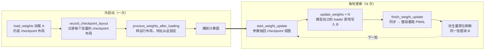
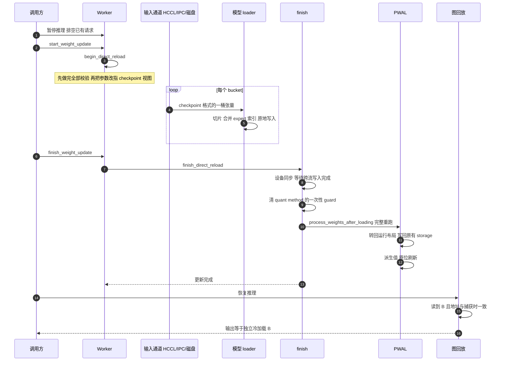
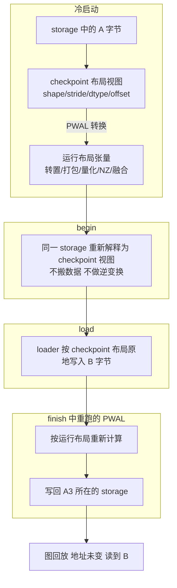
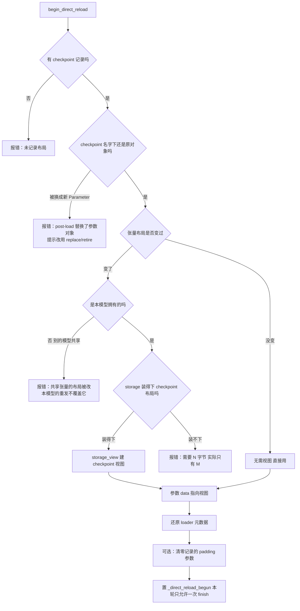
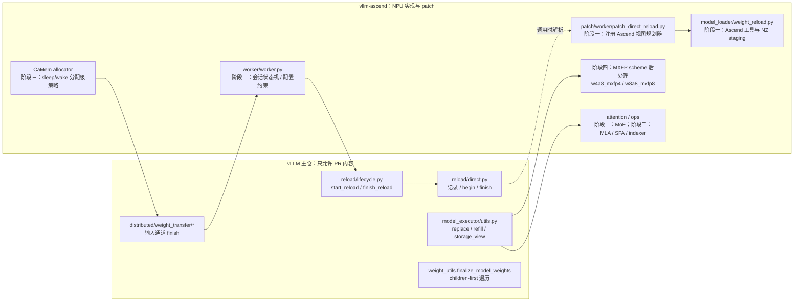
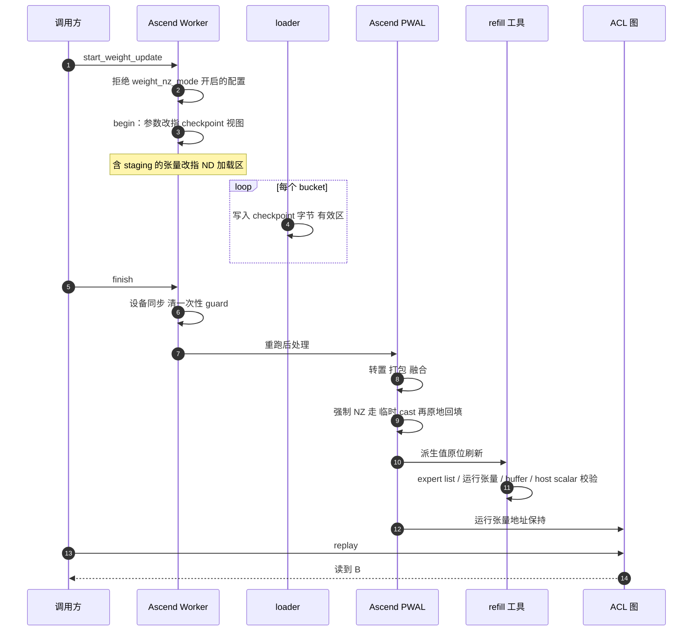
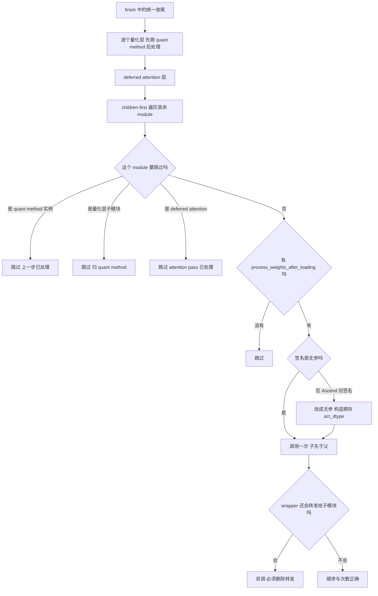
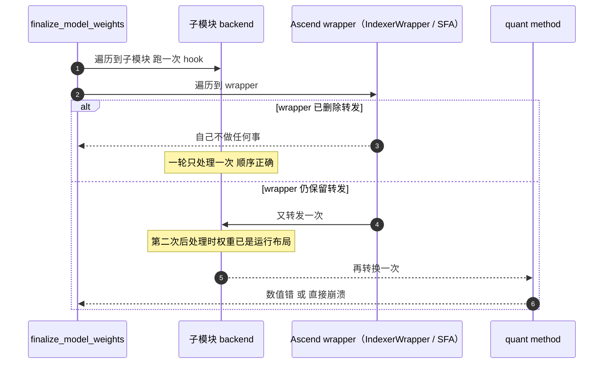
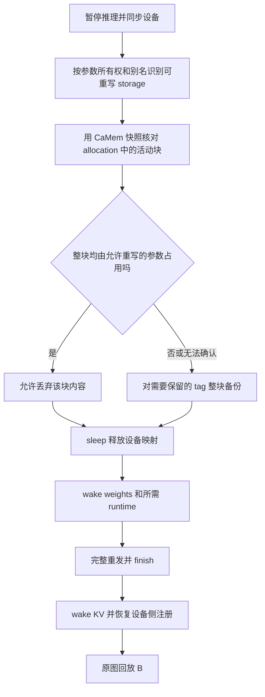
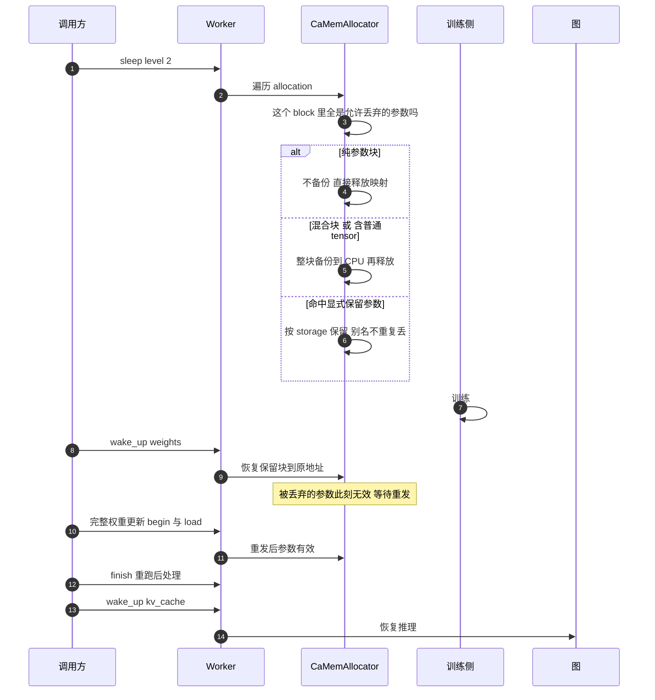

# RFC #54477：权重热更新（direct reload）实现与 vllm-ascend 适配方案

> 本文讲三件事：① RFC #54477 的权重更新重构——direct reload 的总览（开关、一张流程图、关键函数）与每个机制的设计依据（第 2 章）；② 上游机制在 vllm-ascend 上的落点：从 12 项到 27 项（第 3 章）；③ 方案四（按场景优先级适配）的五个阶段设计（第 4 章）。
>
> 图只放在关键处：每个关键机制一张流程图或时序图，紧跟其后的是读图说明；代码只保留决定行为的那几行（节选）。

---

## 1. 背景：layerwise 重载的局限

RL 训练每一轮都会产出一份新权重 B。推理侧正在服务、**并且已经捕获过计算图**的模型必须从 A 换成 B，且换完之后的状态要与"独立冷加载 B"一致。

旧做法（layerwise reload）是**逐层重建**：把每层重新加载、重新后处理、重新塞回原地址。它有三个绕不开的毛病：

- **每轮都要新建临时参数**，重建过程本身还要重跑后处理，成本高且容易走偏；
- **派生对象仍指向被丢弃的临时参数**，不报错，但输出用旧值或已释放内存；
- **层与层之间的顺序靠 loader 上报**，半层权重被 finalize 就是静默的数值错位。

把这三条翻成机制语言：**写错了位置（布局）**、**位置对但已经没人读（地址）**、**位置和值都对、但由它算出来的量没跟着变（派生值）**。第 2 章的三个参照系就是照着这三条建立的。

RFC 最初（Rev 1）想用"给 PWAL（= `process_weights_after_loading`，加载后处理）分类、更新时跳过一部分后处理"来省成本；Rev 2 放弃了这个方向——**跳过 PWAL 会让 MLA 这类派生数据继续读旧权重**。Rev 2 的结论是：

> 更新完成的模型必须等价于"用新 checkpoint 冷启动"，**同时**保留已捕获的图所引用的地址。

两条同时成立才叫权重热更新。第 2 章先给出 direct reload 的总览（开关、流程图、关键函数），再按一次完整更新的执行顺序展开每个机制的设计依据。

---

## 2. direct reload 的机制与设计依据

### 2.1 direct reload 总览

**开关**：`VLLM_RELOAD_MODE`（`vllm/envs.py`，进程级，启动前设定）——`layerwise` 为默认，`direct` 表示原地重载。它与传输通道正交：HCCL / IPC / M2N / 磁盘 inplace 都走同一组 `begin → load → finish`。

**一句话**：direct 把新 checkpoint 字节**写进正在服务的模型已有的 storage**，再按冷启动的同一套后处理**原地重算**一遍；已捕获的图不重新捕获。



读图要点：

- 冷启动建立三个参照系：**布局**（`_ckpt` 记录）、**地址**（PWAL 之后的 storage）、**消费者**（捕获的图）。每轮只做两件事——换字节、按参照系重算。
- `begin` 到 `finish` 成功之间**不能推理**：这期间模型里是 checkpoint 布局的字节，kernel 读它得到的是完全错误的数。
- **失败不回滚**：finish 在开头就消费掉 begin，失败后只能开一轮完整更新，不能重试同一个 finish。

使用者只看到三段 API（磁盘入口对应 `start_reload → load_weights → finish_reload`）：

| 阶段 | 入口 | 调用方义务 |
| --- | --- | --- |
| start | `start_weight_update` | 先暂停推理、排空在途请求 |
| update × N | `update_weights` | 按 checkpoint 名称发**全量**、checkpoint 格式张量 |
| finish | `finish_weight_update` | 成功前保持暂停；失败则开新一轮完整更新 |

**关键函数**（按"什么时候被调用"分组）：

| 时机 | 函数 | 干什么 |
| --- | --- | --- |
| 冷启动 | `record_checkpoint_layout` | 在 PWAL 之前给每个可加载张量记 `_ckpt`（shape/stride/dtype/offset + loader 属性 + storage 指针）与参数名集合；这是 begin 的参照系 |
| 冷启动 | `process_weights_after_loading`（PWAL） | 一次完整的后处理：转置、打包、量化、融合、算派生 scale；运行布局与地址从此固定 |
| 冷启动 | `finalize_model_weights` | 收尾遍历：children-first、无参 module hook、共享子模块去重 |
| 每轮 start | `begin_direct_reload` | 把被改过布局的张量按 `_ckpt` 建回 checkpoint 视图、恢复 loader 属性、清零 padding；所有校验通过后才动模型 |
| 每轮 start | `_checkpoint_views` / `storage_view` | 算出"每个张量在它自己 storage 上的 checkpoint 视图"，不搬数据、不做逆变换；Ascend 在这里换成带 ND staging 的实现 |
| 每轮 update | `model.load_weights` | **唯一**写字节的实现：把 checkpoint 张量原地充填进模型（分片、TP 切片、tie、专家索引都在这里） |
| 每轮 finish | `finish_direct_reload` | 消费 begin（一次性）、设备同步、清 quant method 的一次性 guard，然后整段重跑 PWAL |
| 每轮 finish | `process_weights_after_loading` | 同一份 PWAL 再跑一遍：把 checkpoint 布局搬回运行布局，并重算派生量 |
| 保参数身份 | `replace_parameter` / `retire_parameter` / `move_parameter` | 换形状时保住 `Parameter` 对象与 loader；退休不再被 kernel 读的源参数（下轮仍可加载）；让改名后的两个名字共享同一 storage |
| 派生量刷新 | `refill_derived` / `refill_derived_buffer` / `refill_runtime_tensor` / `refill_nz_weight` / `refill_expert_list` | 把派生量写回**原来的地址**：普通属性、非持久 buffer、运行张量（含物理 NZ）、专家列表；布局或物理 format 变了就报错，绝不静默换址 |
| padding | `padding_fill_params` | 冷启动登记"哪些 MoE 参数是 padding"，begin 时整项清零（清零后必须全量重发有效区）；上游已换成 `fill_on_reload`，见 2.6 |
| 会话 | `_end_weight_update` / `reset_weight_update_target` | 结束会话、恢复默认更新目标，让下一轮能 start |

Ascend 侧的唯一结构性差异在 begin 与派生刷新：begin 用 `checkpoint_views` 覆盖上游规划（为强制 NZ 参数提供 ND 加载区），派生刷新用 `refill_*` 系列保证地址不变。为什么必须这样，见 2.5、2.6、2.7 与 4.2.5。

### 2.2 冷启动：在 PWAL 之前记录 checkpoint 布局

冷启动一共四步：加载、记录、后处理、捕获计算图。记录只在冷启动做一次，之后每一轮更新都复用它。

四条决定设计形状的要点：

1. **记录必须在 PWAL 之前**。PWAL 之后的张量已经不是 checkpoint 布局，再记录就记错了参照系。记录的不是"文件里的形状"，而是"本地分片后的可加载形状"——TP 切片、名称映射仍由模型自己的 `load_weights` 负责。
2. **`_ckpt` 挂在张量自己身上**，不挂在模块字典里：张量会被 PWAL 换成新对象，模块字典会失效；`_ckpt` 跟着"被记录的那个对象"走，正好对应"这个对象还能不能按 checkpoint 方式写"。
3. **按对象去重、按名字记全**：别名（tie 权重、共享 embedding/lm_head）只记一次，但每个名字都要记，因为 PWAL 可能替换掉其中任意一个。
4. **图捕获的是地址**，不是参数名、不是 Python 对象。所以"参数看起来换好了"根本不算数。

`_ckpt` 是四元组，每个字段都有用途：

| 字段 | 用途 | 少了它会怎样 |
| --- | --- | --- |
| `owner`（模型身份对象） | 区分"本模型记录的"与"别的模型共享来的"（draft 复用 target 的 `lm_head`） | 会把 draft 的更新当成 target 的，写坏未发送的数据 |
| `(shape, stride, dtype, offset)` | begin 时按它重建 checkpoint 视图 | 不知道要恢复成什么布局 |
| `attrs`（loader 元数据） | 后处理可能改 `_output_dim/_packed_dim`，begin 要还原 | loader 用错的切分参数写入，静默错位 |
| `storage` 指针 | 判断 storage 是否被搬过（被 `set_` 进融合 buffer） | offset 用错，#65281 修的就是这个 |

### 2.3 一轮更新的全链路时序

这是主图，后面几节分别把其中关键的一段放大。



读图要点：

- **begin 之前全部校验完**：一旦 begin 返回，模型就进入"不能推理"状态，所以可能失败的检查（参数被换过、storage 装不下、共享参数布局变了）必须提前做完（见 2.5）。
- **load 用的是模型自己的 loader**，没有"direct 专用 loader"。分片、TP 切片、tie、专家索引、dtype 转换一份都不重写——这保证更新路径与冷启动路径是同一份代码。代价是调用方**必须把每个模块的完整 checkpoint 张量发全**。
- **finish 是"完整重跑"而不是"增量补几处"**：PWAL 本身非幂等（一次量化、一次融合、一次吸收），只有整段重跑才能保证结果等于冷启动。
- **同步点在 finish 开头**：接收端可能在别的 stream 上写，不同步就开始后处理会读到半份数据。

### 2.4 同一块 storage 的四种视角

把镜头对准**一块 storage**：同一段显存，在不同阶段用的是不同的"解释方式"。



逐条读：

- **A2 → A3 是"格式变换"**：可能改 shape/stride、改字节数（padding）、甚至换 storage（变大装不下）。这一步由 PWAL 完成。
- **A3 → B1 是"零成本重解释"**：只新建视图让 loader 有位可写，数据没动，所以此刻图读到的值是错的——这就是"不能推理"的原因。
- **C1 写的是 checkpoint 布局的字节**：如果 B1 建错（本该恢复成转置布局，却直接用了运行布局），shape 全对、数值全错。
- **写回必须落回 A3 那块 storage**，派生值也必须写回图正在读的那个对象——这正是 2.7 要解决的保址问题。

### 2.5 begin 的校验与视图恢复

begin 是一次更新的入口：它要在改动模型之前，把所有可能失败的条件判完。



四类拒绝都有明确含义与正确做法：

| 拒绝 | 含义 | 正确做法 |
| --- | --- | --- |
| 无记录 | 这个模型没走 direct 冷启动 | 先按直连方式冷启动一次 |
| 参数对象被换 | PWAL 里 `del` 或新建了 `Parameter` | 改用 `replace_parameter` / `retire_parameter` |
| 共享张量被改布局 | draft 复用了 target 的参数，而 draft 的更新不重发它 | 让共享方各自拥有，或在 target 侧更新 |
| 容量不足 | PWAL 把张量缩小了（打包/pad 后字节数变小） | 用独立加载区（Ascend 的 ND staging 就是这种） |

容量怎么算（**用 stride 算真实跨度**而不是 `numel`，这样非连续布局和带空洞的 padded 视图都能算对）、storage 被搬过时怎么改 offset（#65281），都在 2.7(2) 的 `_in_own_storage` 里展开。

### 2.6 padding 与 meta 的初始化

MoE 的专家权重常被 pad 到对齐尺寸。padding 不是 checkpoint 数据，loader 不会写它，但 kernel 会按整块读。冷启动时它是 0；更新后如果保留旧值或随机值，数值就可能错。三条规则：

1. **selector 的判定**：只有"维度对不上"（hidden/intermediate 大于 unpadded 版本，或 TP shard 带 padding）时才需要清；**per-expert 标量（`(E,)`、`(E, ≤2)`）不是 padding 的对象**，混进去会把真实数据清零。
2. **清零会擦掉 checkpoint 区域**，所以清零之后调用方**必须完整重发这些参数的有效区**——"begin 清零"与"必须全量发送"是绑定的。
3. **meta 物化要补 0**：`materialize_meta_tensor` 原本用 `empty_strided` 得到未初始化内存，padding 会留垃圾，改成 `empty_strided(...).zero_()`。

这条对 Ascend 影响很大：Ascend 的 padding 发生在 **scheme 的后处理里**（`_maybe_pad_weight`、`F.pad`、TP padding），不在 `moe_config` 上，所以 Ascend 侧要自己实现等价的 selector（阶段一的 ③，见 4.2.5(7)）。

注：上游 #67563 已把这个机制换成 Parameter 上的 `fill_on_reload`（见 3.2），本节按阶段一实际代码（`_ckpt_padding_fill`）描述，迁移动作见 4.6.2。

### 2.7 PWAL 的保址写回

PWAL 天然想"算一个新张量、赋给属性"。direct 要求它写回**旧地址**，于是上游把常见写法收敛成五个工具，判定只有一条：**新张量能不能塞进参数自己那块 storage**。

**(1) 三类会破坏保址的写法**

| 写法 | 典型代码 | 直接后果 |
| --- | --- | --- |
| 新建并赋值 | `layer.weight.data = t.transpose(0, 1).contiguous()` | 换了 storage，图读旧地址，不报错 |
| 删除源参数 | `del layer.w13_weight` | 下一次 `begin` 抛 `post-load processing replaced the parameter object…` |
| 改名换对象 | `layer.qkv = layer.qkv_proj; del layer.qkv_proj` | loader 按 checkpoint 名找不到写入目标 |

**(2) 判定函数：`_in_own_storage`**

direct 全部"能不能原地写"都落在这段代码上（`vllm/model_executor/utils.py`）：

```python
def _extent(t):                     # 张量在 storage 里实际跨过多少元素（含空洞）
    if t.numel() == 0:
        return 0
    return 1 + sum((n - 1) * s for n, s in zip(t.shape, t.stride()))

def _in_own_storage(old, new, whole_storage=False):
    storage = old.untyped_storage()
    offset, size = old.storage_offset() * old.element_size(), new.element_size()
    span = _extent(new)             # 用 stride 算真实跨度，不用 numel
    if whole_storage:               # direct
        fits = (span >= new.numel()                              # ① 不自重叠
                and offset + span * size <= storage.nbytes())    # ② 装得下
    else:                           # 冷启动（保守）
        fits = (new.numel() > 0
                and span == new.numel()                          # 无空洞
                and _extent(old) == old.numel()                  # 旧张量也无空洞
                and new.numel() * size <= old.numel() * old.element_size())
    if (not fits or old.device != new.device
            or new.untyped_storage().data_ptr() == storage.data_ptr()
            or offset % size):      # 对齐
        return new                  # 塞不进去：返回新张量（地址会变）
    view = storage_view(storage, offset // size, new.shape, new.stride(), new.dtype)
    return view.copy_(new)          # 塞得进：拷进旧 storage，返回它
```

两个分支的差别，就是 direct 的全部"放宽"：

| 条件 | 冷启动口径 | direct 口径 | 于是能原地写的场景 |
| --- | --- | --- | --- |
| 空洞 | 新旧都要求无空洞 | 只要求**不自重叠** | FP8 之类的 padded 视图 |
| 容量 | 不超过旧张量字节数 | 不超过**整块 storage** | 后处理把权重 pad 变大（第一次换到更大 storage，之后每轮都放得下） |
| 空张量 | 不允许 | 允许 | 权重被清空（checkpoint 字节留在 storage 里给下一轮） |

还有一条红线：**"每轮都塞不下"是错误，不是放宽**——它说明地址每轮都会漂移，必须报错或改成固定缓冲。

**(3) 五个工具各自落到哪**

| 工具 | 判定 / 动作 | 关键实现 |
| --- | --- | --- |
| `replace_parameter(layer, name, t)` | 保对象：同布局直接 `copy_`；否则进 `_in_own_storage`；再不行才改 `.data` | 见下段代码 |
| `refill_derived(obj, name, t)` | 普通派生属性：同 shape/dtype/device 就 `copy_`，否则 `setattr` | `return old.copy_(new)` |
| `retire_parameter(layer, name)` | 打 `retired = True`：对象与数据都留着，`kernel_parameters` / `get_live_param` 跳过 | `getattr(layer, name).retired = True` |
| `move_parameter(layer, src, dst)` | 同一个对象注册成两个名字，一个 storage | `layer.register_parameter(dst, param)` |
| `storage_view(storage, offset, shape, stride, dtype)` | `begin` 用的视图 | `empty(0).set_(storage, offset, shape, stride)` |

`replace_parameter` 的核心分支（决定"保对象 / 保地址 / 保 loader"）：

```python
if (isinstance(old_param, torch.nn.Parameter)
        and not getattr(old_param, "requantization_source", False)
        and not (old_param.is_meta and not new_tensor.is_meta)):
    if (old_param.shape == new_tensor.shape
            and old_param.stride() == new_tensor.stride()
            and old_param.dtype == new_tensor.dtype
            and old_param.device == new_tensor.device):
        old_param.data.copy_(new_tensor)                    # 同布局：原地
    else:
        old_param.data = _in_own_storage(
            old_param, new_tensor, whole_storage=direct_reload_enabled())
    for attr_name, attr in new_tensor_attrs.items():
        setattr(old_param, attr_name, attr)                 # kernel 标志等跟着搬
    return
# 只有"这个名字下本来没有 Parameter"时才新建对象
```

三样东西同时被保住：**对象**（`Parameter` 不换，`_ckpt` 记录还挂在它身上）、**地址**（能塞就塞）、**loader**（`weight_loader` 显式不迁移，永远沿用旧参数的）。

**(4) Ascend 侧多出来的两种形态**

上游的判定默认"storage 里就是 ND 字节"，Ascend 有两个例外：

- **参数同时是 loader 目标、且运行区是 NZ**：NPU 的 `set_(storage)` 会继承 storage 的 NZ 描述符，在 NZ storage 上铺 ND 视图写进去就是垃圾。于是 `refill_runtime_parameter` 另开一块 ND staging 给 loader，运行区保留、只 `copy_`：

```python
def refill_runtime_parameter(layer, name, tensor):
    parameter = getattr(layer, name)
    ckpt = getattr(parameter, "_ckpt", None)
    if ckpt is not None and not hasattr(parameter, "_direct_reload_staging"):
        shape, stride, dtype, offset = ckpt[1]
        parameter._direct_reload_staging = ...      # 按 checkpoint 布局另开 ND 区
    parameter.data = refill_runtime_tensor(layer, name, tensor)   # 运行区原位 copy_
```

- **运行张量挂在非 Module 对象上**（MLAPO 的三个 NZ 投影、KPool 的派生 buffer）：没有 `Parameter` 可保，就用 `_reload_runtime_buffers[name]` 记住第一次的分配，之后每轮 `copy_` 并返回旧对象：

```python
def refill_runtime_tensor(layer, name, tensor):
    buffers = layer.__dict__.setdefault("_reload_runtime_buffers", {})
    old = buffers.get(name)
    if old is None:
        buffers[name] = tensor
        return tensor
    if _layout(old) != _layout(tensor):
        raise ValueError(f"{name}: runtime layout changed; rebuild and recapture graphs")
    if old.device.type == "npu" and torch_npu.get_npu_format(old) != torch_npu.get_npu_format(tensor):
        raise ValueError(f"{name}: physical format changed; rebuild and recapture graphs")
    old.copy_(tensor)
    return old
```

与上游的差别只有一条：上游"塞不下就换 `.data`"，Ascend 侧"布局或物理 format 变了就报错"。为什么必须这样，见 4.2.5(3)。

**(5) 所以"保址"的准确含义**

**"保址"不是"从不换地址"，而是"从第一轮开始地址稳定"**：冷启动时换一次 storage 完全可以接受，因为图还没捕获；更新期间一旦换了，图就永远读旧地址。

---

## 3. 上游来源：从 12 项到 27 项

方案四**不按上游 PR 分组交付**，只把 PR 当作"机制来源"。下面三张表依次是：基线 12 项、11-09 之后新合入的关键项、以及未合入项划出的边界。五个阶段的定义见 4.1，本章只登记来源与落点。

### 3.1 基线 12 项（2026-11-09 快照）

| 上游 PR | 提供的机制 | 方案四中的位置与 Ascend 动作 |
| --- | --- | --- |
| [#62407](https://github.com/vllm-project/vllm/pull/62407) | 保留被改名、转换或退休的参数身份 | 阶段一 ①（冷加载与源保留）及下一次 begin；核对源名称、别名与 loader |
| [#64336](https://github.com/vllm-project/vllm/pull/64336) | direct 生命周期、布局恢复及 worker 失败收尾 | 阶段一 ②、⑥；检查独立 NPU worker 的异常会话语义 |
| [#65281](https://github.com/vllm-project/vllm/pull/65281) | 参数换 storage 后按当前 offset 恢复 | 阶段一 ②；核对切片与融合缓冲 |
| [#64352](https://github.com/vllm-project/vllm/pull/64352) | 冷启动记录 padded 参数、begin 清零 | 阶段一 ③；机制已被 #67563 替换，迁移见 4.6.2 |
| [#64357](https://github.com/vllm-project/vllm/pull/64357) | 模型级收尾移至整体加载末尾 | 阶段一 ④；避免按桶 finalize |
| [#57678](https://github.com/vllm-project/vllm/pull/57678) | 无参 module hook、子模块优先、共享对象去重 | 阶段一 ④；核对 MLA / SFA / indexer 的注册与委托 |
| [#65914](https://github.com/vllm-project/vllm/pull/65914) | 更新路径统一收尾 | 阶段一 ④；阶段二按入口核对已处理格式 |
| [#64886](https://github.com/vllm-project/vllm/pull/64886) | 较早的 kernel-format 派生刷新接口 | 记录替代关系，实现使用 #65914 的最终机制 |
| [#64692](https://github.com/vllm-project/vllm/pull/64692) | 原位刷新派生张量与内核常量 | 阶段一 ⑤；阶段四扩展到量化 scale |
| [#64691](https://github.com/vllm-project/vllm/pull/64691) | 权重传输结束后归还可释放缓存 | 阶段一交付边界；阶段三检验多轮共卡资源表现 |
| [#66010](https://github.com/vllm-project/vllm/pull/66010) | Level-2 仅丢弃允许重写的纯参数分配 | 阶段三；独立于常驻显存更新交付 |
| [#65296](https://github.com/vllm-project/vllm/pull/65296) | ROCm preshuffle scale 的身份与刷新 | ROCm 后端来源留档；A3/A5 无对应执行路径，阶段三无 NPU 开发任务 |

### 3.2 11-09 之后新合入的关键项

截至 2026-11-19，tracker 条目 1–41 中共 **27 项已合入**（11-09 快照 12 项 + 新增 15 项；tracker 图标滞后于 API，以 `merged_at` 为准）。下表只列**落在 Ascend 实际改过路径上**的项——它们正是阶段五存在的理由。

| 上游 PR | 合入（UTC） | 提供的机制 | 对 Ascend 的影响 / 落点 |
| --- | --- | --- | --- |
| [#65347](https://github.com/vllm-project/vllm/pull/65347) | 11-16 | A→B→A 与独立冷启动**逐 tensor 位级一致**的 refit 测试：地址不移、分配器块不增删、每轮 level-2 sleep 变体 | 验收口径直接复用（4.7）；sleep 变体落阶段三 |
| [#65802](https://github.com/vllm-project/vllm/pull/65802) | 11-16 | online 量化模块的 direct reload：加载时按 checkpoint 对应方法量化，无对应方案直接拒绝 | 不在本次范围（量化只做 A5 MXFP）；若接入需等价路径 |
| [#66487](https://github.com/vllm-project/vllm/pull/66487) | 11-18 | direct finish 不再重新 tie word embeddings | Qwen 系 tied embedding 受益；旧行为会静默丢弃 `lm_head` 更新 |
| [#65799](https://github.com/vllm-project/vllm/pull/65799) | 11-18 | finish 完整性检查：必须加载冷启动加载过的每个 parameter，缺失即抛错并点名 | **行为破坏性变更**：partial 更新会失败；NZ staging / retired / expert-list 参数需逐项确认（4.6.2） |
| [#65353](https://github.com/vllm-project/vllm/pull/65353) | 11-18 | gpt-oss 的 streamed MXFP4 专家按 TP 整块切分 | 主要是 NVIDIA；"按 TP 整块切"与 Ascend 专家切分同构，可参考 |
| [#67563](https://github.com/vllm-project/vllm/pull/67563) | 11-18 | **padding 机制替换**：`padding_fill_params()` 删除，改为构造期给 Parameter 打 `fill_on_reload`，begin 清零所有带标记的 tensor | **必改**：Ascend 侧现有 override 会变成死代码，begin 不再清零且无任何提示（4.6.2） |
| [#68345](https://github.com/vllm-project/vllm/pull/68345) | 11-18 | finish 的 PWAL 只对冷启动记录到的 `_ckpt_modules` 重跑，冷启动后新增的模块跳过 | 与阶段一 ④ 的"归属修正"语义重叠，需复核后决定保留/简化（4.6.2） |
| [#67836](https://github.com/vllm-project/vllm/pull/67836) | 11-19 | load plan：跨 dtype 拷贝与 `param[...] = w` 记为 direct 写，按约 2 GiB 批量 `_foreach_copy_` | 若后续接入 `use_load_plan`，这些写入语义是新基线 |
| [#68043](https://github.com/vllm-project/vllm/pull/68043) | 11-19 | **packed 传输线格式统一**：所有 side 共用一套 `chunk_layout`，超 buffer 的 tensor 走 dim-0 `wire_segments` | Ascend HCCL/IPC packed 必须按新布局实现（阶段二格子 + 4.6.2） |
| [#68329](https://github.com/vllm-project/vllm/pull/68329) | 11-19 | 删除 torchao reload decorator，并入统一生命周期 | 引用该 decorator 的 Ascend 补丁需清理 |
| [#65487](https://github.com/vllm-project/vllm/pull/65487) | — | packed entry 对齐；packed NCCL 等调用方 stream | 部分已被 #68043 重新实现，按新实现对齐 |
| [#66118](https://github.com/vllm-project/vllm/pull/66118) | — | indexer 的 `wk` / `weights_proj` 独立成层加载，融合 GEMM 在 PWAL 派生 | 跟 GLM-5.3 系必读：MLA/indexer 的加载粒度与派生点都变了（阶段二模型线） |

另外两项属于测试设施与家族迁移，不进方案：`#67210`（reload 测试留显存 headroom）、`#65904`（MiniMax-M3 迁 `AutoWeightsLoader`）。`#68048` 在 layerwise 线，不在 tracker 条目内。

### 3.3 未合入项与边界

| 未合入 | 状态 | 作用、对方案的影响 |
| --- | --- | --- |
| [#68041](https://github.com/vllm-project/vllm/pull/68041) | Review | **F8 开关**：`direct` 变默认；把 offload / torchao / LoRA / draft 等所有拒绝从启动期集中到 `start_reload` 一处。合入前 Ascend 必须准备好拒绝矩阵，否则默认切换当天集体踩（4.6.3） |
| [#68094](https://github.com/vllm-project/vllm/pull/68094) | Draft | 服务侧 pending-update 拦截：权重不完整时拒绝推理。与"begin 到 finish 之间不能推理"的调用方责任互补；未合入前仍靠调用方 pause |
| [#66666](https://github.com/vllm-project/vllm/pull/66666) | Draft | MLA 上的 FP8 KV cache（DeepSeek / Kimi / GLM）。涉及 KV scale 与图内常量，不在阶段四范围 |
| [#66002](https://github.com/vllm-project/vllm/pull/66002) | Review | `SupportsDirectReload` 模型声明 + 拒绝原因。已明确为 F8 的**非前置项**；Ascend 侧的"可声明 / 可拒绝"仍需自建 |
| [#65562](https://github.com/vllm-project/vllm/pull/65562) | Draft | dummy loading 保留真实冷启动的 KV scale 默认值，影响 dummy start 的对照基准 |
| [#68032](https://github.com/vllm-project/vllm/pull/68032) | Draft | FlashInfer bmm scale 随 reload 后的 KV scale 更新。NVIDIA 后端，A3/A5 无对应路径 |

**已经合入、不再作为边界的前项**：#65799（完整性检查）、#65487 / #65353（packed 对齐、gated MXFP4）、#65562 之外的 KV scale 项——它们的语义已进 3.2，按新语义实现即可。

**为什么"来源"要单独登记**：同一项机制会跨阶段使用（#64692 在阶段一用于 BF16 运行缓冲，到阶段四才扩展到量化 scale），一个阶段也要多项机制（阶段一同时依赖 6 项）。所以阶段是否完成，看的是目标场景的端到端证据，而不是"某个 PR 的每一处都改过了"。旧方案三的 G1～G4 只是历史交付名称，与方案四的阶段不是一一对应关系。

---

## 4. vllm-ascend 适配方案（方案四）：按场景优先级适配

### 4.1 方案定位：为什么按场景而不是按 PR 组

Ascend 侧的组织方式经过四次调整：

| 方案 | 组织方式 | 优点 | 问题 |
| --- | --- | --- | --- |
| 一、按上游 PR 适配 | 一个 PR 一个适配提交 | 来源清晰、便于回滚 | 重复处理依赖；容易漏"上游没改但 NPU 必须改"的路径 |
| 二、按功能适配 | 8 个功能包、6 步实施 | 覆盖 Ascend 特有缺口 | 前期要设计支持范围与验收矩阵 |
| 三、按已合入 PR 组联合适配 | 只继承已合入实现，按 PR 组（G1～G4）联合交付 | 不引入未合入能力，边界清楚 | **组的边界是来源边界，不是交付边界**：一条业务能力要跨多个组，组内通过不等于组合可用 |
| **四、按场景优先级适配（本文）** | 按"硬件 × 精度 × 是否共卡"排五个阶段，每阶段独立交付、独立验收 | 阶段的完成条件就是业务可用的条件；不支持的组合显式留"待验" | 需要自建场景验收矩阵 |

方案四的立足点是一句话：**第一阶段独立交付的功能，就是"第一轮用 B 推理时，原图就应读到与独立冷加载 B 一致的权重、派生张量和计算结果"**。权重交换过程中释放显存、使用其他传输方式、适配量化权重，分别在后续阶段展开。

| 阶段 | 业务场景 | 阶段交付 | 完成标志 |
| --- | --- | --- | --- |
| 一 · 收缩版基础实现 | A3/A5，非量化 BF16 Qwen（dense + MoE），`weight_nz_mode=0`，权重常驻显存 | 把上游 direct 契约接到 Ascend 的 ND / NZ / expert-list 三种形态；磁盘 checkpoint 与非 packed HCCL 两个入口可用 | 同一候选在 A3/A5 上给出 A→A→B→A、独立冷 B、原图回放（0 recapture）与失败恢复 |
| 二 · 通道 × 打包 × 模型矩阵 | 同一精度下新增的入口、打包方式与模型族 | 按 hccl/ipc × packed/unpacked × Qwen/DeepSeek-V4/GLM… 逐格补齐；把收缩版砍掉的 MLA/SFA/MLAPO/KPool/`wo_a` 线接回来 | 每格独立冷 B + 原图回放证据；不支持的格显式留"待验/不适用" |
| 三 · sleep mode | 训练与推理共卡 | Level-2 sleep/wake 与真实权重传输的整轮交换 | 共卡配置下 A→B→A + 原图 + 内存释放/恢复证据 |
| 四 · A5 MXFP 量化 | A5，W4A8 / W8A8（其余量化不做） | 两种格式各自覆盖 Linear、MoE 的 direct 原图更新 | 各自量化格式的冷加载参考 + 原图回放 |
| 五 · 其余需适配项 | 跟随上游演进 + 未覆盖分支 | padding / finish 遍历集合 / 完整性检查 / packed 线格式 / 默认模式等机制迁移，以及 MTP 等可选专项 | 每项有独立冷参考证据；没做的显式登记 |


两条首批实施建议（是建议，不是约束）：

- **图配置**：`FULL_DECODE_ONLY`（已有真机依据）。表中的"原图"指更新前已经捕获、更新后实际回放的同一张 decode 图；其他图模式、capture size、并行规模按实测范围登记。
- **通道**：HCCL 非 packed（已有测试基础），同时把**磁盘 / inplace checkpoint** 作为独立入口验收。

三条接入原则（沿用，仍然成立）：

1. **vLLM 侧只保留 PR 内容**：本地适配要么进 Ascend 的 patch 机制，要么在 Ascend 侧重写。验收方式：`git diff --name-only` 是 PR 文件白名单的子集 + 逐文件 SHA256 与上游一致。
2. **Ascend 逻辑放 vllm-ascend**：通过插件、继承或既有 patch 机制实现，不直接改 vLLM 源码。
3. **"只继承已合入"≠"只改上游同名文件"**：Ascend 自有 worker / scheme / attention / allocator 里的必要等价实现，同样是本方案的责任。上游 PR 清单里没有"强制 NZ 运行区""CaMem allocation 选择器"，但它们都在 direct 的必经路径上。



**阶段依赖与并行关系**：

1. 先固定配套基线（vLLM `c410543d9`、vllm-ascend `4d90fc908`），核对哪些已合入项在目标 pin 内；
2. **阶段一**：冷加载与源保留 → begin 与视图恢复 → 分桶写入与 MoE padding → finish 与 hook 所有权 → 图可见权重写回 → worker 会话与恢复。这六步就是调用顺序，不能跳步验收；
3. **阶段二**：可**立即开始、与阶段三/四并行**——每格独立验收，互不阻塞；只有 packed 与阶段五的线格式迁移有耦合；
4. **阶段三**：Level-2 依赖阶段一的 begin/finish 与 worker 会话 → 真实权重传输依赖 worker 与 allocator 接口；
5. **阶段四**：量化 scale 是阶段一 ⑤ 在量化场景的扩展，必须先有同格式冷加载参考；
6. **阶段五**：跟随上游 pin 更新节奏，按"静默错优先"的顺序逐项迁移。

**实际执行到哪**：阶段一已有收缩版 PR（11 文件 / 5 个生产文件），28 单测 + 2 子测试通过、12 项整模型热重载（0.6B / 30B × eager / graph × 磁盘 / HCCL，含 NZ）逐轮断言通过、仓内 e2e unpacked direct 629 s、layerwise 418 s 通过（packed 仍 skip）；阶段二~五未开始。

### 4.2 阶段一：收缩版 PR（BF16 Qwen 基础实现）

**输入**：已冷加载并捕获 decode 图的 target 模型 A（未量化 BF16），以及同结构 checkpoint B；显式 `VLLM_RELOAD_MODE=direct`、`weight_nz_mode=0`、非量化 KV、关闭推测解码。
**输出**：在同一引擎、同一图实例中可以推理的 B（0 recapture、逐 token / 逐 top-5 logprob 等于独立冷载 B），以及下一轮还能装回 A 的模型。
**范围说明**：算子内部强制使用的物理 NZ（FRACTAL_NZ）**属于本阶段**——它是物理排布，不是量化。

#### 4.2.1 收缩版交付了什么

这个 PR **没有**新增"重载"功能本身——`begin → loader 写入 → finish → PWAL` 的生命周期全在上游。它做的是把上游的通用契约，接到 Ascend 的三种特殊物理形态上，再补齐入口、测试与证据。三个真正难的运行期问题：

1. **上游让 loader"在参数自己的 storage 上铺一个 ND 视图"往回写，而 Ascend 的 storage 里是 NZ**。NZ storage 不是 ND 字节，在上面铺 ND 视图写下去就是垃圾；NPU 的 `set_(storage)` 又会继承 storage 的 NZ 描述符，所以连"借一块 NZ storage 当 ND 用"都不行 → 必须另分配一块纯 ND staging 作为 loader 目的地。
2. **PWAL 每轮都会新分配张量并改写属性，而图读的是第一轮地址**。每轮都再做一次 NZ cast、再 `unbind + clone` 一份专家列表、再 `transpose + contiguous`，然后把属性指过去 → direct 下必须"保留第一次的运行分配，之后只 `copy_` 值进去，并把属性指回那块分配"。
3. **老代码 `del layer.w13_weight` 删掉源参数，而上游 `begin` 会拒绝"checkpoint 名字下的对象被换/被删"** → direct 下改成 `retire_parameter`：对象与数据都保留、kernel 侧跳过。

生产文件只有 5 个：

| # | 文件 | +/− | 一句话作用 |
| --- | --- | --- | --- |
| 1 | `model_loader/weight_reload.py`（新增 154 行） | +154 | 保留运行分配、ND staging、expert-list 回填、替换上游 `_checkpoint_views` |
| 2 | `ops/fused_moe/routed_experts.py` | +16/−12 | MoE PWAL 里 4 处 cast/split 改成 `refill_nz_weight` / `refill_expert_list` + `retire_parameter` |
| 3 | `patch/worker/__init__.py` | +7 | direct 模式下在 import 期安装视图补丁 |
| 4 | `patch/__init__.py` | +8 | 补丁登记：补了哪个上游符号、为什么、何时删 |
| 5 | `worker/worker.py` | +28/−11 | 给 start/update/finish/reload 套 `set_current_vllm_config`，统一会话收尾 |

另有 6 个测试文件（1 新增 5 修改），其中 `tests/ut/model_loader/test_weight_reload.py` 新增 169 行。

**收缩掉的部分**（相对上一轮 17 文件版，整条注意力线被删，接回工作属于阶段二）：

| 上一版有 | 本版 | 后果 |
| --- | --- | --- |
| `attention/sfa_v1.py`（源参数保留 + PROLOG_V3 回填） | 无 | SFA / DeepSeek 的 `W_UK` / `W_UV` / `weight_dq` 等不再适配 |
| `attention/indexer_kpool.py`（5 个派生 buffer） | 无 | KPool / indexer 派生状态不再适配 |
| `ops/mla.py`（`IndexerWrapper` hook 所有权） | 无 | 无 |
| `ops/linear.py`（`wo_a` 三维 reshape 走 `replace_parameter`） | 无 | 纯 dense BF16 走上游路径即可 |
| `patch/worker/patch_direct_reload.py`（独立文件） | 并入 `patch/worker/__init__.py` | 少一个文件，行为等价 |
| `weight_reload.py` 177 行（含 `refill_derived_buffer`） | 154 行 | KPool 用到的那部分一起删掉 |

> 要特别说清：**"qwen-only"是验证范围与文档口径，不是运行时拦截**。最终 `pr.diff` 里 `worker.py` 只加了 `_check_nz_disabled()`，没有模型/量化/EPLB/fused-MC2 的拒绝检查。未验证的模型在 direct 下**不会被拒**——这正是阶段五要补"拒绝矩阵"的原因（见 4.6.3）。

#### 4.2.2 按调用顺序的六个接入点

| 位置 | 需要接入或核对的行为 | 典型错误及判定 | 阶段一覆盖 |
| --- | --- | --- | --- |
| ① 冷加载与源保留 | 保住 checkpoint 参数对象、名称、必要别名及 loader 属性 | 若源投影在首次 PWAL 后已释放，下一轮 loader 失去写入目标 | MoE 的 `w13/w2` 改为 `retire_parameter`；SFA 的 `kv_b_proj` 属阶段二 |
| ② begin 恢复加载视图 | 预检归属、共享参数、容量及 offset；参数迁入新 storage 时用当前 offset；NZ 运行权重保留原址，必要时在 ND 张量上接收 | 容量、归属或物理布局不兼容须显式报错；把 opaque NZ 当 ND 字节写会数值错 | ✅ `checkpoint_views` + `_direct_reload_staging` |
| ③ 分桶写入及 MoE padding | 原模型 loader 负责所有分片；冷启动选中的 padded MoE 参数在 begin 整项清零，随后重发全部有效区 | 桶间不得提前执行模型收尾；核对选中名单、零 padding、有效区 | ✅ 继承上游（机制已被 #67563 替换，见 4.6.2） |
| ④ finish 与 hook 所有权 | 收齐后先同步，再执行公共 PWAL；已注册 backend 由 children-first 处理，未注册的由 wrapper / impl 委托 | 避免从公共遍历、wrapper、SFA 三条路径重复到达同一 backend | 部分：worker 侧已交付；`IndexerWrapper` 归属修正属阶段二 |
| ⑤ 图可见权重写回 | 逐个更新内核实际读取的运行权重、持久缓冲、列表元素及派生值；布局兼容时原位回填 | 仅检查 `named_parameters()` 会漏掉融合投影和 expert-list 元素 | ✅ `refill_nz_weight` / `refill_runtime_tensor` / `refill_expert_list` |
| ⑥ worker 会话与恢复 | 用正确的设备和当前 vLLM 配置调用 finish；异常时上报原错误、结束旧会话、重置更新目标 | 实际注入 PWAL 异常；重试旧 finish 应失败，新事务可修复 | ✅ `set_current_vllm_config` + `_end_weight_update` |
#### 4.2.3 一次更新的时序



这张图与 2.3 的主图差别只有三处，正好是 Ascend 在阶段一的三个改造点：**begin 里多一层 Ascend 视图规划器**、**PWAL 里强制 NZ 要"临时 cast + 原地回填"**、**派生值要经过 Ascend 的 refill 工具**。

#### 4.2.4 拿到运行时对象，先问它是什么

阶段一的实现可以归成一张判定图：**先确定对象类型，再决定处置方式**。


读图要点：

- **左半支是"参数身份"**：能不能下轮再写、写进去是不是原位，取决于这里选哪种处置。
- **右半支是"派生对象"**：它们不是 checkpoint 数据，begin 不会给它们建视图，所以只能靠后处理**主动原位刷新**；布局一变就必须报错，因为图引用的就是这块地址。
- **host scalar 是唯一"只能拒绝"的**：它被烘焙进算子入参，改值不会让已捕获的图重新读它（阶段一不命中 FlatQuant 这类路径，条目保留）。

#### 4.2.5 关键实现

**(1) 参数身份与专家列表（①）**

```python
# 原：新建列表 + 删除源参数（下一轮无法再加载，图也丢引用）
layer.w13_weight_list = [w.clone() for w in layer.w13_weight.data.unbind(dim=0)]
del layer.w13_weight

# 新：列表原地回填；direct 下源参数退休，layerwise 保持基线的删除
for name in ("w13_weight", "w2_weight"):
    weights = list(getattr(layer, name).data.unbind(dim=0))
    refill_expert_list(layer, f"{name}_list", [w.clone() for w in weights])
    if direct_reload_enabled():
        retire_parameter(layer, name)
    else:
        delattr(layer, name)
```

三个 refill 工具的区别必须分清：

| 工具 | 归属 | 布局变化时的处理 | 适用对象 |
| --- | --- | --- | --- |
| `refill_derived` | vLLM 通用 | 允许 `setattr` 换对象（调用方保证图契约） | 普通派生属性 |
| `refill_expert_list` | Ascend | **报错**（元素被图引用，换地址就是错） | 专家列表及其元素 |
| `refill_derived_buffer` | Ascend（阶段二才接回） | direct 下**报错** | 非持久 buffer（KPool 等） |

```python
def refill_expert_list(layer, name, tensors):
    old = getattr(layer, name, None)
    if old is None or not direct_reload_enabled():
        setattr(layer, name, tensors)   # layerwise 保持基线行为
        return
    if len(old) != len(tensors) or any(_layout(a) != _layout(b) for a, b in zip(old, tensors)):
        raise ValueError(f"{name}: expert runtime layout changed; reload the model and recapture graphs")
    for target, source in zip(old, tensors):
        target.copy_(source)            # 先全量校验，再逐元素回填
```

**(2) 派生量必须拥有独立 storage（⑤）**

派生量一旦是 Parameter，就会进 `loadable_tensors`，begin 会给它建 checkpoint 视图——但它根本不是 checkpoint 数据，loader 会往"派生量的视图"里写字节，两边互相踩。所以派生量必须是**拥有独立 storage 的普通属性或非持久 buffer**。

阶段一里这条原则的落地就是下面 (3) 的两块区：MoE 的 NZ 运行区与 expert-list 的每个元素都拥有自己的分配，并被 `_reload_runtime_buffers` 记住。**GLM KPool 的 5 个派生 buffer**（用切片 / `float()` / `contiguous()` 派生，可能直接别名到 checkpoint 参数）连同 `refill_derived_buffer` 一起**随注意力线移出了收缩版**，接回工作属于阶段二（见 4.3.2）。

**(3) 强制 NZ：ND 加载区 + NZ 运行区（②⑤）**

这是 Ascend 最特殊的一块。背景是三个事实叠在一起：

- RL 场景要求 `weight_nz_mode=0`（走 ND），但 Ascend 的**部分内核只接受 FRACTAL_NZ**，会在后处理里**无条件** `npu_format_cast`；
- 每次 cast 都新建一块 NZ storage 再 `attr.data = tensor` → **地址每轮都变**，图读旧地址；
- 而这个参数同时是 loader 的写入目标（checkpoint 参数），begin 时必须有一块**按 checkpoint 布局的 ND 区**可写。

两个需求冲突，所以方案是**两块区并存**：ND 区只给 loader 写，NZ 区只给图读，后处理负责把 ND 转成 NZ 并回填。

```python
def refill_nz_weight(layer, name, *, force: bool = True):
    source = getattr(layer, name).data
    if not force and not _should_trans_nz(source):
        return                                                           # 策略不允许：保持 ND
    if direct_reload_enabled():
        # 用 set_/as_strided 重建的张量可能继承 storage 的原描述，
        # 先 clone 成连续 ND，让 cast 按最终运行 shape 进行
        source = source.clone(memory_format=torch.contiguous_format)
    tensor = torch_npu.npu_format_cast(source, ACL_FORMAT_FRACTAL_NZ)   # 临时 NZ
    refill_runtime_parameter(layer, name, tensor)                        # 回填固定运行区

def refill_runtime_parameter(layer, name, tensor):
    if not direct_reload_enabled():
        getattr(layer, name).data = tensor
        return
    parameter = getattr(layer, name)
    ckpt = getattr(parameter, "_ckpt", None)
    if ckpt is not None and not hasattr(parameter, "_direct_reload_staging"):
        # 这个参数同时是 loader 写入目标：另开一块 ND 加载区
        shape, stride, dtype, offset = ckpt[1]
        parameter._direct_reload_staging = torch.empty_strided(
            shape, stride, dtype=dtype, device=parameter.device)
    buffers = layer.__dict__.setdefault("_reload_runtime_buffers", {})
    old = buffers.get(name)
    if old is None:
        buffers[name] = tensor
    else:
        if _layout(old) != _layout(tensor):
            raise ValueError(f"{name}: runtime layout changed; rebuild and recapture graphs")
        if old.device.type == "npu" and torch_npu.get_npu_format(old) != torch_npu.get_npu_format(tensor):
            raise ValueError(f"{name}: physical format changed; rebuild and recapture graphs")
        old.copy_(tensor)      # NZ → NZ 原地回填，地址不变
        tensor = old
    getattr(layer, name).data = tensor
```

四个"看起来能省、实际不可行"的做法（都在真机上验证过）：

| 想省掉的做法 | 不可行的原因 |
| --- | --- |
| 直接在 NZ storage 上建 ND 视图给 loader 写 | NPU 的 `set_(storage)` 视图会**继承 storage 的 NZ 描述**，专家切片 loader 无法把它当 ND 用 |
| 用 `npu_format_cast` 的返回值判断"是否已是 NZ" | 这套 CANN 上某些视图会"原地址返回 ND"，格式查询不可靠，只能以 `data_ptr` 为准 |
| 每轮新建 NZ 张量再赋值 | 地址每轮漂移，图读到旧值，且不报错 |
| NZ → NZ 也先 clone 再赋值 | 多余一次全量拷贝；`copy_` 在同布局 NZ→NZ 下既保址又保值 |

代价要说清：**强制 NZ 的权重 2× 常驻**（NZ 运行区 + ND 加载区），每轮还有一次 clone 的瞬时峰值。方案接受这个代价，因为替代方案（每轮换地址）是正确性问题。

交付版把"运行区保址"抽成了 `refill_runtime_tensor`（同一套 layout / 物理 format 校验），好让非 Module 的 attention impl 也能复用；`refill_runtime_parameter` 只多做一件事：给"同时是 loader 目标"的参数另开 ND staging（含非零 offset 的分配）。

**(4) Ascend 实现的接入方式（②的落点）**

vLLM 侧不允许改非 PR 内容，所以用**运行期替换**：

```python
# vllm_ascend/patch/worker/__init__.py
if getattr(vllm_envs, "VLLM_RELOAD_MODE", None) == "direct":
    import vllm_ascend.patch.worker.patch_direct_reload  # noqa: F401
```

```python
# vllm_ascend/model_loader/weight_reload.py
_UPSTREAM_CHECKPOINT_VIEWS = vllm_direct._checkpoint_views   # 只捕获一次，避免套娃

def checkpoint_views(model):
    # 没有任何 staging（普通 ND 模型）→ 直接走原 PR 实现，零改动
    if not any(getattr(t, "_direct_reload_staging", None) is not None
               for _, t in vllm_direct.loadable_tensors(model)):
        return _UPSTREAM_CHECKPOINT_VIEWS(model)
    ...  # 有 staging：校验 owner / 布局 / device，然后返回 (t, staging)

def install_direct_reload_patch():
    vllm_direct._checkpoint_views = checkpoint_views
```

两个好处：**零侵入**（vLLM 文件一个字节不改，可逐文件哈希证明）与**渐进**（不用 staging 的模型完全走上游路径）。patch 必须登记目标、原因、关联 PR、移除计划与作用范围，否则下次升级没人知道它为什么存在。

**(5) finish 与 hook 所有权（④）**

一轮收尾要做到"统一、有序、不重复"，并且"没有 forward 里临时补建"的路径。调度顺序：



**Ascend 侧的两个坑都在这一格**：



交付版的做法不是"删掉所有转发"，而是**按对象所有权判断**：`impl` / `indexer` 已经注册进模块树（`isinstance(..., nn.Module)`）时，交给 children-first 遍历；未注册的普通对象仍由 wrapper / SFA 显式委托。

> 阶段一（收缩版）只带有 worker 侧的 `set_current_vllm_config` 与统一会话收尾，**不含**下面这两处归属修正——它们改的 `ops/mla.py` 与 `attention/sfa_v1.py` 已随注意力线移出，接回工作属于阶段二（4.3.2）。

| 路径 | 改前 | 改后 | 改法 |
| --- | --- | --- | --- |
| KPool 形态的完整链路 | 公共遍历 1 次 + `IndexerWrapper` 转发 1 次 + SFA→wrapper→backend 1 次 = **3** | **1** | `ops/mla.py`：`impl` 是已注册 `nn.Module` 时不再转发 |
| SFA 的 indexer | 公共遍历 1 次 + SFA 显式 1 次 = **2** | **1** | `attention/sfa_v1.py`：已注册 Module 的 indexer 跳过重复委托 |
| 普通（非 Module）backend / indexer | 1 | 1（不变） | 保留显式委托；`vllm_version_is("0.33.0")` 分支也保留 |

判据是**对象所有权**，不是"已处理"布尔标志：每轮 finish 都重新判、重新执行，不会出现"第二轮被跳过"。**没有新增跨轮 guard**。

**(6) worker 会话与失败恢复（⑥）**

direct 的 finish 在开头就消费掉 begin，所以**失败后不能重试同一个 finish**：

```python
# finish 失败：direct 已消费 begin，只能开新一轮完整更新
try:
    self.weight_transfer_engine.finish_weight_update()
except BaseException:
    if direct_reload_enabled():
        self._end_weight_update()      # 清 active + reset 更新目标
    raise
self._end_weight_update()
```

**没有回滚**是设计选择：direct reload 不保存快照，修复靠"下一次完整更新"。所以"失败后能重新 start"是硬需求。

**(7) MoE padding 的选中与清零（③）**

上游的 selector 挂在 `RoutedExperts` 上：只有"维度对不上"（hidden / intermediate 大于 unpadded 版本，或 TP shard 带 padding）时才需要清；**per-expert 标量（`(E,)`、`(E, ≤2)`）不是 padding 的对象**，混进去会把真实数据清零。清零会擦掉 checkpoint 区域，所以清零之后调用方**必须完整重发这些参数的有效区**——"begin 清零"与"必须全量发送"是绑定的。

Ascend 侧的核对点：padding 可能发生在 **scheme 的后处理里**（`_maybe_pad_weight`、`F.pad`、TP padding），`moe_config` 上不一定有 unpadded 字段。阶段一要先确认实际命中的 BF16 路径是否产生 padding：

- 有 padding → 需要该 scheme 实现等价的 `padding_fill_params()`（或登记"N/A 及理由"），并把结果并进 begin 的清零清单；
- 强制 NZ 参数的 padding 在 NZ 布局下，清零要在 **staging** 上做，否则会清到运行区；
- 无 padding（例如本阶段实测的配置）→ 该行登记为"N/A + 依据"，而不是留空。

#### 4.2.6 A3 与 A5 分别验什么

| 分支 | 观察对象与建议用例 | 通过条件 |
| --- | --- | --- |
| 普通 BF16 dense（如 Qwen3-0.6B） | 普通 Linear 及实际命中的转置 / 融合权重；磁盘与 HCCL 两个入口各跑一遍 | 两入口各自取得冷 B 对照，原图跨轮推理，随后可装回 A |
| BF16 MoE（如 Qwen3-30B-A3B） | 堆叠权重或 expert-list 路径，记录 w13/w2、列表元素与强制 NZ；目标配置出现 padding 时加入 ③ 的检查 | 有效专家权重与计算结果匹配冷 B；原图所持每个元素继续有效；按硬件、布局及 TP/EP 规模分别登记 |
| 图模式 | eager 与 `FULL_DECODE_ONLY` 各跑一轮 | 图实例不变、capture 数不增、replay 数增长（0 recapture） |
| 失败恢复 | 在真实 worker 入口注入一次 PWAL 异常 | 旧会话结束、新 start 可开、完整重发后原图匹配冷 B |

SFA / KPool、A5 native MLAPO、PROLOG_V3 等分支**不在阶段一**（收缩版已把注意力线删除），它们的验证清单见 4.3.2。

#### 4.2.7 阶段一的交付边界

阶段一用**权重常驻内存**的完整事务建立最小可用能力。三条边界必须写清：

1. **MoE padding 在无 sleep 时也可能触发**；HCCL 在普通更新结束时也会归还可释放缓存。这两项随首批路径验收：HCCL 继承的 finish 先调 `finish_reload`、再调 `empty_cache()`，direct 收尾在 PWAL 前执行的设备同步负责让其他流的写入可见——**分别核对两者的位置，无需在 Ascend 再叠加一次全局 finish**。
2. **只承诺"同一份入口的全量更新"**：数据回滚、自动拦截所有推理入口、完整的整轮完整性检查（#65799）都不在本阶段；调用方在成功 finish 前必须保持模型暂停。
3. **不承诺跨模式等价**：layerwise 与 direct 的数值等价未建立；layerwise 的 expert-list 旧图读 A 是已知边界。

| 路径 | 阶段一结论 | 处理规则 |
| --- | --- | --- |
| 量化（W4A4 / W4A8 / W8A8 / WNA16、量化 KV） | 不在本阶段 | 阶段四（A5 MXFP）；其他量化不做 |
| MTP / 推测解码 / draft 更新 | 不在本阶段 | 阶段五，且需业务明确"只更新 target / 只更新 draft / 两者一起" |
| MegaMoe 共享专家融合 | 需 `enable_fused_mc2 == 3` + MXFP，当前目标硬件不可达 | 记录为"目标配置不可达"，不作为已支持 |
| 310P | 有独立 PWAL 与硬件差异 | 排除，并写清文件与范围依据 |
| 真实 HCCL / 多卡规模 | 传输路径与并行扩展 | 需要独立证据，磁盘 bucket 不能替代；按阶段二登记 |
| 强制 NZ 的内存 | 2× 常驻 + 每次 clone 峰值 | 按 EP 切分给出估算，必要时"finish 后释放加载区" |

### 4.3 阶段二：通道 × 打包 × 模型矩阵（可与阶段三、四并行）

收缩版只覆盖了**一个模型族 × 两种入口**：Qwen（dense + MoE）×（磁盘 checkpoint、非 packed HCCL）。阶段二做的是把同一套机制**横向铺开**——按"入口 × 是否 packed × 模型族"补格子，每格独立验收，互不阻塞。

**输入**：阶段一已通过的收缩版 PR，加上业务需要的入口、打包方式与模型族。
**输出**：一张"入口 × 打包 × 模型"的支持表，每格标明通过 / 待验 / 不适用与依据。

#### 4.3.1 入口 × 打包矩阵

| 入口 | 打包 | 现状 | 阶段二要补什么 |
| --- | --- | --- | --- |
| 磁盘 / inplace checkpoint | — | 已过（0.6B / 30B，eager / graph） | 更大模型、TP/EP 组合；注意 dummy start 的引擎上磁盘入口在两种模式下都会失败 |
| HCCL | unpacked | 已过（仓内 e2e 629 s） | 多卡 / TP / EP / PD 配置按业务补 |
| HCCL | **packed** | **skip**（依赖 #18726 / #18763） | 按 #68043 的新 `chunk_layout` 重做收发；bucket 边界与缓冲复用要重新验 |
| NPU IPC | unpacked | 未验证 | 设备映射、句柄生命周期、finish 同步 |
| NPU IPC | **packed** | 未验证 | 与 #68043 共用一套布局，和上行合并实施 |

两条纪律：

- **通过的 HCCL 非 packed 用例只支持那一个通道**，不能外推到 packed / IPC；
- packed 的实现要等 #68043 的线格式定稿，**先做 unpacked 与磁盘，packed 与阶段五的机制迁移合并实施**更省事。

#### 4.3.2 模型线：收缩版砍掉的部分要接回来

收缩版相对上一轮 17 文件版，把整条注意力线删掉了（`sfa_v1.py`、`indexer_kpool.py`、`ops/mla.py`、`ops/linear.py` 的 `wo_a`、以及 `refill_derived_buffer`）。这些必须按模型族逐条接回：

| 模型族 | 需要接的线 | 依据 / 备注 |
| --- | --- | --- |
| Qwen3 / Qwen3-MoE | 已覆盖：dense（ND）、MoE（ND / fused-MC2 NZ / expert-list） | 阶段一 |
| DeepSeek-V4 | MLA：MLAPO 的三个 NZ 投影（`weight_dq` / `weight_dkv_kr` / `weight_uq_qr`）+ padded `mlapo_W_UK_T`；SFA 的 PROLOG_V3 三分支；`wo_a` 的三维 reshape | 收缩版把这几条线整条删掉；`wo_a` 用 `replace_parameter` 保址，MLAPO/SFA 用 `refill_runtime_tensor` |
| GLM-5.3 | KPool / indexer 的 5 个派生 buffer（`_key_weight`、`_gate_weight`、`_head_weight_f32`、`_norm_weight_f32`、`_norm_bias_f32`）；indexer 零宽 RoPE；KDA 的 Q/K/V 融合 `conv1d.weight` | vllm-ascend #19828 已给出缓存方案；派生 buffer 用 `refill_derived_buffer` |
| Kimi-K3 / MiniMax-M3 / gpt-oss | 按业务触发逐个界定（KDA conv、MegaMoE、MXFP4 专家切分） | 各自有 TP / 量化前置，不预先承诺 |

接回来时要守同一条判定：**图读的地址不变**。所以每条线的落点都是"有 `Parameter` 就用 `refill_runtime_parameter` / `replace_parameter`，没有就用 `refill_runtime_tensor` / `refill_derived_buffer`"，不允许"每轮新建 + 重绑属性"。

#### 4.3.3 验收

每格按 4.7 的六问出证据，最小集是：

- 独立冷 B 参考（同硬件、同配置、同量化/格式）；
- 原图回放：图实例不变、捕获数不增、回放数增长；
- 具名消费者的 `data_ptr` / offset / layout / format / 值逐轮比对（列表按元素）；
- 失败路径：该入口注入一次 PWAL 异常，验证会话结束 → 新 start 完整重发 → 恢复。

**并行关系**：阶段二与阶段三（sleep）、阶段四（A5 MXFP）互不阻塞，可按人和机器分头推进；只有 packed 与阶段五的线格式迁移有耦合，建议合并做。

### 4.4 阶段三：sleep mode 与共卡权重交换

**输入**：阶段一已通过的硬件、模型与更新入口，加上共卡场景要求的休眠策略。
**输出**：共卡配置下可独立使用的 BF16 图模式能力——sleep → wake weights → 完整更新 → 原图回放 → wake KV，且释放/恢复的内存与状态可对照。

#### 4.4.1 Level-2 sleep/wake



固定版本的 Ascend worker 会按名称备份选定参数和 `named_buffers()`，CaMem 按 tag 处理分配。weights pool 里还可能放有普通 tensor 属性、内核指针表及参数和非参数共享的块。旧栈已经出现过"唤醒后地址相同、普通属性丢值、原图算错"的反例，所以实施时要对照已有 block 级适配，把策略接到当前 worker 与 CaMem 的真实生命周期。

| 内存或生命周期 | 实现与验证 |
| --- | --- |
| 纯参数、显式保留参数、别名 | 只有整块均为允许重写的纯参数时才可免备份。保留规则按 storage 归并，任何需保留的别名都会影响整块策略；被丢弃的参数在推理前完整重发 |
| 混合块、普通属性、runtime / graph | 对需要保留的 tag 整块备份，未知块保守处理。唤醒后检查内容、地址、offset 及图实际读取的结果，再由 finish 把 A 的派生值刷新成 B |
| KV、pool 和注册回调 | 按 tag 延迟唤醒。KV-only wake 避免访问尚未映射的 weights；核对全局 buffer 注销/重注册、同 tag 多 pool 和连续多轮 sleep/wake，保留既有 extra cleanup 顺序 |
| 端到端交换 | A3/A5 各运行真实传输、分 tag 唤醒、A→B→A 与原图回放。记录释放量、备份量、轮后设备占用和数值；历史单卡磁盘分桶结果只作对照 |

#### 4.4.2 allocation 级时序



一个容易忽略的时序事实：**wake 之后、finish 之前的派生值是上一轮的旧值**，直到 finish 重跑 PWAL 才按新权重刷新。这也是"finish 必须整段重跑"的另一个理由。

#### 4.4.3 验收与边界

| 项 | 要求 |
| --- | --- |
| 端到端交换 | A3/A5 各跑真实传输 + 分 tag 唤醒 + A→B→A + 原图回放；记录释放量、备份量、轮后设备占用与数值 |
| sleep 包裹下的 refit | 按 #65347 的口径，**每轮更新外都套一次 level-2 sleep/wake**，逐 tensor 比对冷启动 |
| 混合块与普通属性 | 唤醒后检查内容、地址、offset，以及图实际读取的结果；未知块保守备份 |
| KV / pool / 回调 | 按 tag 延迟唤醒；核对全局 buffer 注销/重注册、同 tag 多 pool、连续多轮 sleep/wake |
| 不做 | 本次不做 packed 通道下的 sleep 组合；不做多卡规模（按阶段二登记） |

### 4.5 阶段四：A5 MXFP W4A8 与 W8A8

**输入**：A5 上可独立冷加载的两个同结构量化 checkpoint A/B，明确权重编码、分组 scale、目标 Linear / MoE scheme、实际 kernel 和并行配置。
**输出**：两份可独立声明的支持结果，分别对应 W4A8 MXFP 和 W8A8 MXFP。两者沿用阶段一的会话与阶段三适用的交换方式，主要新增工作在 checkpoint 布局、转换 guard、scale 及原图持有的量化运行缓冲。


| 组合 | 重点设计 | 最直接的失效信号 |
| --- | --- | --- |
| W4A8 MXFP Linear | 在 `W4A8_MXFP` 路径核对压缩权重、分组 scale 的 reshape/transpose、`_mxfp4_transformed` 的恢复时机；保留下一轮可写入的 checkpoint 视图 | 第二轮仍使用旧 scale、重复重排或把打包值当普通整数转换 |
| W4A8 MXFP MoE | 对 w13/w2 权重和 scale 分别追踪实际 GMM 或其他命中内核，检查 NZ、每专家列表引用和 DS 专用分支。每项以真实硬件 profile 和实际 dispatch 为准 | 参数看似已更新，图内专家或 scale 列表仍指旧元素 |
| W8A8 MXFP Linear | 核对 `W8A8_MXFP8` 的持久转换缓冲、`restore_weights_for_rl_loading` 与 direct 生命周期的实际衔接、`_mxfp8_transformed`；使用 DS 子类时另验派生输入 | guard 跨轮跳过转换，或在 begin 和专用 restore 中重复恢复，导致原图读取错误布局 |
| W8A8 MXFP MoE | 核对 w13/w2 的物理 NZ 格式、scale 重排、不同 kernel 分支及专家列表；记录实际算子收到的张量 | 物理格式或 scale 编码错误，即便外层 shape 和地址稳定，输出仍偏离冷 B |

**阶段三专有的两类机制**（阶段一不命中，写在这里备查）：

**(1) 一次性 guard 的清理**

Ascend 的 scheme 里有 `_mxfp4_transformed` / `_mxfp8_transformed` 这类"只转换一次"的标记。上游 finish 只清 quant method 的 `_already_called_process_weights_after_loading`，Ascend 的标记不会被清——后果是**整段后处理被跳过，模型静默停在 checkpoint 布局**。

```python
def process_quant_weights(scheme, layer):
    if direct_reload_enabled():
        if getattr(layer, "_already_called_process_weights_after_loading", False):
            return                      # 同一轮内重复调用直接跳过
        layer.__dict__.pop("_mxfp4_transformed", None)
        layer.__dict__.pop("_mxfp8_transformed", None)
    scheme.process_weights_after_loading(layer)
    if direct_reload_enabled():
        layer._already_called_process_weights_after_loading = True
```

三条规则：只在 direct 模式生效（layerwise 保持原语义）；只清 Ascend 自己设的标记（不无差别清同名属性）；同轮重复调用要去重。

**(2) host scalar 的拒绝与 E8M0 的按字节保真**

FlatQuant 的 `clip_ratio` 是算子入参的 host float，已经被图烘焙。改 tensor 不生效，改 host 值也不会让已捕获的图重新读它。原则是**值不变则放行，值变化则显式拒绝**，让调用方走"重建模型 + 重新捕获"：宁可拒绝，不可静默错。

E8M0（`float8_e8m0fnu`）是**编码而非数值**，CANN 的 copy 不支持全部 MX dtype，需要按字节保真：

```python
for target, source in zip(old, tensors):
    if target.dtype == torch.float8_e8m0fnu:
        target.view(torch.uint8).copy_(source.view(torch.uint8))
    else:
        target.copy_(source)
```

**实施与退出条件**：每种格式先构造"只改权重""只改 scale"的可辨识输入，再做两者一起变化的整模型 A→A→B→A。对 E8M0 scale 核对编码字节，对 opaque NZ 核对物理格式和真实算子数值。每轮 finish 前处理该 scheme 的 guard，同一轮避免重复转换。Linear、MoE 分别达到冷加载一致和原图回放后，再逐项复验 Level-2、真实 HCCL、业务使用的 kernel-format/IPC/packed 与并行组合；每格记录通过、待验或不适用及原因。量化结果的参考引擎须使用同一量化格式和内核配置。

### 4.6 阶段五：其余需适配项（跟随上游演进）

**输入**：阶段一~四已通过的配置，加上上游 pin 的更新节奏。
**输出**：把 Ascend 补丁栈与新基线对齐，并为"默认模式"准备好拒绝矩阵。

#### 4.6.1 为什么需要这一阶段

阶段一固定在 vLLM `c410543d9` / vllm-ascend `4d90fc908`。而上游在 11-09 之后又合入 15 个 RFC PR（3.2），其中 **5 处落在 Ascend 实际改过的路径上**：padding 清零机制、finish 的遍历集合、finish 完整性检查、packed 线格式、默认模式开关。这些不是"新功能"，而是**既有契约被改写**——不改不会报错，会静默错。

这 5 处是否已经包含在 `c410543d9` 里，要按 pin 的实际内容逐项核对；下表的"旧实现"列以**阶段一当前代码**为准，核对方式是对照该 pin 里 `reload/direct.py`、`weight_utils.py`、`reload/packed*.py` 的实际实现。

#### 4.6.2 五处机制迁移

| # | 上游变更 | 旧实现（阶段一） | 新要求 | 不改的后果 |
| --- | --- | --- | --- | --- |
| 1 | #67563 padding | 冷启动把 `padding_fill_params()` 的结果记进 `_ckpt_padding_fill`，begin 遍历清零 | 构造期给 Parameter 打 `fill_on_reload=True`，begin 清零所有带标记的 owned tensor | Ascend 的 override 变成死代码，begin 不再清零，dummy start / level-2 之后 padding 是脏的，**无任何 shape 或报错提示** |
| 2 | #68345 finish 遍历集合 | `finalize_model_weights` 对整棵模块树 children-first | 只对冷启动记录到的 `_ckpt_modules` 重跑；冷启动后新增的模块（LoRA wrapper 等）跳过 | 与阶段一 ④ 的归属修正语义重叠：两套并存会出现"该跑的没跑 / 该跳的没跳" |
| 3 | #65799 完整性检查 | finish 前不检查是否发全 | 更新必须加载冷启动加载过的每个 parameter，缺一个就在 PWAL 之前抛错并点名；名单可通过 `--sleep-preserve-parameter-names` 豁免 | 以前"少发也能过"的 partial 更新现在直接失败；NZ staging / retired / expert-list 的 stacked 参数是否都在记录里要逐项确认 |
| 4 | #68043 packed 线格式 | 旧的 packer 与 per-tensor 解包 | 所有 side 共用 `chunk_layout`；超 buffer 两倍的 tensor 走 dim-0 `wire_segments`；misaligned IPC 条目改拷贝 | Ascend packed 收发按旧布局解码 → 数据错位；与阶段二的 packed 格子合并实施 |
| 5 | #68041 默认模式（未合） | direct 需显式开启；不支持的配置不拒绝 | direct 成为默认；所有拒绝集中到 `start_reload` 一处并记一次日志 | 默认切换当天，量化 / NZ / 非 A3/A5 / CPU offload / LoRA 会一起静默走 direct |

迁移顺序建议按风险排：**1（padding）→ 2（遍历集合）→ 3（完整性）→ 4（packed）→ 5（默认模式）**。前两项是"静默错"，必须先进；第 3 项会改变失败面，改完要重跑一轮 e2e；第 4、5 项可以等业务需要再排。

#### 4.6.3 默认模式前必须准备的拒绝矩阵

`#68041` 合入前，Ascend 侧要先能"明确拒绝"而不是"静默走 direct"：

| 配置 | 现状 | 目标 |
| --- | --- | --- |
| `weight_nz_mode != 0` | 已拒绝（`_check_nz_disabled`，start 与磁盘 reload 两个入口） | 保持 |
| 量化（W4A4 / W4A8 / W8A8 / WNA16、量化 KV） | 不拒绝 | 除 A5 MXFP（阶段四）外一律显式拒绝 |
| MLA / SFA / KPool 等未适配模型线 | **不拒绝**（收缩版"qwen-only"只是验证口径） | 要么接入（阶段二），要么按模型/quant method 声明 `supports_direct_reload = False` |
| 非 A3/A5 硬件（310P 等） | 不拒绝 | 显式拒绝并给原因 |
| CPU offload / LoRA / torchao | 由上游 `_verify_direct_reload_compat` 拒绝 | 跟随上游 |

#### 4.6.4 验收口径对齐与其他顺手项

- **按 #65347 的断言层次组织证据**：状态（含 host scalar）+ 地址（`data_ptr` / stride / storage_offset）+ 内存（分配器块不增删、峰值有界）+ 模式 + 是否 sleep + 输出（token / logprob）。这样 Ascend 的结果可以和上游直接对话，不必自建一套。
- **#66487**：Ascend 上 tied-embedding 模型的 `lm_head` 更新不再被丢弃，"更新成功但输出不变"的现象可以复查一次。
- **#65802**：若 Ascend 走在线量化（ModelSlim 等），direct 下必须有"加载时可量化"的等价路径，否则只能拒绝。
- **#68329**：torchao decorator 已删，任何引用 `_do_torchao_reload` 的 Ascend 补丁失效。
- **#66118**：跟 GLM-5.3 系时，`wk` / `weights_proj` 的加载粒度与 PWAL 派生点都变了，MLA/indexer 的接线要按新粒度重做。
- **上游私有名依赖**：`checkpoint_views` 依赖 `_checkpoint_views` / `_layout` / `loadable_tensors`。前两个在 import 期就会摸到（改名立刻 `AttributeError`），`_layout` 在函数体内调用（改名要到第一次 reload 才炸）。pin 升级 checklist 里要登记这三个符号。

#### 4.6.5 可选专项

| 专项 | 启动条件 | 说明 |
| --- | --- | --- |
| MTP / 推测解码 | 业务明确"只更新 target / 只更新 draft / 两者一起" | 需先列出共享 embedding / `lm_head` 的 storage 所有者、各自发包内容、finish 顺序与单侧失败的恢复方式；没有业务需求可以一直不启动 |
| 其他量化格式 | 业务提出 | 本次不做；接入时先让该模型冷加载与真实算子有基准，再验 direct 原图 |

### 4.7 统一验收与交付方式

| 要回答的问题 | 需要留存的证据 |
| --- | --- |
| 本轮确实用 B 推理了吗？ | 独立冷 A/B；选取能区分两者的固定输入；热模型依次 A→A→B→A。逐轮比较 token、logprobs、关键权重和派生值；容差随具体模型与算子记录 |
| 真的是原图吗？ | 固定输入形状和 capture descriptor，记录图实例、捕获计数、成功回放计数。跨更新期间图实例相同、捕获数不增加，每轮推理回放数增加 |
| 图读取的对象正确吗？ | 按"模型层名 → 消费算子 → 输入名"记录 tensor/storage 地址、offset、shape、stride、dtype、NPU format 和值；列表按元素记录，scale 按编码与算子输出核对 |
| 收尾完整且每轮只做一次吗？ | 记录注册树中的实际对象、层方法和 module hook 顺序及次数；用不同合法 bucket 切分复验共享 backend 和未注册 backend 两种情况 |
| 真实入口能从失败中恢复吗？ | 保存 worker/runner 发起的调用、异常和状态。对 direct finish 注入失败，验证旧会话关闭、新 start 完整重发、成功 finish 后原图匹配冷 B。多 rank 配置记录所有参与 rank 的结果 |
| 实施能复现吗？ | 固定双仓 commit、镜像、CANN / torch-npu、模型/checkpoint、硬件和并行配置。交付 Ascend 增量及累计 diff、原代码与最终源码、启动命令和原始日志；核对 vLLM diff 的上游来源 |

每阶段以**硬件 × 模型和精度 × 图模式 × 更新入口 × 是否 sleep × 并行配置**为一行出具结果。单测、NPU 组件、完整模型和真实传输分别注明验证层级。**只要一个声明支持的场景尚缺原图或冷参考证据，该行就保留"待验"**，其他已经通过的配置可以独立交付。

配套台账（字段沿用既有交付，把"组"换成"阶段"）：

| 台账 | 最低字段 |
| --- | --- |
| source-ledger | repo/PR/merge_commit/merged_at、是否在 verified pin 内、祖先检查、应用顺序、处理结果 |
| hunk-map | patch SHA256、文件、hunk 头、上游 PR/符号或 NPU-local、所属阶段、理由、测试 |
| model-correspondence | 上游模型文件/符号、target/draft/后端、Ascend 等价实现、可达配置、结论/证据 |
| scheme-storage-coverage | scheme/分支 × 存储形态 × 是否换地址 × 结论 × 证据 |
| call-path-matrix | worker.start/finish、HCCL/IPC/M2N、磁盘 inplace、guard 清理点、失败重开、真实通信是否运行 |

---

## 5. 附录

### 5.1 术语

| 术语 | 含义 |
| --- | --- |
| PWAL | `process_weights_after_loading`，加载后处理：转置、量化、打包、融合、算派生 scale |
| checkpoint 布局 | loader 要写入的本地 shape/stride/dtype/offset 与加载属性；不等于完整文件里未分片张量的形状 |
| 保址 | 保住图/kernel 真正读取的 storage 与地址；只保住参数名或 Python 对象不够 |
| 派生张量 | 由权重算出、被 kernel 直接读、但不是 checkpoint 参数的张量 |
| staging（ND 加载区） | 为强制 NZ 权重额外保留的、供 loader 写入的 ND 缓冲区 |
| retired 参数 | 标记退休的源参数：保留注册与数据、可再加载、被 kernel 参数枚举跳过 |
| NZ / ND | Ascend 的 FRACTAL_NZ 物理排布 / 普通 ND 排布 |

### 5.2 上游 PR 索引（含合入时间）

合入时间取 GitHub API 的 `merged_at`（UTC，只保留日期），表内按时间排序。表一为 2026-11-09 基线快照内已合入的 12 项，表二为之后新合入、且与方案相关的 12 项。

**基线 12 项（≤ 2026-11-06）**

| PR | 主题 | 合入时间（UTC） | 方案四中的位置 |
| --- | --- | --- | --- |
| [#62407](https://github.com/vllm-project/vllm/pull/62407) | 参数身份、别名、loader 语义 | 2026-10-28 | 阶段一 ① |
| [#64357](https://github.com/vllm-project/vllm/pull/64357) | 模型级 hook 移到加载末尾 | 2026-10-30 | 阶段一 ④ |
| [#64691](https://github.com/vllm-project/vllm/pull/64691) | 更新后同步与缓存清理 | 2026-10-30 | 阶段一交付边界 / 阶段三资源表现 |
| [#64336](https://github.com/vllm-project/vllm/pull/64336) | direct 生命周期、checkpoint 视图、worker 会话 | 2026-10-31 | 阶段一 ②⑥ |
| [#57678](https://github.com/vllm-project/vllm/pull/57678) | 无参 hook、children-first 遍历 | 2026-11-02 | 阶段一 ④ |
| [#64692](https://github.com/vllm-project/vllm/pull/64692) | 派生 tensor/scale/constants 原位刷新 | 2026-11-02 | 阶段一 ⑤（阶段四扩展到 scale） |
| [#65281](https://github.com/vllm-project/vllm/pull/65281) | 搬移后的当前 offset | 2026-11-03 | 阶段一 ② |
| [#65296](https://github.com/vllm-project/vllm/pull/65296) | ROCm preshuffle scale 身份 | 2026-11-03 | ROCm 留档，无 NPU 任务 |
| [#64886](https://github.com/vllm-project/vllm/pull/64886) | 被 #65914 替代 | 2026-11-05 | 仅记录替代关系 |
| [#65914](https://github.com/vllm-project/vllm/pull/65914) | 所有路径统一 finish | 2026-11-06 | 阶段一 ④（阶段二核对其他入口） |
| [#64352](https://github.com/vllm-project/vllm/pull/64352) | begin 清零 padded MoE 参数 | 2026-11-06 | 阶段一 ③（已被 #67563 替换） |
| [#66010](https://github.com/vllm-project/vllm/pull/66010) | level-2 sleep 只丢纯参数分配 | 2026-11-06 | 阶段三 |

**11-09 之后新合入（与方案相关）**

| PR | 主题 | 合入时间（UTC） | 方案四中的位置 |
| --- | --- | --- | --- |
| [#65347](https://github.com/vllm-project/vllm/pull/65347) | A→B→A 与冷启动逐 tensor 位级一致的 refit 测试 | 2026-11-16 | 阶段三（sleep 包裹）+ 4.7 验收口径 |
| [#65802](https://github.com/vllm-project/vllm/pull/65802) | online 量化的 direct reload | 2026-11-16 | 不在本次范围 |
| [#65799](https://github.com/vllm-project/vllm/pull/65799) | finish 完整性检查（缺 parameter 即拒绝） | 2026-11-18 | 阶段五（4.6.2） |
| [#66487](https://github.com/vllm-project/vllm/pull/66487) | direct finish 不再重新 tie word embeddings | 2026-11-18 | 阶段五（顺手项） |
| [#67563](https://github.com/vllm-project/vllm/pull/67563) | padding 改为 Parameter 上的 `fill_on_reload` | 2026-11-18 | 阶段五（4.6.2） |
| [#68345](https://github.com/vllm-project/vllm/pull/68345) | finish 只重跑冷启动记录的 `_ckpt_modules` | 2026-11-18 | 阶段五（4.6.2） |
| [#65353](https://github.com/vllm-project/vllm/pull/65353) | gpt-oss streamed MXFP4 专家按 TP 整块切分 | 2026-11-18 | 参考（与 Ascend 专家切分同构） |
| [#67836](https://github.com/vllm-project/vllm/pull/67836) | load plan：跨 dtype 拷贝记为 direct 写 | 2026-11-19 | 若接入 `use_load_plan` 则为新基线 |
| [#68043](https://github.com/vllm-project/vllm/pull/68043) | packed 传输线格式统一（`chunk_layout`） | 2026-11-19 | 阶段二 packed 格 + 阶段五（4.6.2） |
| [#68329](https://github.com/vllm-project/vllm/pull/68329) | 删除 torchao reload decorator | 2026-11-19 | 阶段五（顺手项） |
| [#65487](https://github.com/vllm-project/vllm/pull/65487) | packed entry 对齐（部分被 #68043 重做） | 未取到 | 阶段二 packed 格 |
| [#66118](https://github.com/vllm-project/vllm/pull/66118) | indexer `wk` / `weights_proj` 独立成层加载 | 未取到 | 阶段二模型线（GLM） |

`#65487` 与 `#66118` 的精确合入时间未从 API 取到，仅由 tracker 确认已合入。未合入项（#68041 / #68094 / #66666 / #66002 / #65562 / #68032）见 3.3。

设计来源：[vllm-project/vllm#54477](https://github.com/vllm-project/vllm/issues/54477)。

### 5.3 关键代码位置

| 功能 | 位置 |
| --- | --- |
| 记录/begin/finish | `vllm/model_executor/model_loader/reload/direct.py` |
| 生命周期入口 | `vllm/model_executor/model_loader/reload/lifecycle.py`、`inplace.py` |
| 保址工具 | `vllm/model_executor/utils.py`（`storage_view`、`_in_own_storage`、`replace_parameter`、`refill_derived`、`retire_parameter`、`move_parameter`、`set_kernel_parameter`、`kernel_parameters`、`get_live_param`） |
| 统一 hook 遍历 | `vllm/model_executor/model_loader/weight_utils.py::finalize_model_weights` |
| meta 物化 | `vllm/model_executor/model_loader/reload/meta.py` |
| padding selector | `vllm/model_executor/layers/fused_moe/routed_experts.py::padding_fill_params` |
| Ascend 工具与 NZ | `vllm_ascend/model_loader/weight_reload.py` |
| Ascend 接入 patch | `vllm_ascend/patch/worker/__init__.py`（收缩版在 import 期直接安装；上一版是独立文件 `patch/worker/patch_direct_reload.py`） |
| Ascend 会话状态机 | `vllm_ascend/worker/worker.py` |
