# RFC #54477：权重热更新（direct reload）实现与 vllm-ascend 适配方案

> 本文讲三件事：① RFC #54477 的权重更新重构——direct reload 的总览（开关、一张流程图、关键函数）与每个机制的设计依据（第 2 章）；② 12 项上游机制在 vllm-ascend 上的落点（第 3 章）；③ 方案四（按场景优先级适配）的四个阶段设计（第 4 章）。
>
> 图只放在关键处：每个关键机制一张流程图或时序图，紧跟其后的是读图说明；代码只保留决定行为的那几行（节选）。

---

## 1. 背景：layerwise 重载的局限

RL 训练每一轮都会产出一份新权重 B。推理侧正在服务、**并且已经捕获过计算图**的模型必须从 A 换成 B，且换完之后的状态要与"独立冷加载 B"一致。

旧做法（layerwise reload）是**逐层重建**：把每层重新加载、重新后处理、重新塞回原地址。它有三个绕不开的毛病：

- **每轮都要新建临时参数**，重建过程本身还要重跑后处理，成本高且容易走偏；
- **派生对象仍指向被丢弃的临时参数**，不报错，但输出用旧值或已释放内存；
- **层与层之间的顺序靠 loader 上报**，半层权重被 finalize 就是静默的数值错位。

RFC 最初（Rev 1）想用"给 PWAL 分类、更新时跳过一部分后处理"来省成本；Rev 2 放弃了这个方向——**跳过 PWAL 会让 MLA 这类派生数据继续读旧权重**。Rev 2 的结论是：

> 更新完成的模型必须等价于"用新 checkpoint 冷启动"，**同时**保留已捕获的图所引用的地址。

两条同时成立才叫权重热更新。第 2 章先给出 direct reload 的总览（开关、流程图、关键函数），再按一次完整更新的执行顺序展开每个机制的设计依据。

---

## 2. RFC 的实现流程

### 2.1 direct reload 总览

**开关**：`VLLM_RELOAD_MODE`（`vllm/envs.py`，进程级，启动前设定）——`layerwise` 为默认，`direct` 表示原地重载。它与传输通道正交：HCCL / IPC / M2N / 磁盘 inplace 都走同一组 `begin → load → finish`。

**一句话**：direct 把新 checkpoint 字节**写进正在服务的模型已有的 storage**，再按冷启动的同一套后处理**原地重算**一遍；已捕获的图不重新捕获。

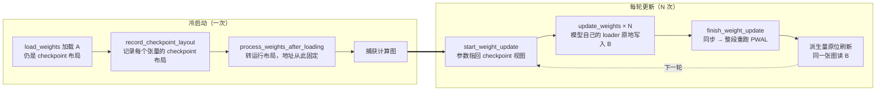

读图要点：

- 冷启动建立三个参照系：**布局**（`_ckpt` 记录）、**地址**（PWAL 之后的 storage）、**消费者**（捕获的图）。每轮只做两件事——换字节、按参照系重算。
- `begin` 到 `finish` 成功之间**不能推理**：这期间模型里是 checkpoint 布局的字节，kernel 读它得到的是完全错误的数。
- **失败不回滚**：finish 在开头就消费掉 begin，失败后只能开一轮完整更新，不能重试同一个 finish。
- loader 只有一份：direct 不另写 loader，分片、TP 切片、tie、专家索引仍由 `model.load_weights` 负责——代价是调用方必须发全量 checkpoint 张量。

使用者只看到三段 API（磁盘入口对应 `start_reload → load_weights → finish_reload`）：

| 阶段 | 入口 | 调用方义务 |
| --- | --- | --- |
| start | `start_weight_update` | 先暂停推理、排空在途请求 |
| update × N | `update_weights` | 按 checkpoint 名称发**全量**、checkpoint 格式张量 |
| finish | `finish_weight_update` | 成功前保持暂停；失败则开新一轮完整更新 |

**关键函数**（按"什么时候被调用"分组）：

| 时机 | 函数 | 干什么 |
| --- | --- | --- |
| 冷启动 | `record_checkpoint_layout` | 在 PWAL 之前给每个可加载张量记 `_ckpt`（shape/stride/dtype/offset + loader 属性 + storage 指针）与参数名集合；这是 begin 的参照系。别名按对象去重、按名字全记 |
| 冷启动 | `process_weights_after_loading`（PWAL） | 一次完整的后处理：转置、打包、量化、融合、算派生 scale；运行布局与地址从此固定 |
| 冷启动 | `finalize_model_weights` | 收尾遍历：children-first、无参 module hook、共享子模块去重 |
| 每轮 start | `begin_direct_reload` | 把被改过布局的张量按 `_ckpt` 建回 checkpoint 视图、恢复 loader 属性、清零 padding；所有校验通过后才动模型 |
| 每轮 start | `_checkpoint_views` / `storage_view` | 算出"每个张量在它自己 storage 上的 checkpoint 视图"，不搬数据、不做逆变换；Ascend 在这里换成带 ND staging 的实现 |
| 每轮 update | `model.load_weights` | **唯一**写字节的实现：把 checkpoint 张量原地充填进模型（分片、TP 切片、tie、专家索引都在这里） |
| 每轮 finish | `finish_direct_reload` | 消费 begin（一次性）、设备同步、清 quant method 的一次性 guard，然后整段重跑 PWAL |
| 每轮 finish | `process_weights_after_loading` | 同一份 PWAL 再跑一遍：把 checkpoint 布局搬回运行布局，并重算派生量 |
| 保参数身份 | `replace_parameter` / `retire_parameter` / `move_parameter` | 换形状时保住 `Parameter` 对象与 loader；退休不再被 kernel 读的源参数（下轮仍可加载）；让改名后的两个名字共享同一 storage |
| 派生量刷新 | `refill_derived` / `refill_derived_buffer` / `refill_runtime_tensor` / `refill_nz_weight` / `refill_expert_list` | 把派生量写回**原来的地址**：普通属性、非持久 buffer、运行张量（含物理 NZ）、专家列表；布局或物理 format 变了就报错，绝不静默换址 |
| padding | `padding_fill_params` | 冷启动登记"哪些 MoE 参数是 padding"，begin 时整项清零（清零后必须全量重发有效区） |
| 会话 | `_end_weight_update` / `reset_weight_update_target` | 结束会话、恢复默认更新目标，让下一轮能 start |

Ascend 侧的唯一结构性差异在 begin 与派生刷新：begin 用 `checkpoint_views` 覆盖上游规划（为强制 NZ 参数提供 ND 加载区），派生刷新用 `refill_*` 系列保证地址不变。为什么必须这样，见 2.6、2.7 与 4.2.4。

### 2.2 冷启动：在 PWAL 之前记录 checkpoint 布局

冷启动一共四步：加载、记录、后处理、捕获计算图。记录只在冷启动做一次，之后每一轮更新都复用它。

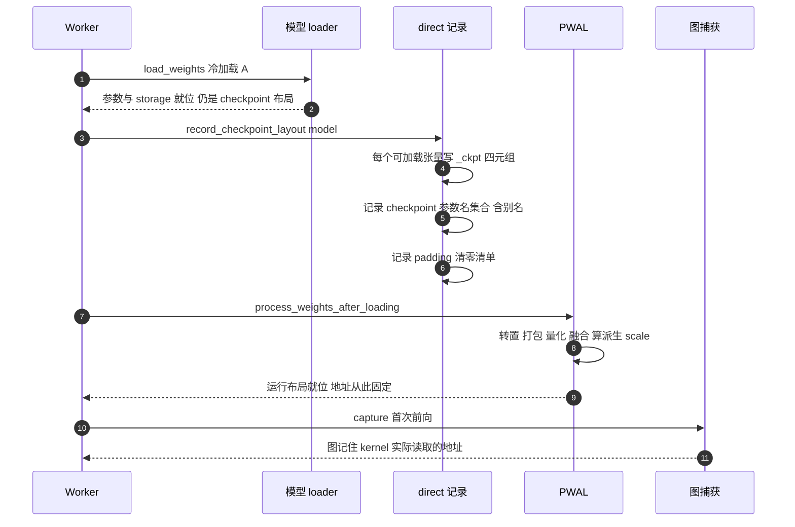

四条决定设计形状的要点：

1. **记录必须在 PWAL 之前**。PWAL 之后的张量已经不是 checkpoint 布局，再记录就记错了参照系。记录的不是"文件里的形状"，而是"本地分片后的可加载形状"——TP 切片、名称映射仍由模型自己的 `load_weights` 负责。
2. **`_ckpt` 挂在张量自己身上**，不挂在模块字典里：张量会被 PWAL 换成新对象，模块字典会失效；`_ckpt` 跟着"被记录的那个对象"走，正好对应"这个对象还能不能按 checkpoint 方式写"。
3. **按对象去重、按名字记全**：别名（tie 权重、共享 embedding/lm_head）只记一次，但每个名字都要记，因为 PWAL 可能替换掉其中任意一个。
4. **图捕获的是地址**，不是参数名、不是 Python 对象。所以"参数看起来换好了"根本不算数。

`_ckpt` 是四元组，每个字段都有用途：

| 字段 | 用途 | 少了它会怎样 |
| --- | --- | --- |
| `owner`（模型身份对象） | 区分"本模型记录的"与"别的模型共享来的"（draft 复用 target 的 `lm_head`） | 会把 draft 的更新当成 target 的，写坏未发送的数据 |
| `(shape, stride, dtype, offset)` | begin 时按它重建 checkpoint 视图 | 不知道要恢复成什么布局 |
| `attrs`（loader 元数据） | 后处理可能改 `_output_dim/_packed_dim`，begin 要还原 | loader 用错的切分参数写入，静默错位 |
| `storage` 指针 | 判断 storage 是否被搬过（被 `set_` 进融合 buffer） | offset 用错，#65281 修的就是这个 |

### 2.3 一轮更新的全链路时序

这是主图，后面几节分别把其中关键的一段放大。

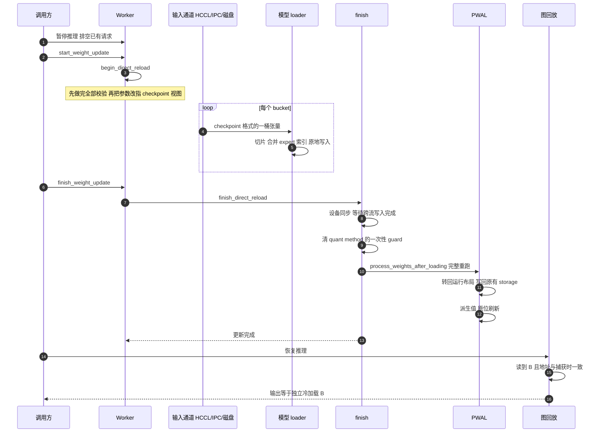

读图要点：

- **begin 之前全部校验完**：一旦 begin 返回，模型就进入"不能推理"状态，所以任何可能失败的检查（参数被换过、storage 装不下、共享参数布局变了）必须在此之前做完。
- **load 用的是模型自己的 loader**，没有"direct 专用 loader"。分片、TP 切片、tie、专家索引、dtype 转换一份都不重写——这保证更新路径与冷启动路径是同一份代码。代价是调用方**必须把每个模块的完整 checkpoint 张量发全**。
- **finish 是"完整重跑"而不是"增量补几处"**：PWAL 本身非幂等（一次量化、一次融合、一次吸收），只有整段重跑才能保证结果等于冷启动。
- **同步点在 finish 开头**：接收端可能在别的 stream 上写，不同步就开始后处理会读到半份数据。

### 2.4 同一块 storage 的四种视角

把镜头对准**一块 storage**：同一段显存，在不同阶段用的是不同的"解释方式"。

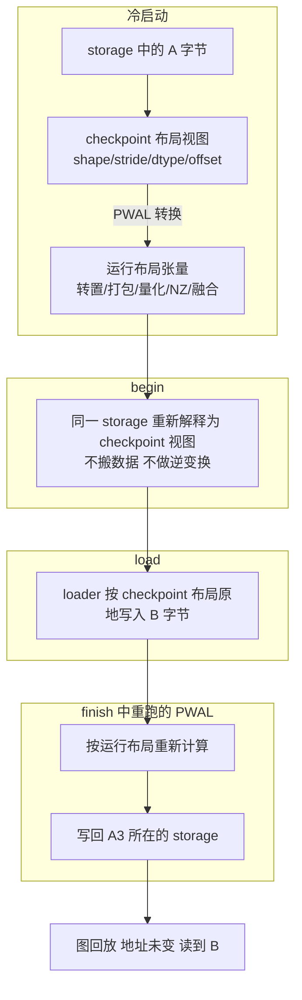

逐条读：

- **A2 → A3 是"格式变换"**：可能改 shape/stride、改字节数（padding）、甚至换 storage（变大装不下）。这一步由 PWAL 完成。
- **A3 → B1 是"零成本重解释"**：只新建视图让 loader 有位可写，数据没动，所以此刻图读到的值是错的——这就是"不能推理"的原因。
- **C1 写的是 checkpoint 布局的字节**：如果 B1 建错（本该恢复成转置布局，却直接用了运行布局），shape 全对、数值全错。
- **最后一步（写回）必须落到 A3 那块 storage**，否则图读旧地址；**重算出来的派生值也必须写回图正在读的那个对象**。

### 2.5 begin 的校验与视图恢复

begin 是一次更新的入口：它要在改动模型之前，把所有可能失败的条件判完。

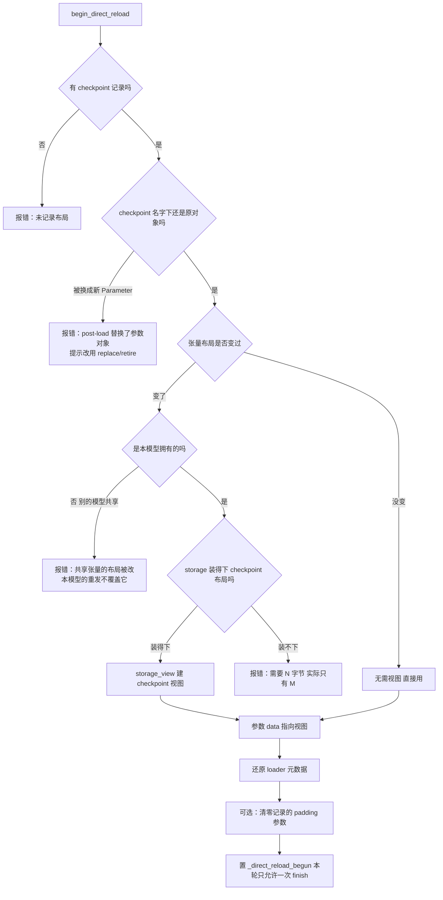

四类拒绝都有明确含义与正确做法：

| 拒绝 | 含义 | 正确做法 |
| --- | --- | --- |
| 无记录 | 这个模型没走 direct 冷启动 | 先按直连方式冷启动一次 |
| 参数对象被换 | PWAL 里 `del` 或新建了 `Parameter` | 改用 `replace_parameter` / `retire_parameter` |
| 共享张量被改布局 | draft 复用了 target 的参数，而 draft 的更新不重发它 | 让共享方各自拥有，或在 target 侧更新 |
| 容量不足 | PWAL 把张量缩小了（打包/pad 后字节数变小） | 用独立加载区（Ascend 的 ND staging 就是这种） |

容量判定用了一个很小但关键的技巧：**用 stride 计算真实跨度**而不是 `numel`，这样"转置后的非连续布局"和"带空洞的 padded 视图"都能算对；再叠加 offset 修正（storage 被搬过时用当前 offset），就是 #65281 的内容。

### 2.6 PWAL 的保址写回

后处理天然想"算一个新张量、赋给属性"。direct 要求它写回旧地址，于是上游把常见模式收敛成五个工具：`replace_parameter`、`storage_view`、`refill_derived`、`retire_parameter`、`move_parameter`。核心就一条判定：**新张量能否塞进旧 storage**。

| 场景 | 冷启动（保守） | direct（放宽） | 放宽后的效果 |
| --- | --- | --- | --- |
| 后处理让权重变大（MoE padding） | 放不下 → 换 storage | 允许用 storage 剩余空间 | 冷启动那次换到更大的 storage，之后每轮都放得下，地址从第一轮起就稳定 |
| 带空洞的视图（如 FP8 padding） | 要求"无空洞" | 只要求"不自重叠" | padding 视图也能原位写回 |
| 权重被清空（numel=0） | 不允许 | 允许 | checkpoint 字节留在 storage 里给下一轮用 |
| 更新中每轮都放不下 | — | 报错或改固定缓冲 | 绝不允许地址每轮漂移 |

所以 **"保址"不是"从不换地址"，而是"从第一轮开始地址稳定"**：冷启动时换一次 storage 完全可以接受，因为图还没捕获。

### 2.7 padding 与 meta 的初始化

MoE 的专家权重常被 pad 到对齐尺寸。padding 不是 checkpoint 数据，loader 不会写它，但 kernel 会按整块读。冷启动时它是 0；更新后如果保留旧值或随机值，数值就可能错。三条规则：

1. **selector 的判定**：只有"维度对不上"（hidden/intermediate 大于 unpadded 版本，或 TP shard 带 padding）时才需要清；**per-expert 标量（`(E,)`、`(E, ≤2)`）不是 padding 的对象**，混进去会把真实数据清零。
2. **清零会擦掉 checkpoint 区域**，所以清零之后调用方**必须完整重发这些参数的有效区**——"begin 清零"与"必须全量发送"是绑定的。
3. **meta 物化要补 0**：`materialize_meta_tensor` 原本用 `empty_strided` 得到未初始化内存，padding 会留垃圾，改成 `empty_strided(...).zero_()`。

这条对 Ascend 影响很大：Ascend 的 padding 发生在 **scheme 的后处理里**（`_maybe_pad_weight`、`F.pad`、TP padding），不在 `moe_config` 上，所以 Ascend 侧要自己实现等价的 selector（阶段一的 ③，见 4.2.4(7)）。

---

## 3. 上游来源：12 项已合入机制与 Ascend 落点

方案四**不按上游 PR 分组交付**，只把 PR 当作"机制来源"登记。下表按机制在运行时的位置排列，给出每项来源在方案四中的位置与 Ascend 要做的动作。

| 上游 PR | 提供的机制 | 方案四中的位置与 Ascend 动作 |
| --- | --- | --- |
| [#62407](https://github.com/vllm-project/vllm/pull/62407) | 保留被改名、转换或退休的参数身份 | 阶段一 ①（冷加载与源保留）及下一次 begin；核对源名称、别名与 loader |
| [#64336](https://github.com/vllm-project/vllm/pull/64336) | direct 生命周期、布局恢复及 worker 失败收尾 | 阶段一 ②、⑥；检查独立 NPU worker 的异常会话语义 |
| [#65281](https://github.com/vllm-project/vllm/pull/65281) | 参数换 storage 后按当前 offset 恢复 | 阶段一 ②；核对切片与融合缓冲 |
| [#64352](https://github.com/vllm-project/vllm/pull/64352) | 冷启动记录 padded 参数、begin 清零 | 阶段一 ③；MoE padding 在无 sleep 时也会触发 |
| [#64357](https://github.com/vllm-project/vllm/pull/64357) | 模型级收尾移至整体加载末尾 | 阶段一 ④；避免按桶 finalize |
| [#57678](https://github.com/vllm-project/vllm/pull/57678) | 无参 module hook、子模块优先、共享对象去重 | 阶段一 ④；核对 MLA / SFA / indexer 的注册与委托 |
| [#65914](https://github.com/vllm-project/vllm/pull/65914) | 更新路径统一收尾 | 阶段一 ④；阶段二核对已处理格式与其他入口 |
| [#64886](https://github.com/vllm-project/vllm/pull/64886) | 较早的 kernel-format 派生刷新接口 | 记录替代关系，实现使用 #65914 的最终机制 |
| [#64692](https://github.com/vllm-project/vllm/pull/64692) | 原位刷新派生张量与内核常量 | 阶段一 ⑤；阶段三扩展到量化 scale |
| [#64691](https://github.com/vllm-project/vllm/pull/64691) | 权重传输结束后归还可释放缓存 | 阶段一交付边界；阶段二检验多轮共卡资源表现 |
| [#66010](https://github.com/vllm-project/vllm/pull/66010) | Level-2 仅丢弃允许重写的纯参数分配 | 阶段二；独立于常驻显存更新交付 |
| [#65296](https://github.com/vllm-project/vllm/pull/65296) | ROCm preshuffle scale 的身份与刷新 | ROCm 后端来源留档；A3/A5 无对应执行路径，阶段二无 NPU 开发任务 |

**未合入的项决定方案的"边界"**（不是方案的一部分，但不能假装不存在）：

| 未合入 | 缺什么 | 对方案的影响 |
| --- | --- | --- |
| #65799 | 整轮完整性检查（缺参数/shard/expert 时拒绝） | 完整性靠调用方与测试 |
| #66002 | 模型 opt-in 与"已知静默路径"拒绝 | 哪些模型支持要人肉维护 |
| #65347 | "更新后与冷启动按位一致"的测试体系 | 验收体系要自建 |
| #65487 / #65353 | packed 接收对齐、gated MXFP4 | 相关组合不写入支持声明 |
| #65562 / #65802 / #66118 等 | dummy KV scale、online quant、indexer/MLA 独立加载 | 对应场景显式排除 |

**为什么"来源"与"交付单元"要分开**：

1. 同一项机制跨阶段使用：#64692 在阶段一用于 BF16 持久运行缓冲与融合投影，到阶段三才扩展到量化 scale；
2. 一个阶段要用多项机制：阶段一同时依赖上表中的 6 项；
3. 阶段是否完成，由"目标场景的端到端证据"判定，而不是"某个 PR 的每一处都改过了"。

也正因如此，旧方案三里的 **G1 / G2 / G3 / G4 只是历史交付名称**。它们按来源分组，与方案四的四个阶段不是一一对应关系。

---

## 4. vllm-ascend 适配方案（方案四）：按场景优先级适配

### 4.1 方案定位：为什么按场景而不是按 PR 组

Ascend 侧的组织方式经过四次调整：

| 方案 | 组织方式 | 优点 | 问题 |
| --- | --- | --- | --- |
| 一、按上游 PR 适配 | 一个 PR 一个适配提交 | 来源清晰、便于回滚 | 重复处理依赖；容易漏"上游没改但 NPU 必须改"的路径 |
| 二、按功能适配 | 8 个功能包、6 步实施 | 覆盖 Ascend 特有缺口 | 前期要设计支持范围与验收矩阵 |
| 三、按已合入 PR 组联合适配 | 只继承已合入实现，按 PR 组（G1～G4）联合交付 | 不引入未合入能力，边界清楚 | **组的边界是来源边界，不是交付边界**：一条业务能力要跨多个组，组内通过不等于组合可用 |
| **四、按场景优先级适配（本文）** | 按"硬件 × 精度 × 是否共卡"排四个阶段，每阶段独立交付、独立验收 | 阶段的完成条件就是业务可用的条件；不支持的组合显式留"待验" | 需要自建场景验收矩阵 |

方案四的立足点是一句话：**第一阶段独立交付的功能，就是"第一轮用 B 推理时，原图就应读到与独立冷加载 B 一致的权重、派生张量和计算结果"**。权重交换过程中释放显存、使用其他传输方式、适配量化权重，分别在后续阶段展开。

| 阶段 | 业务场景 | 阶段交付 | 完成标志 |
| --- | --- | --- | --- |
| 一 · BF16 原图直接重载 | A3、A5，非量化 BF16，显式开启 direct，权重常驻显存 | 从已有 checkpoint 或训练端全量更新 target 模型，重新执行加载后处理，在原图上恢复推理 | 两种硬件分别给出同一候选版本的 A→A→B→A、独立冷 A/B、原图回放及失败恢复证据 |
| 二 · BF16 权重交换与其他更新能力 | 同一硬件和精度，训练与推理共卡，或业务采用其他输入格式、传输入口及 reload 模式 | 优先完成 Level-2 sleep/wake 与真实权重传输的整轮交换；随后按入口交付其余适用能力 | 每个声明支持的组合都在目标机器上完成整轮更新和原图验证；共卡用例额外验证状态恢复和内存释放 |
| 三 · A5 MXFP 权重重载 | A5，MXFP 格式 W4A8 和 W8A8，同等优先级 | 两种格式分别覆盖 Linear、MoE 的 direct 原图更新，再覆盖阶段二适用的交换能力 | 用各自量化格式的冷加载结果作参考，核验真实量化内核读取的权重、scale、派生状态及输出 |
| 四 · 其他场景 | 其他量化、其他模型组合、MTP/推测解码 | 由实际模型和更新协议触发，每项单独界定参数归属、实现及验收 | 指定组合有独立证据即可交付；MTP 没有业务需求时可以一直不启动 |

两条首批实施建议（是建议，不是约束）：

- **图配置**：`FULL_DECODE_ONLY`（已有真机依据）。表中的"原图"指更新前已经捕获、更新后实际回放的同一张 decode 图；其他图模式、capture size、并行规模按实测范围登记。
- **通道**：HCCL 非 packed（已有测试基础），同时把**磁盘 / inplace checkpoint** 作为独立入口验收。

三条接入原则（沿用，仍然成立）：

1. **vLLM 侧只保留 PR 内容**：本地适配要么进 Ascend 的 patch 机制，要么在 Ascend 侧重写。验收方式：`git diff --name-only` 是 PR 文件白名单的子集 + 逐文件 SHA256 与上游一致。
2. **Ascend 逻辑放 vllm-ascend**：通过插件、继承或既有 patch 机制实现，不直接改 vLLM 源码。
3. **"只继承已合入"≠"只改上游同名文件"**：Ascend 自有 worker / scheme / attention / allocator 里的必要等价实现，同样是本方案的责任。上游 PR 清单里没有"强制 NZ 运行区""CaMem allocation 选择器"，但它们都在 direct 的必经路径上。

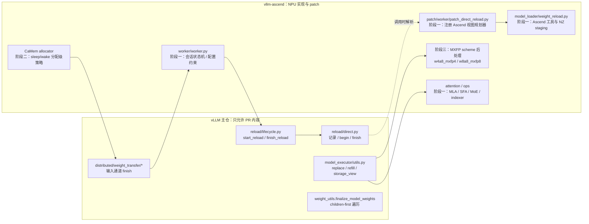

**阶段依赖与实施顺序**：

1. 先固定配套基线（vLLM `ba15685`、vllm-ascend `9005a22a`），核对哪些已合入项在目标 pin 内；
2. 阶段一：冷加载与源保留 → begin 与视图恢复 → 分桶写入与 MoE padding → finish 与 hook 所有权 → 图可见权重写回 → worker 会话与恢复。这六步的顺序就是调用顺序，不能跳步验收；
3. 阶段二：**Level-2 依赖阶段一的 begin 与 finish** → 真实权重传输依赖 worker 与 allocator 接口 → 其余入口按业务需要排期；
4. 阶段三：**量化 scale 是阶段一 ⑤ 在量化场景的扩展**，必须先有同格式冷加载参考；
5. 阶段四：按业务触发，每项单独界定归属与验收。

**实际执行到哪**：阶段一的代码与大部分证据已就位，还差"组合版本（历史 G1 + G2）在 A3/A5 的整轮真机验收"与一项静态审查发现的 SFA 源保留缺口；阶段二、三、四未开始。

### 4.2 阶段一：A3/A5 BF16 原图直接重载

**输入**：已冷加载并捕获图的 target 模型 A，以及同结构 BF16 checkpoint B。启动时显式设置 `VLLM_RELOAD_MODE=direct`，使用非量化权重和 KV、关闭推测解码，沿用已测入口的 `weight_nz_mode=0`。
**输出**：在同一引擎、同一图实例中可以推理的 B，以及下一轮还能装回 A 的模型。
**范围说明**：算子内部强制使用的物理 NZ（FRACTAL_NZ）**属于本阶段**——它是物理排布，不是量化。

#### 4.2.1 按调用顺序的六个接入点

| 位置 | 需要接入或核对的行为 | 典型错误及判定 |
| --- | --- | --- |
| ① 冷加载与源保留 | 保住 checkpoint 参数对象、名称、必要别名及 loader 属性。检查冷启动时会 dispose 源投影的 SFA 分支，尤其是仅设 direct、未启用 RL 且未配 transfer 的磁盘更新 | 若 `kv_b_proj` 在首次 PWAL 后已释放，下一轮 loader 可能失去写入目标。用该入口单独复现，在 vllm-ascend 修正实际命中的保留条件，并回归普通冷启动 |
| ② begin 恢复加载视图 | 预检归属、共享参数、容量及 offset。参数迁入新 storage 时使用当前 offset。物理 NZ 的运行权重保留原址，必要时在可加载的 ND 张量上接收 checkpoint | 合法布局可重载；容量、归属或物理布局不兼容时显式报错。把 opaque NZ 当普通 ND 字节写会产生数值错误 |
| ③ 分桶写入及 MoE padding | 原模型 loader 负责所有分片。冷启动已选中的 padded MoE 参数在 begin 整项清零，随后重发全部有效区；小维每专家 scale 按公共选择规则排除 | 对比一整桶、按层及混合边界三种切分；direct 的桶间不得提前执行模型收尾。核对选中名单、零 padding、有效区及冷 B 输出 |
| ④ finish 与 hook 所有权 | 收齐后先同步，再执行公共 PWAL。已注册的 indexer backend 由 children-first 遍历处理；未注册的普通后端由 wrapper / impl 委托。保留后端所需 dtype 的转接 | 在共享 indexer 上记录对象身份、顺序与轮次。冷启动一次，每次完整 finish 一次，第二轮依然执行。避免从公共遍历、wrapper、SFA 三条路径重复到达同一 backend |
| ⑤ 图可见权重写回 | 逐个更新内核实际读取的运行权重、持久缓冲、列表元素及派生值。布局兼容时原位回填，遇到无法维持原图契约的变化则结束本轮更新 | 同时比较具名消费者的地址、布局和值。仅检查 `named_parameters()` 会漏掉 KPool buffer、MLAPO 融合投影和 expert-list 元素 |
| ⑥ worker 会话与恢复 | 用正确的设备和当前 vLLM 配置调用 finish。direct finish 异常时上报原错误、结束旧会话、重置更新目标。重新 start、完整重发、成功 finish 并核对原图后再恢复推理 | 实际注入 PWAL 异常；重试旧 finish 应失败，新事务可修复。若模型无法恢复，则重建引擎。数据回滚和自动拦截所有推理入口属于不同能力 |

#### 4.2.2 一次更新的时序

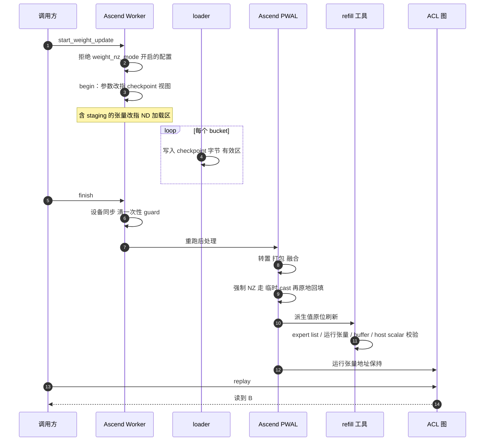

这张图与 2.3 的主图差别只有三处，正好是 Ascend 在阶段一的三个改造点：**begin 里多一层 Ascend 视图规划器**、**PWAL 里强制 NZ 要"临时 cast + 原地回填"**、**派生值要经过 Ascend 的 refill 工具**。

#### 4.2.3 拿到运行时对象，先问它是什么

阶段一的实现可以归成一张判定图：**先确定对象类型，再决定处置方式**。


读图要点：

- **左半支是"参数身份"**：能不能下轮再写、写进去是不是原位，取决于这里选哪种处置。
- **右半支是"派生对象"**：它们不是 checkpoint 数据，begin 不会给它们建视图，所以只能靠后处理**主动原位刷新**；布局一变就必须报错，因为图引用的就是这块地址。
- **host scalar 是唯一"只能拒绝"的**：它被烘焙进算子入参，改值不会让已捕获的图重新读它（阶段一不命中 FlatQuant 这类路径，条目保留）。

#### 4.2.4 关键实现

**(1) 参数身份与专家列表（①）**

```python
# 原：新建列表 + 删除源参数（下一轮无法再加载，图也丢引用）
layer.w13_weight_list = [w.clone() for w in layer.w13_weight.data.unbind(dim=0)]
del layer.w13_weight

# 新：列表原地回填；direct 下源参数退休，layerwise 保持基线的删除
for name in ("w13_weight", "w2_weight"):
    weights = list(getattr(layer, name).data.unbind(dim=0))
    refill_expert_list(layer, f"{name}_list", [w.clone() for w in weights])
    if direct_reload_enabled():
        retire_parameter(layer, name)
    else:
        delattr(layer, name)
```

三个 refill 工具的区别必须分清：

| 工具 | 归属 | 布局变化时的处理 | 适用对象 |
| --- | --- | --- | --- |
| `refill_derived` | vLLM 通用 | 允许 `setattr` 换对象（调用方保证图契约） | 普通派生属性 |
| `refill_expert_list` | Ascend | **报错**（元素被图引用，换地址就是错） | 专家列表及其元素 |
| `refill_derived_buffer` | Ascend | direct 下**报错** | 非持久 buffer |

```python
def refill_expert_list(layer, name, tensors):
    old = getattr(layer, name, None)
    if old is None or not direct_reload_enabled():
        setattr(layer, name, tensors)   # layerwise 保持基线行为
        return
    if len(old) != len(tensors) or any(_layout(a) != _layout(b) for a, b in zip(old, tensors)):
        raise ValueError(f"{name}: expert runtime layout changed; reload the model and recapture graphs")
    for target, source in zip(old, tensors):
        target.copy_(source)            # 先全量校验，再逐元素回填
```

**(2) 派生量必须拥有独立 storage（⑤）**

派生量一旦是 Parameter，就会进 `loadable_tensors`，begin 会给它建 checkpoint 视图——但它根本不是 checkpoint 数据，loader 会往"派生量的视图"里写字节，两边互相踩。所以派生量必须是**拥有独立 storage 的普通属性或非持久 buffer**。

阶段一的实际样本是 GLM KPool 的 5 个派生 buffer（原实现用切片、`float()`、`contiguous()` 派生，可能直接别名到 checkpoint 参数）：

```python
# 原：切片 / float() / contiguous() 的结果可能与 checkpoint 参数共享 storage
self._key_weight = self.wk_weights_proj.weight[: self.head_dim].detach().contiguous()

# 新：显式 clone 拿到独立 storage，再交给 Ascend 的 buffer 回填工具
refill_derived_buffer(
    self, "_key_weight",
    self.wk_weights_proj.weight[: self.head_dim].detach().clone().contiguous(),
)
```

`refill_derived_buffer` 只在 `name` 是已注册且 `persistent=False` 的 buffer 时才工作（拒绝 checkpoint 参数与持久 buffer）；同布局 `copy_`，direct 下布局变化即报错。

**(3) 强制 NZ：ND 加载区 + NZ 运行区（②⑤）**

这是 Ascend 最特殊的一块。背景是三个事实叠在一起：

- RL 场景要求 `weight_nz_mode=0`（走 ND），但 Ascend 的**部分内核只接受 FRACTAL_NZ**，会在后处理里**无条件** `npu_format_cast`；
- 每次 cast 都新建一块 NZ storage 再 `attr.data = tensor` → **地址每轮都变**，图读旧地址；
- 而这个参数同时是 loader 的写入目标（checkpoint 参数），begin 时必须有一块**按 checkpoint 布局的 ND 区**可写。

两个需求冲突，所以方案是**两块区并存**：ND 区只给 loader 写，NZ 区只给图读，后处理负责把 ND 转成 NZ 并回填。

```python
def refill_nz_weight(layer, name, *, force: bool = True):
    source = getattr(layer, name).data
    if not force and not _should_trans_nz(source):
        return                                                           # 策略不允许：保持 ND
    if direct_reload_enabled():
        # 用 set_/as_strided 重建的张量可能继承 storage 的原描述，
        # 先 clone 成连续 ND，让 cast 按最终运行 shape 进行
        source = source.clone(memory_format=torch.contiguous_format)
    tensor = torch_npu.npu_format_cast(source, ACL_FORMAT_FRACTAL_NZ)   # 临时 NZ
    refill_runtime_parameter(layer, name, tensor)                        # 回填固定运行区

def refill_runtime_parameter(layer, name, tensor):
    if not direct_reload_enabled():
        getattr(layer, name).data = tensor
        return
    parameter = getattr(layer, name)
    ckpt = getattr(parameter, "_ckpt", None)
    if ckpt is not None and not hasattr(parameter, "_direct_reload_staging"):
        # 这个参数同时是 loader 写入目标：另开一块 ND 加载区
        shape, stride, dtype, offset = ckpt[1]
        parameter._direct_reload_staging = torch.empty_strided(
            shape, stride, dtype=dtype, device=parameter.device)
    buffers = layer.__dict__.setdefault("_reload_runtime_buffers", {})
    old = buffers.get(name)
    if old is None:
        buffers[name] = tensor
    else:
        if _layout(old) != _layout(tensor):
            raise ValueError(f"{name}: runtime layout changed; rebuild and recapture graphs")
        if old.device.type == "npu" and torch_npu.get_npu_format(old) != torch_npu.get_npu_format(tensor):
            raise ValueError(f"{name}: physical format changed; rebuild and recapture graphs")
        old.copy_(tensor)      # NZ → NZ 原地回填，地址不变
        tensor = old
    getattr(layer, name).data = tensor
```

四个"看起来能省、实际不可行"的做法（都在真机上验证过）：

| 想省掉的做法 | 不可行的原因 |
| --- | --- |
| 直接在 NZ storage 上建 ND 视图给 loader 写 | NPU 的 `set_(storage)` 视图会**继承 storage 的 NZ 描述**，专家切片 loader 无法把它当 ND 用 |
| 用 `npu_format_cast` 的返回值判断"是否已是 NZ" | 这套 CANN 上某些视图会"原地址返回 ND"，格式查询不可靠，只能以 `data_ptr` 为准 |
| 每轮新建 NZ 张量再赋值 | 地址每轮漂移，图读到旧值，且不报错 |
| NZ → NZ 也先 clone 再赋值 | 多余一次全量拷贝；`copy_` 在同布局 NZ→NZ 下既保址又保值 |

代价要说清：**强制 NZ 的权重 2× 常驻**（NZ 运行区 + ND 加载区），每轮还有一次 clone 的瞬时峰值。方案接受这个代价，因为替代方案（每轮换地址）是正确性问题。

交付版把"运行区保址"抽成了 `refill_runtime_tensor`（同一套 layout / 物理 format 校验），好让非 Module 的 attention impl 也能复用；`refill_runtime_parameter` 只多做一件事：给"同时是 loader 目标"的参数另开 ND staging（含非零 offset 的分配）。

**(4) Ascend 实现的接入方式（②的落点）**

vLLM 侧不允许改非 PR 内容，所以用**运行期替换**：

```python
# vllm_ascend/patch/worker/__init__.py
if getattr(vllm_envs, "VLLM_RELOAD_MODE", None) == "direct":
    import vllm_ascend.patch.worker.patch_direct_reload  # noqa: F401
```

```python
# vllm_ascend/model_loader/weight_reload.py
_UPSTREAM_CHECKPOINT_VIEWS = vllm_direct._checkpoint_views   # 只捕获一次，避免套娃

def checkpoint_views(model):
    # 没有任何 staging（普通 ND 模型）→ 直接走原 PR 实现，零改动
    if not any(getattr(t, "_direct_reload_staging", None) is not None
               for _, t in vllm_direct.loadable_tensors(model)):
        return _UPSTREAM_CHECKPOINT_VIEWS(model)
    ...  # 有 staging：校验 owner / 布局 / device，然后返回 (t, staging)

def install_direct_reload_patch():
    vllm_direct._checkpoint_views = checkpoint_views
```

两个好处：**零侵入**（vLLM 文件一个字节不改，可逐文件哈希证明）与**渐进**（不用 staging 的模型完全走上游路径）。patch 必须登记目标、原因、关联 PR、移除计划与作用范围，否则下次升级没人知道它为什么存在。

**(5) finish 与 hook 所有权（④）**

一轮收尾要做到"统一、有序、不重复"，并且"没有 forward 里临时补建"的路径。调度顺序：

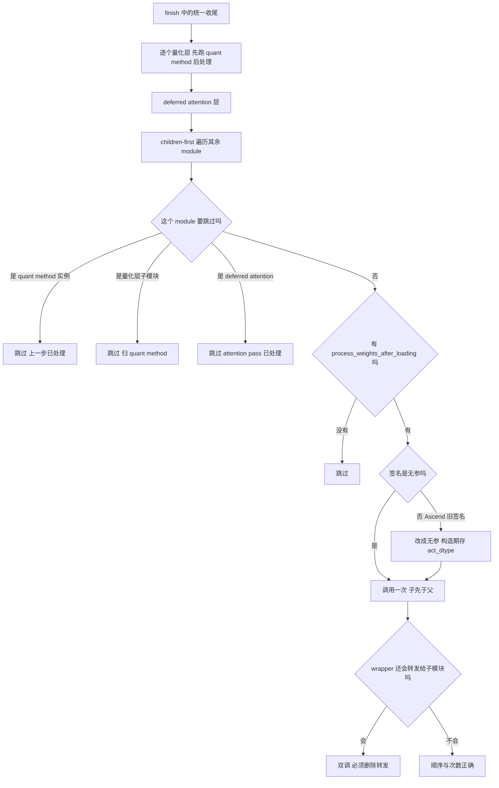

**Ascend 侧的两个坑都在这一格**：

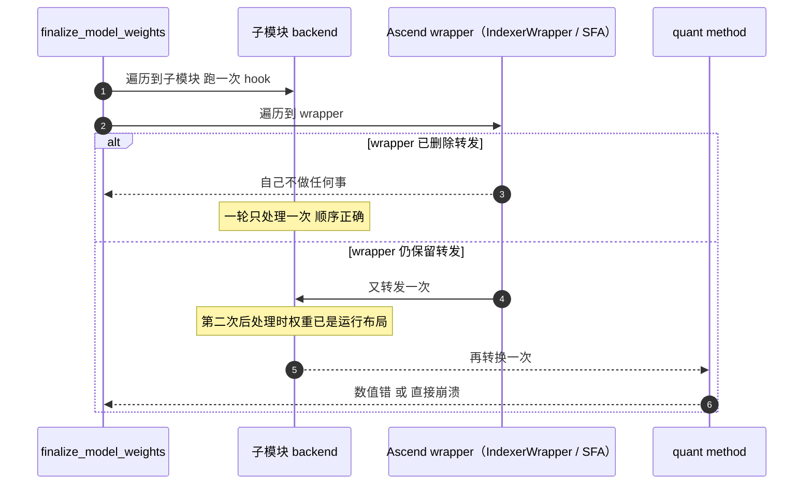

交付版的做法不是"删掉所有转发"，而是**按对象所有权判断**：`impl` / `indexer` 已经注册进模块树（`isinstance(..., nn.Module)`）时，交给 children-first 遍历；未注册的普通对象仍由 wrapper / SFA 显式委托。

| 路径 | 改前 | 改后 | 改法 |
| --- | --- | --- | --- |
| KPool 形态的完整链路 | 公共遍历 1 次 + `IndexerWrapper` 转发 1 次 + SFA→wrapper→backend 1 次 = **3** | **1** | `ops/mla.py`：`impl` 是已注册 `nn.Module` 时不再转发 |
| SFA 的 indexer | 公共遍历 1 次 + SFA 显式 1 次 = **2** | **1** | `attention/sfa_v1.py`：已注册 Module 的 indexer 跳过重复委托 |
| 普通（非 Module）backend / indexer | 1 | 1（不变） | 保留显式委托；`vllm_version_is("0.33.0")` 分支也保留 |

判据是**对象所有权**，不是"已处理"布尔标志：每轮 finish 都重新判、重新执行，不会出现"第二轮被跳过"。**没有新增跨轮 guard**。

**(6) worker 会话与失败恢复（⑥）**

direct 的 finish 在开头就消费掉 begin，所以**失败后不能重试同一个 finish**：

```python
# finish 失败：direct 已消费 begin，只能开新一轮完整更新
try:
    self.weight_transfer_engine.finish_weight_update()
except BaseException:
    if direct_reload_enabled():
        self._end_weight_update()      # 清 active + reset 更新目标
    raise
self._end_weight_update()
```

**没有回滚**是设计选择：direct reload 不保存快照，修复靠"下一次完整更新"。所以"失败后能重新 start"是硬需求。

**(7) MoE padding 的选中与清零（③）**

上游的 selector 挂在 `RoutedExperts` 上：只有"维度对不上"（hidden / intermediate 大于 unpadded 版本，或 TP shard 带 padding）时才需要清；**per-expert 标量（`(E,)`、`(E, ≤2)`）不是 padding 的对象**，混进去会把真实数据清零。清零会擦掉 checkpoint 区域，所以清零之后调用方**必须完整重发这些参数的有效区**——"begin 清零"与"必须全量发送"是绑定的。

Ascend 侧的核对点：padding 可能发生在 **scheme 的后处理里**（`_maybe_pad_weight`、`F.pad`、TP padding），`moe_config` 上不一定有 unpadded 字段。阶段一要先确认实际命中的 BF16 路径是否产生 padding：

- 有 padding → 需要该 scheme 实现等价的 `padding_fill_params()`（或登记"N/A 及理由"），并把结果并进 begin 的清零清单；
- 强制 NZ 参数的 padding 在 NZ 布局下，清零要在 **staging** 上做，否则会清到运行区；
- 无 padding（例如本阶段实测的配置）→ 该行登记为"N/A + 依据"，而不是留空。

#### 4.2.5 A3 与 A5 分别验什么

| 分支 | 观察对象和建议用例 | 通过条件 |
| --- | --- | --- |
| A3/A5 普通 BF16 dense | 目标硬件上选可运行的 dense 模型，检查普通 Linear 及实际命中的转置或融合权重；磁盘和 HCCL 分别运行 | 两入口各自取得冷 B 对照，原图跨轮推理，随后可装回 A |
| A3/A5 BF16 MoE | 选择实际命中的堆叠权重或 expert-list 路径，记录 w13/w2、列表元素和强制 NZ。目标配置出现专家 padding 时加入 ③ 的检查 | 有效专家权重和计算结果匹配冷 B，原图所持每个元素继续有效。按硬件、布局及 TP/EP 规模分别登记 |
| SFA / KPool | 对命中该 backend 的模型树观察 `_key_weight`、`_gate_weight`、`_head_weight_f32`、`_norm_weight_f32`、`_norm_bias_f32`；另验 SFA direct-only 源保留 | 五个 buffer 值和地址逐轮正确，backend 每轮处理一次。完整检索路径用目标模型验证，组件 matmul/bmm 仅作定位 |
| A5 native BF16 MLAPO | 分别验证 32 头及 20→32 头 padding，断言 native 路径被选中。查 `weight_dq`、`weight_dkv_kr`、`weight_uq_qr` 的真实 NZ 格式和 `mlapo_W_UK_T` 的引用 | 带/不带 padding 都用更新前的 decode 图获得冷 B 的 token 与 logprobs。这里补的是 attention head，与 MoE 参数清零分别验证 |
| 特定模型分支 | SFA 的未量化 PD consumer 若选到 PROLOG_V3，验三个 NZ 投影；若业务模型含 GDN/KDA，则验对应 packed 卷积权重 | 记录硬件能力、命中条件与实际算子。只有目标模型路径实际执行并通过时才列入对应硬件的支持表 |

#### 4.2.6 阶段一的交付边界

阶段一用**权重常驻内存**的完整事务建立最小可用能力。三条边界必须写清：

1. **MoE padding 在无 sleep 时也可能触发**；HCCL 在普通更新结束时也会归还可释放缓存。这两项随首批路径验收：HCCL 继承的 finish 先调 `finish_reload`、再调 `empty_cache()`，direct 收尾在 PWAL 前执行的设备同步负责让其他流的写入可见——**分别核对两者的位置，无需在 Ascend 再叠加一次全局 finish**。
2. **只承诺"同一份入口的全量更新"**：数据回滚、自动拦截所有推理入口、完整的整轮完整性检查（#65799）都不在本阶段；调用方在成功 finish 前必须保持模型暂停。
3. **不承诺跨模式等价**：layerwise 与 direct 的数值等价未建立；layerwise 的 expert-list 旧图读 A 是已知边界。

| 路径 | 阶段一结论 | 处理规则 |
| --- | --- | --- |
| 量化（W4A4 / W4A8 / W8A8 / WNA16、量化 KV） | 不在本阶段 | 阶段三（A5 MXFP）与阶段四（其他量化） |
| MTP / 推测解码 / draft 更新 | 不在本阶段 | 阶段四，且需业务明确"只更新 target / 只更新 draft / 两者一起" |
| MegaMoe 共享专家融合 | 需 `enable_fused_mc2 == 3` + MXFP，当前目标硬件不可达 | 记录为"目标配置不可达"，不作为已支持 |
| 310P | 有独立 PWAL 与硬件差异 | 排除，并写清文件与范围依据 |
| 真实 HCCL / 多卡规模 | 传输路径与并行扩展 | 需要独立证据，磁盘 bucket 不能替代；按阶段二登记 |
| 强制 NZ 的内存 | 2× 常驻 + 每次 clone 峰值 | 按 EP 切分给出估算，必要时"finish 后释放加载区" |

### 4.3 阶段二：BF16 权重交换与其余适用能力

**输入**：阶段一已通过的具体硬件、模型及更新入口，再加上使用场景要求的休眠策略、权重格式或传输通道。
**输出**：每种新增方式可独立使用的 BF16 图模式配置。先做共卡训练最需要的 Level-2，再扩展其余入口；各入口沿用同一套原图与数值判据。

#### 4.3.1 Level-2 sleep/wake

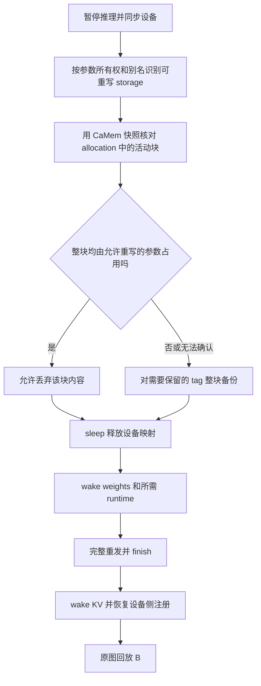

固定版本的 Ascend worker 会按名称备份选定参数和 `named_buffers()`，CaMem 按 tag 处理分配。weights pool 里还可能放有普通 tensor 属性、内核指针表及参数和非参数共享的块。旧栈已经出现过"唤醒后地址相同、普通属性丢值、原图算错"的反例，所以实施时要对照已有 block 级适配，把策略接到当前 worker 与 CaMem 的真实生命周期。

| 内存或生命周期 | 实现与验证 |
| --- | --- |
| 纯参数、显式保留参数、别名 | 只有整块均为允许重写的纯参数时才可免备份。保留规则按 storage 归并，任何需保留的别名都会影响整块策略；被丢弃的参数在推理前完整重发 |
| 混合块、普通属性、runtime / graph | 对需要保留的 tag 整块备份，未知块保守处理。唤醒后检查内容、地址、offset 及图实际读取的结果，再由 finish 把 A 的派生值刷新成 B |
| KV、pool 和注册回调 | 按 tag 延迟唤醒。KV-only wake 避免访问尚未映射的 weights；核对全局 buffer 注销/重注册、同 tag 多 pool 和连续多轮 sleep/wake，保留既有 extra cleanup 顺序 |
| 端到端交换 | A3/A5 各运行真实传输、分 tag 唤醒、A→B→A 与原图回放。记录释放量、备份量、轮后设备占用和数值；历史单卡磁盘分桶结果只作对照 |

allocation 级时序：

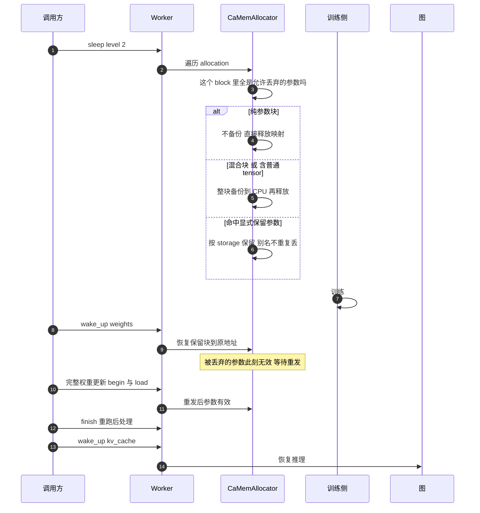

一个容易忽略的时序事实：**wake 之后、finish 之前的派生值是上一轮的旧值**，直到 finish 重跑 PWAL 才按新权重刷新。这也是"finish 必须整段重跑"的另一个理由。

#### 4.3.2 同一精度下的其他能力如何排期

| 能力 | 具体实施 | 验收和依赖 |
| --- | --- | --- |
| kernel-format 输入 | 对已经分片且已经过后处理的权重，走对应 inplace / iterator 分支；按运行时名称写入，使用 `weights_already_processed` 语义刷新 module 派生状态，避免再次转置或打包 | 与等价 checkpoint 冷 B 对照，检查派生值和原图；输入名称、格式和本地分片须显式记录 |
| HCCL packed、NPU IPC | packed 重点核对 begin 清零与接收流顺序、bucket 边界、缓冲复用；IPC 单验设备映射、句柄生命周期和 finish 同步。按固定 pin 的实际可达接口实施 | 真实跨进程发包，改变桶大小并重复更新。通过的 HCCL 非 packed 用例只支持该通道；依赖未在 pin 中具备的上游修复时单列 |
| layerwise 更新 | 业务需要这一模式时沿用它自己的按层收尾，先处理 expert-list 重绑导致旧图仍读 A 的已知边界 | 用能区分 A/B 的实际列表消费者复现并修复，再验同模式冷 B。分别记录 direct 与 layerwise 的通过组合 |
| 并行及模型入口 | 在业务需要的 TP/EP、PD 或其他 runner 上核对本地 shard、expert/scale 的归属及所有 rank 的收尾。M2N、稀疏更新、其他 loader 先查 Ascend 可达性和输入契约 | 以该入口和配置的真机证据决定范围。稀疏更新尤其要证明所有需重新转换或被清零的区域都被覆盖 |
| 完整性、模型支持声明、检测与 CI | 对照固定 pin 和已有上游工作，分别登记整轮缺 shard/expert 检查、更新期间服务隔离、模型声明、运行时检测及模型族 CI 的依赖 | 在当前全量更新模式由调用方暂停并发齐。测试可观察地址与调用次数；生产能力随对应上游实现及 Ascend 验证单独交付 |

**ROCm 项**：DeepSeek-V4 的 preshuffle scale 修复（#65296）只在 ROCm 后端执行，A3/A5 BF16 没有该分支。登记来源后即可结束，**阶段二无对应 NPU 开发任务**。

### 4.4 阶段三：A5 MXFP W4A8 与 W8A8

**输入**：A5 上可独立冷加载的两个同结构量化 checkpoint A/B，明确权重编码、分组 scale、目标 Linear / MoE scheme、实际 kernel 和并行配置。
**输出**：两份可独立声明的支持结果，分别对应 W4A8 MXFP 和 W8A8 MXFP。两者沿用阶段一的会话与阶段二适用的交换方式，主要新增工作在 checkpoint 布局、转换 guard、scale 及原图持有的量化运行缓冲。


| 组合 | 重点设计 | 最直接的失效信号 |
| --- | --- | --- |
| W4A8 MXFP Linear | 在 `W4A8_MXFP` 路径核对压缩权重、分组 scale 的 reshape/transpose、`_mxfp4_transformed` 的恢复时机；保留下一轮可写入的 checkpoint 视图 | 第二轮仍使用旧 scale、重复重排或把打包值当普通整数转换 |
| W4A8 MXFP MoE | 对 w13/w2 权重和 scale 分别追踪实际 GMM 或其他命中内核，检查 NZ、每专家列表引用和 DS 专用分支。每项以真实硬件 profile 和实际 dispatch 为准 | 参数看似已更新，图内专家或 scale 列表仍指旧元素 |
| W8A8 MXFP Linear | 核对 `W8A8_MXFP8` 的持久转换缓冲、`restore_weights_for_rl_loading` 与 direct 生命周期的实际衔接、`_mxfp8_transformed`；使用 DS 子类时另验派生输入 | guard 跨轮跳过转换，或在 begin 和专用 restore 中重复恢复，导致原图读取错误布局 |
| W8A8 MXFP MoE | 核对 w13/w2 的物理 NZ 格式、scale 重排、不同 kernel 分支及专家列表；记录实际算子收到的张量 | 物理格式或 scale 编码错误，即便外层 shape 和地址稳定，输出仍偏离冷 B |

**阶段三专有的两类机制**（阶段一不命中，写在这里备查）：

**(1) 一次性 guard 的清理**

Ascend 的 scheme 里有 `_mxfp4_transformed` / `_mxfp8_transformed` 这类"只转换一次"的标记。上游 finish 只清 quant method 的 `_already_called_process_weights_after_loading`，Ascend 的标记不会被清——后果是**整段后处理被跳过，模型静默停在 checkpoint 布局**。

```python
def process_quant_weights(scheme, layer):
    if direct_reload_enabled():
        if getattr(layer, "_already_called_process_weights_after_loading", False):
            return                      # 同一轮内重复调用直接跳过
        layer.__dict__.pop("_mxfp4_transformed", None)
        layer.__dict__.pop("_mxfp8_transformed", None)
    scheme.process_weights_after_loading(layer)
    if direct_reload_enabled():
        layer._already_called_process_weights_after_loading = True
```

三条规则：只在 direct 模式生效（layerwise 保持原语义）；只清 Ascend 自己设的标记（不无差别清同名属性）；同轮重复调用要去重。

**(2) host scalar 的拒绝与 E8M0 的按字节保真**

FlatQuant 的 `clip_ratio` 是算子入参的 host float，已经被图烘焙。改 tensor 不生效，改 host 值也不会让已捕获的图重新读它。原则是**值不变则放行，值变化则显式拒绝**，让调用方走"重建模型 + 重新捕获"：宁可拒绝，不可静默错。

E8M0（`float8_e8m0fnu`）是**编码而非数值**，CANN 的 copy 不支持全部 MX dtype，需要按字节保真：

```python
for target, source in zip(old, tensors):
    if target.dtype == torch.float8_e8m0fnu:
        target.view(torch.uint8).copy_(source.view(torch.uint8))
    else:
        target.copy_(source)
```

**实施与退出条件**：每种格式先构造"只改权重""只改 scale"的可辨识输入，再做两者一起变化的整模型 A→A→B→A。对 E8M0 scale 核对编码字节，对 opaque NZ 核对物理格式和真实算子数值。每轮 finish 前处理该 scheme 的 guard，同一轮避免重复转换。Linear、MoE 分别达到冷加载一致和原图回放后，再逐项复验 Level-2、真实 HCCL、业务使用的 kernel-format/IPC/packed 与并行组合；每格记录通过、待验或不适用及原因。量化结果的参考引擎须使用同一量化格式和内核配置。

### 4.5 阶段四：其他量化和可选的 MTP

| 触发需求 | 输入与设计 | 交付和退出条件 |
| --- | --- | --- |
| 其他量化格式或量化 KV/cache | 明确硬件、权重/激活/KV 各自 dtype、scheme、算子及 checkpoint。逐项追踪 weight、scale、offset、bias、派生对象和可能固化到图中的 host scalar | 先让该模型冷启动和真实算子有基准，再验 direct 原图与业务所需交换方式。无法动态更新的图常量须有明确的拒绝或重建行为 |
| 其他模型、硬件或并行扩展 | 取得目标模型与部署配置，确认是否引入新的源参数释放、布局转换、通信路径或图消费者 | 仅为新增路径补实现并回归已有支持组合；提交该配置的独立冷 B 和跨轮结果 |
| MTP / 推测解码（可选） | 业务先明确只更新 target、只更新 draft 或两者一起更新。列出共享 embedding/lm_head 的 storage 所有者、各自发包内容、finish 顺序及某一侧失败后的恢复方式 | 对各自更新和共享权重分别验证冷参考、原图、两侧版本一致性与失败恢复。只有实际使用 MTP 时才投入该专项 |

### 4.6 统一验收与交付方式

| 要回答的问题 | 需要留存的证据 |
| --- | --- |
| 本轮确实用 B 推理了吗？ | 独立冷 A/B；选取能区分两者的固定输入；热模型依次 A→A→B→A。逐轮比较 token、logprobs、关键权重和派生值；容差随具体模型与算子记录 |
| 真的是原图吗？ | 固定输入形状和 capture descriptor，记录图实例、捕获计数、成功回放计数。跨更新期间图实例相同、捕获数不增加，每轮推理回放数增加 |
| 图读取的对象正确吗？ | 按"模型层名 → 消费算子 → 输入名"记录 tensor/storage 地址、offset、shape、stride、dtype、NPU format 和值；列表按元素记录，scale 按编码与算子输出核对 |
| 收尾完整且每轮只做一次吗？ | 记录注册树中的实际对象、层方法和 module hook 顺序及次数；用不同合法 bucket 切分复验共享 backend 和未注册 backend 两种情况 |
| 真实入口能从失败中恢复吗？ | 保存 worker/runner 发起的调用、异常和状态。对 direct finish 注入失败，验证旧会话关闭、新 start 完整重发、成功 finish 后原图匹配冷 B。多 rank 配置记录所有参与 rank 的结果 |
| 实施能复现吗？ | 固定双仓 commit、镜像、CANN / torch-npu、模型/checkpoint、硬件和并行配置。交付 Ascend 增量及累计 diff、原代码与最终源码、启动命令和原始日志；核对 vLLM diff 的上游来源 |

每阶段以**硬件 × 模型和精度 × 图模式 × 更新入口 × 是否 sleep × 并行配置**为一行出具结果。单测、NPU 组件、完整模型和真实传输分别注明验证层级。**只要一个声明支持的场景尚缺原图或冷参考证据，该行就保留"待验"**，其他已经通过的配置可以独立交付。

配套台账（字段沿用既有交付，把"组"换成"阶段"）：

| 台账 | 最低字段 |
| --- | --- |
| source-ledger | repo/PR/merge_commit/merged_at、是否在 verified pin 内、祖先检查、应用顺序、处理结果 |
| hunk-map | patch SHA256、文件、hunk 头、上游 PR/符号或 NPU-local、所属阶段、理由、测试 |
| model-correspondence | 上游模型文件/符号、target/draft/后端、Ascend 等价实现、可达配置、结论/证据 |
| scheme-storage-coverage | scheme/分支 × 存储形态 × 是否换地址 × 结论 × 证据 |
| call-path-matrix | worker.start/finish、HCCL/IPC/M2N、磁盘 inplace、guard 清理点、失败重开、真实通信是否运行 |

---

## 5. 附录

### 5.1 术语

| 术语 | 含义 |
| --- | --- |
| PWAL | `process_weights_after_loading`，加载后处理：转置、量化、打包、融合、算派生 scale |
| checkpoint 布局 | loader 要写入的本地 shape/stride/dtype/offset 与加载属性；不等于完整文件里未分片张量的形状 |
| 保址 | 保住图/kernel 真正读取的 storage 与地址；只保住参数名或 Python 对象不够 |
| 派生张量 | 由权重算出、被 kernel 直接读、但不是 checkpoint 参数的张量 |
| staging（ND 加载区） | 为强制 NZ 权重额外保留的、供 loader 写入的 ND 缓冲区 |
| retired 参数 | 标记退休的源参数：保留注册与数据、可再加载、被 kernel 参数枚举跳过 |
| NZ / ND | Ascend 的 FRACTAL_NZ 物理排布 / 普通 ND 排布 |

### 5.2 上游 PR 索引

| PR | 主题 | 方案四中的位置 |
| --- | --- | --- |
| [#62407](https://github.com/vllm-project/vllm/pull/62407) | 参数身份、别名、loader 语义 | 阶段一 ① |
| [#64336](https://github.com/vllm-project/vllm/pull/64336) | direct 生命周期、checkpoint 视图、worker 会话 | 阶段一 ②⑥ |
| [#64692](https://github.com/vllm-project/vllm/pull/64692) | 派生 tensor/scale/constants 原位刷新 | 阶段一 ⑤（阶段三扩展到 scale） |
| [#65281](https://github.com/vllm-project/vllm/pull/65281) | 搬移后的当前 offset | 阶段一 ② |
| [#57678](https://github.com/vllm-project/vllm/pull/57678) | 无参 hook、children-first 遍历 | 阶段一 ④ |
| [#64357](https://github.com/vllm-project/vllm/pull/64357) | 模型级 hook 移到加载末尾 | 阶段一 ④ |
| [#65914](https://github.com/vllm-project/vllm/pull/65914) | 所有路径统一 finish | 阶段一 ④（阶段二核对其他入口） |
| [#64886](https://github.com/vllm-project/vllm/pull/64886) | 被 #65914 替代 | 仅记录替代关系 |
| [#64352](https://github.com/vllm-project/vllm/pull/64352) | begin 清零 padded MoE 参数 | 阶段一 ③ |
| [#64691](https://github.com/vllm-project/vllm/pull/64691) | 更新后同步与缓存清理 | 阶段一交付边界 / 阶段二资源表现 |
| [#66010](https://github.com/vllm-project/vllm/pull/66010) | level-2 sleep 只丢纯参数分配 | 阶段二 |
| [#65296](https://github.com/vllm-project/vllm/pull/65296) | ROCm preshuffle scale 身份 | ROCm 留档，无 NPU 任务 |

设计来源：[vllm-project/vllm#54477](https://github.com/vllm-project/vllm/issues/54477)。

### 5.3 关键代码位置

| 功能 | 位置 |
| --- | --- |
| 记录/begin/finish | `vllm/model_executor/model_loader/reload/direct.py` |
| 生命周期入口 | `vllm/model_executor/model_loader/reload/lifecycle.py`、`inplace.py` |
| 保址工具 | `vllm/model_executor/utils.py`（`storage_view`、`_in_own_storage`、`replace_parameter`、`refill_derived`、`retire_parameter`、`move_parameter`、`set_kernel_parameter`、`kernel_parameters`、`get_live_param`） |
| 统一 hook 遍历 | `vllm/model_executor/model_loader/weight_utils.py::finalize_model_weights` |
| meta 物化 | `vllm/model_executor/model_loader/reload/meta.py` |
| padding selector | `vllm/model_executor/layers/fused_moe/routed_experts.py::padding_fill_params` |
| Ascend 工具与 NZ | `vllm_ascend/model_loader/weight_reload.py` |
| Ascend 接入 patch | `vllm_ascend/patch/worker/patch_direct_reload.py`、`patch/worker/__init__.py` |
| Ascend 会话状态机 | `vllm_ascend/worker/worker.py` |
