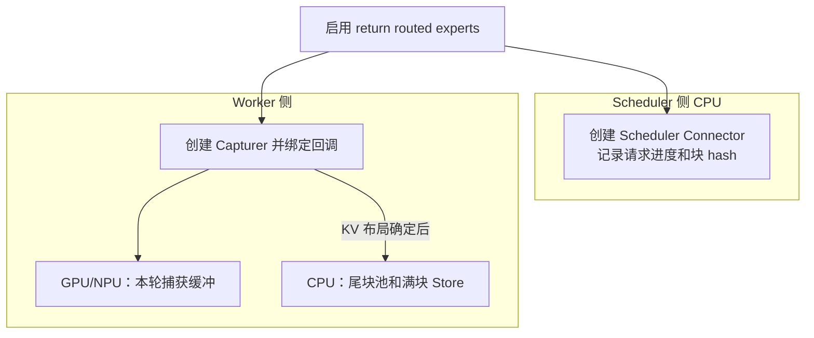
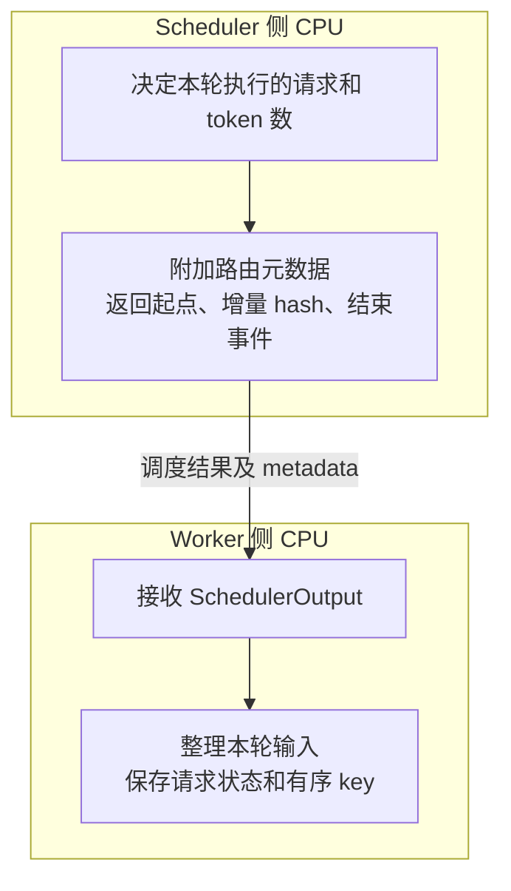
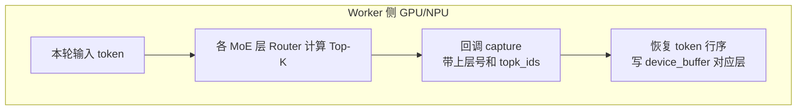
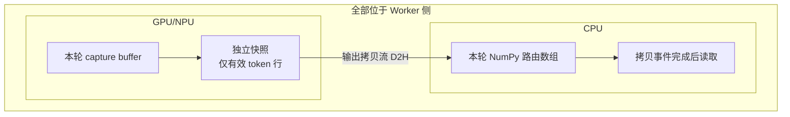
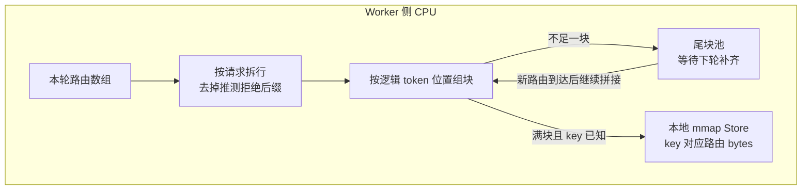
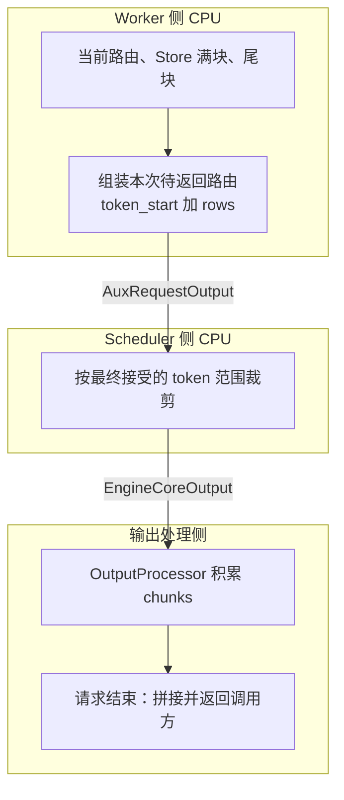
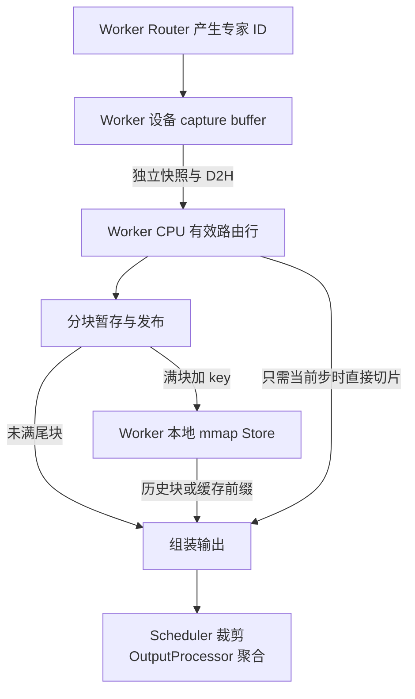
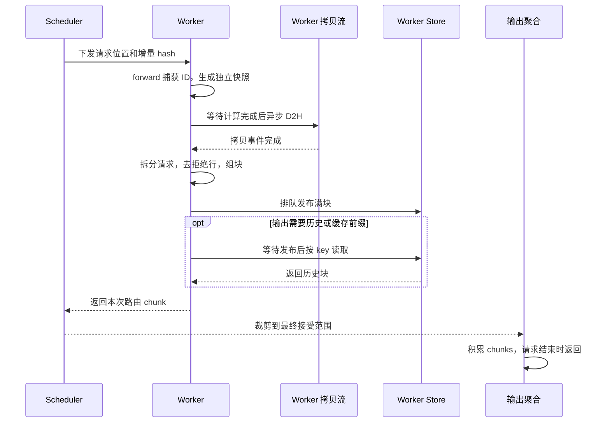

# vLLM Routing Replay 重构与 vllm-ascend 适配

## 1. 背景

MoE 模型的 router 为每个 token 选择 Top-K 专家。RL 训练中，rollout 与训练端可能因精度、算子或 batch 形态不同而选出不同的专家；Routing Replay 将 rollout 的专家 ID 记录下来，供训练端复用。本文介绍 vLLM 负责的路由捕获、存储和返回过程，训练端使用这些 ID 执行 replay。

旧方案由 Scheduler 按物理 KV slot 保存路由，路由数据与物理缓存布局耦合。[PR #45635](https://github.com/vllm-project/vllm/pull/45635) 将其改为 Worker 侧按 KV block hash 保存，便于在前缀缓存、分块 prefill 和异步执行中维护路由记录。下面从一次请求的执行过程展开。

## 2. 新方案实现

先明确两个执行位置。**Scheduler 负责安排本步计算、提供请求和缓存块的信息，并在结果回来后确定有效输出范围；Worker 负责执行模型，产生、保存和整理专家路由。** Worker 同时使用 GPU/NPU 和 CPU：路由从设备拷到 CPU 后，仍在 Worker 侧处理，直到输出阶段才交给 Scheduler。

这里保存的“专家”是**专家 ID**。例如 token `p0` 在某层选中 `[3,7]`，就记录这两个编号，不复制专家权重。记 `R(p0)` 为 `p0` 在所有层的专家 ID，形状为 `[L,K]`；多个 token 按行排列后为 `[T,L,K]`。`L` 按模型总层数分配，非 MoE 层的初始化值不代表真实路由。

下面严格按六个阶段展开：**初始化 → 调度 → 捕获 → 拷贝 → 分块存储 → 输出**。初始化在启动时完成；后五个阶段随着每一轮模型执行重复。文中代码均为关键逻辑节选或等价简化。

为了跟踪数据，使用同一个请求：prompt 为 `[p0,p1,p2,p3,p4]`，最终生成 `[y0,y1]`。假设路由存储每 4 个 token 为一块，即 `B=4`，prompt 分两轮执行。这个块大小只用于讲解。

| 模型执行轮次 | 本轮送入模型的 token | 本轮采样得到的 token |
| --- | --- | --- |
| A：第一段 prefill | `p0,p1,p2` | 无，prompt 尚未处理完 |
| B：第二段 prefill | `p3,p4` | `y0` |
| C：decode | `y0` | `y1`，请求结束 |

“A/B/C”是模型执行轮次，“2.1～2.6”是每轮涉及的处理阶段。后文始终追踪 `R(p0)` 等路由记录，避免将生成的 token 与它自己的路由混淆。

### 2.1 初始化：两侧建立状态，Worker 准备路由缓冲

**执行方：Scheduler 和 Worker 各自初始化。输入：启用路由返回的配置。结果：准备好记录位置与存储空间，此时还没有真实专家 ID。**



**读图：** 同一个开关让两侧分别准备自己的工作。Scheduler 框内准备请求和块的记录；Worker 框内给模型安装捕获回调，并准备设备、CPU 两处内存。两侧之间此时没有传输路由数据。

**1. 开关进入统一配置。** 用户设置 `enable_return_routed_experts=True` 后，`EngineArgs` 将其合并到 `aux_output_config.enable_return_routed_experts`，两侧据此启用 AuxOutput 路径。

**2. Scheduler 创建请求信息管理对象。**

```python
# Scheduler.__init__，节选
self.aux_output_connector = (
    AuxOutputSchedulerConnector(self.kv_cache_manager, self.connector)
    if vllm_config.aux_output_config.enabled
    else None
)
```

`AuxOutputSchedulerConnector` 记录哪些请求正在执行、哪些 hash 已经通知 Worker、哪些请求已结束，以及哪些缓存块需要保留。这些记录用于协调后续步骤；它不分配保存历史专家 ID 的大数组。

**3. Worker 创建捕获器并安装回调。**

```python
# AuxOutputWorkerConnector.__init__，节选
capturer = RoutedExpertsCapturer(
    max_num_batched_tokens=max_num_batched_tokens,
    vllm_config=vllm_config,
)
bind_routed_experts_capturer(model, capturer)
self._capturer = capturer
```

`AuxOutputWorkerConnector` 是 Worker 内管理路由数据的对象。它创建 `RoutedExpertsCapturer`，并给各 MoE 层的 router 安装回调；以后每层选完专家，就通过这个回调将 ID 写进捕获缓冲。

设备缓冲的分配代码为：

```python
# RoutedExpertsCapturer.__init__，节选
self.device_buffer = torch.zeros(
    (max_num_batched_tokens, num_layers, num_experts_per_tok),
    dtype=torch.int32,
    device=current_platform.device_type,
)
```

它保存**本轮执行的 token**，不是某个请求的完整历史。下一轮会复用这块缓冲，所以后面需要及时制作快照、转存到 CPU。

**4. Worker 准备 CPU 存储。** 在 KV cache 布局确定后，`initialize_output_storage(kv_cache_config)` 再创建两部分：`RoutedExpertsBuffer` 暂存不足一块的数据，`BlockObjectStore` 保存可按 key 读取的满块。所核对实现先在 profiling 前创建捕获器，再根据 KV 布局初始化存储；所有 TP rank 参与捕获，CPU 输出存储由 TP first rank 持有。

**本阶段结束时：** Scheduler 有管理信息的对象；Worker 有模型回调、空的设备缓冲和 CPU 存储。例子中的 `R(p0)` 还没有产生。

源码：[Scheduler 初始化](https://github.com/vllm-project/vllm/blob/9b14bef3be65331e0e7754a266b0d91c47b48a3e/vllm/v1/core/sched/scheduler.py)、[Worker 初始化](https://github.com/vllm-project/vllm/blob/9b14bef3be65331e0e7754a266b0d91c47b48a3e/vllm/distributed/aux_output_connector/worker.py)。

### 2.2 调度：Scheduler 下发计算安排和块信息

**执行方：Scheduler 发送，Worker 接收。输入：请求进度和 KV 缓存状态。结果：Worker 明确本轮执行哪些 token，以及后续保存路由时使用哪些 key。**



**读图：** 这里传的是“计算安排”和“路由记录的身份信息”，还没有专家 ID。比如 Scheduler 告诉 Worker 本轮要处理 `p0,p1,p2`；具体选中哪些专家，要等下一阶段执行模型才知道。

**1. Scheduler 决定本轮执行范围。** 正常调度结果包含请求及其调度 token 数。Worker 据此整理 `InputBatch`，得到请求顺序、每个请求在 batch 中的行边界，以及请求内已计算的 token 数。

**2. Scheduler 附加 AuxOutput 元数据。**

```python
# Scheduler.schedule 中的相关逻辑
scheduler_output.aux_output_connector_metadata = (
    self.aux_output_connector.build_connector_meta(
        scheduler_output, self.requests
    )
)
```

先关注其中两个字段：

| 字段 | 含义 | 示例 |
| --- | --- | --- |
| `requests[request_id]` | 新建本次执行状态时，路由从请求的哪个位置开始返回 | 初次返回全部 prompt 时为 0 |
| `block_hashes[request_id]` | 本次新增的、有序 KV block hashes | `p0..p3` 所属满块的 hash |

其余字段通知缓存代际、请求结束和块的引用变化；它们参与清理和缓存保留，后面再说明。

这里有两个不同的位置：**执行起点**是本轮从哪里开始 forward，来自 Worker 的 `InputBatch.num_computed_tokens_np`；**返回起点**是还需要向调用方交付哪里的路由，由元数据和 Worker 的输出游标共同管理。命中前缀缓存时，执行可能从第 4 个位置开始，返回却仍需从第 0 个位置开始。

**3. Worker 保存块 key。** `begin_step(metadata)` 在 forward 前处理这些信息，为请求建立状态，将 hash 追加为有序 key：

```python
# Worker.begin_step 与 key 构造逻辑，合并简化
state = self._requests.setdefault(
    request_id, _WorkerRequestState(emit_cursor=emit_start)
)
keys = [
    f"vllm-artifact/{self._generation}/{block_hash.hex()}"
    for block_hash in block_hashes
]
state.aux_output_keys.extend(keys)
```

`block_hash` 复用 KV 前缀哈希体系，表示相应前缀块的身份；`generation` 区分 prefix cache reset 前后的代际。它不需要等专家 ID 生成后再计算，也不是对专家 ID 数组做散列。

hash 增量只下发到已计算或本轮安排计算的完整块范围。例子中，轮次 A 计划执行 3 个 token，尚不足一块；轮次 B 计划累计执行 5 个 token，可以下发第一个满块 `p0..p3` 的 hash。Worker 将其记为 `key0`，但这不表示 `key0` 的 payload 已经存在。

**本阶段结束时：** Worker 准备好了本轮输入，也知道如何给已经有 hash 的满块命名。Scheduler 尚未收到专家 ID。

源码：[Scheduler Connector 元数据构造](https://github.com/vllm-project/vllm/blob/9b14bef3be65331e0e7754a266b0d91c47b48a3e/vllm/distributed/aux_output_connector/connector.py)、[Worker.begin_step](https://github.com/vllm-project/vllm/blob/9b14bef3be65331e0e7754a266b0d91c47b48a3e/vllm/distributed/aux_output_connector/worker.py)。

### 2.3 捕获：Worker 在模型执行中记录专家 ID

**执行方：Worker 的 GPU/NPU。输入：本轮 token。结果：专家 ID 写入本轮设备缓冲，尚未成为完整请求历史。**



**读图：** 四个动作都发生在 Worker 的模型执行路径。Scheduler 已经安排了计算，但不参与 Top-K，也不负责从模型中取 ID。图中的箭头只追踪专家 ID 的记录过程，模型自身仍继续执行专家计算。

**1. 初始化时绑定的回调带有层号。** 常规 router 的绑定逻辑为：

```python
capture_fn = partial(capturer.capture, module.layer_id)
module.router.set_capture_fn(capture_fn)
```

例如第 5 层调用回调，就相当于执行 `capturer.capture(5, topk_ids)`。层号决定数据写入缓冲的哪一列。

**2. Top-K 计算完成后立即调用回调。**

```python
# BaseRouter._select_experts，节选
topk_weights, topk_ids = self._compute_routing(
    hidden_states, router_logits, topk_indices_dtype, input_ids=input_ids
)
if self.capture_fn is not None:
    self.capture_fn(topk_ids)
topk_ids = self._apply_eplb_mapping(topk_ids)
```

捕获点在 EPLB 逻辑到物理专家映射之前，所以保存的是逻辑专家编号。捕获复用模型已经算出的 `topk_ids`，不额外再算一次 Top-K。

**3. 将本 DP 的 token 行按原顺序写入设备缓冲。** 以普通、非 DBO 执行为例，核心效果为：

```python
# 行序已经恢复后的写入示意
self.device_buffer[:num_local_tokens, layer_id, :] = local_topk_ids
```

在轮次 A，若第 5 层对三个 token 的选择如下：

```text
                  第 5 层选中的专家
p0                [3, 7]
p1                [1, 4]
p2                [2, 6]

写入位置：device_buffer[0:3, 5, :]
```

其他 MoE 层分别填入自己的层号位置。forward 完成后，`device_buffer[0:3]` 就是三行 `R(p0),R(p1),R(p2)`，每一行包含这个 token 各层的 Top-K ID。

TP/DP 通信可能让 router 只看到一个分片，或者看到聚合后的多个 DP 数据。capture 必须先 gather 或切片，恢复本 DP 的正确 token 行序，再执行上述写入。Ascend 的具体恢复方法见第 3 节。

**本阶段结束时：** 三行路由位于 Worker 的 GPU/NPU。这里的“捕获”只是记录本次模型决策；下一轮会覆盖设备缓冲，因此还需要后续快照和存储。

源码：[回调绑定和 Capturer](https://github.com/vllm-project/vllm/blob/9b14bef3be65331e0e7754a266b0d91c47b48a3e/vllm/model_executor/layers/fused_moe/routed_experts_capturer.py)、[BaseRouter](https://github.com/vllm-project/vllm/blob/9b14bef3be65331e0e7754a266b0d91c47b48a3e/vllm/model_executor/layers/fused_moe/router/base_router.py)。

### 2.4 拷贝：Worker 将本轮路由从设备搬到自己的 CPU 内存

**执行方：Worker。输入：设备捕获缓冲。结果：得到可安全读取的 CPU 路由数组，并保留这些行所属的请求和 token 位置。**



**读图：** 这条跨 GPU/NPU 与 CPU 的箭头仍在 Worker 内部。它不是 Worker 向 Scheduler 返回结果。接下来的分块、存储和历史读取，都使用图中的 Worker CPU 数组。

**1. 制作独立快照，防止被下一轮覆盖。**

```python
# RoutedExpertsCapturer.snapshot_routing_data，核心表达式
snapshot = self.device_buffer[:num_rows].to(self.output_dtype)
```

原始 buffer 是 `int32`，输出快照在专家数不超过 256 时为 `uint8`，否则为 `uint16`。dtype 转换生成独立 Tensor；下一轮重用原 buffer，不会覆盖它。`num_rows` 来自实际 batch 边界，不把图执行 padding 作为有效路由输出。

**2. 把快照与本轮请求边界放在一起。** `prepare_output(input_batch)` 创建 `PendingAuxOutput`：

```python
# prepare_output，节选
pending = PendingAuxOutput(
    connector=self,
    request_ids=list(input_batch.req_ids),
    token_starts=input_batch.num_computed_tokens_np,
    query_start_loc=query_start_loc,
    routed_experts_gpu=self._capturer.snapshot_routing_data(num_rows),
)
```

`request_ids` 记录 batch 中的请求顺序；`query_start_loc` 记录各请求占哪些行；`token_starts` 记录这些行在各自请求内从哪个 token 位置开始。例如 A 请求执行 3 行、B 请求执行 2 行，边界为 `[0,3,5]`，之后就能准确拆出 A 的 `[0:3]` 和 B 的 `[3:5]`。

**3. 在输出拷贝流提交 D2H，完成后再消费。** `AsyncOutput` 让 copy stream 等待计算流完成，再调用：

```python
# PendingAuxOutput.enqueue_cpu_copy，节选
self.num_sampled = num_sampled
self.num_rejected = num_rejected
self.routed_experts = self.routed_experts_gpu.to(
    "cpu", non_blocking=True
).numpy()
```

这一步同时保留采样数量和推测拒绝数量，供下一阶段使用。拷贝流记录完成事件；消费方先等待事件，再处理 CPU 内容：

```python
# AsyncOutput.get_output，节选
self.copy_event.synchronize()
self.model_runner_output.aux_output_connector_output = (
    self.pending_aux_output.process_output()
)
```

`process_output()` 内部会完成下一节的分块存储，以及输出节中的 Worker 组装。代码将这些动作放在同一次结果消费中调用；本文拆成阶段是为了看清数据的变化。

**本阶段结束时：** 轮次 A 的 `R(p0),R(p1),R(p2)` 已在 Worker CPU 内存，且知道它们属于哪个请求、从逻辑位置 0 开始。它们尚未传给 Scheduler。

源码：[快照和 PendingAuxOutput](https://github.com/vllm-project/vllm/blob/9b14bef3be65331e0e7754a266b0d91c47b48a3e/vllm/distributed/aux_output_connector/worker.py)、[AsyncOutput](https://github.com/vllm-project/vllm/blob/9b14bef3be65331e0e7754a266b0d91c47b48a3e/vllm/v1/worker/gpu/async_utils.py)。

### 2.5 分块存储：Worker 保存历史路由，等待后续使用

**执行方：Worker CPU。输入：本轮路由数组和前面收到的 key。结果：未满部分留在尾块池，完整且有 key 的块发布到本地 Store。**



**读图：** 两个保存位置都在 Worker CPU。尾块池保存“暂时还凑不成满块”的数据；Store 保存“以后可以通过 key 读回”的完整块。图中的 key 来自 2.2 节 Scheduler 下发的 hash，数据来自 2.4 节的 CPU 拷贝，两者在这里配对。

**1. 拆出每个请求的有效行。**

```python
# AuxOutputWorkerConnector._commit_output，节选
rows = routed_experts[start : end - rejected]
completed = buffer.capture(request_id, capture_start, rows)
```

`start/end` 是这个请求在本轮 batch 数组中的边界，`capture_start` 是这些路由在请求中的逻辑起点。普通生成时 `rejected=0`；推测解码会去掉最终被拒绝的后缀。完整实现还使用已捕获进度和已调度进度校正异步推测下的接续位置，保证有效行连续。

**2. 用逻辑 token 位置决定属于哪一块。** `buffer` 是 `RoutedExpertsBuffer`，其中的 `capture()` 负责 **CPU 组块**，与前面 Capturer 的 **设备捕获** 是两个不同方法。这里不会重新调用模型。

```python
# RoutedExpertsBuffer.capture，关键位置计算
position = token_start + offset
block_start = position // self.block_size * self.block_size
local_start = position - block_start
```

当 `B=4`，位置 0～3 属于第一块，位置 4～7 属于第二块。每条路由写入对应块的对应行；未满尾块通过 `request_id` 找到，下一轮继续接在已有内容后面。完整、对齐的输入块可以直接交给发布逻辑。

贯穿例子中的存储变化如下。表内 `R[p0..p3]` 表示这四个 token 的四行路由，并非保存 token 文本。

| 轮次 | 新到达的 CPU 路由 | Worker 尾块池 | Worker 满块 Store |
| --- | --- | --- | --- |
| A | `R[p0,p1,p2]` | 第一块 3/4 行 | 尚无满块 |
| B | `R[p3,p4]` | `p3` 补满第一块；剩余 `R(p4)` 为第二块 1/4 行 | `key0 → R[p0,p1,p2,p3]` |
| C | `R(y0)` | 第二块变为 `R[p4,y0]`，2/4 行 | 第一块继续保存 |

**3. 满块与 key 配对，发布为 bytes。** 第一块的 `block_start=0`，对应 `aux_output_keys[0]`；第二块如果将来补满，则起点为 4，对应 `aux_output_keys[1]`：

```python
# publish_routed_experts，节选
block_index = block_start // block_size
obj = BlockObject(
    key=aux_output_keys[block_index],
    payload=array.tobytes(order="C"),
)
```

如果数据已经满块，但 hash 更新还没到，Worker 先将它保留在 `pending_blocks`，收到 hash 后再发布。它与未满尾块的区别是：尾块等数据，`pending_blocks` 等 key。

发布过程是：提交输出的线程执行 `tobytes()`，`BackgroundBlockObjectStore` 将对象放入队列，后台线程再写入 `BlockObjectStore`。队列有界，后台化的是存储修改，不是整个组块过程。

**4. Store 将 bytes 写到 Worker 本地内存。**

```python
# BlockObjectStore，分配和写入的关键逻辑
self._arena = mmap.mmap(-1, self.num_slots * self.object_nbytes)

offset = slot * self.object_nbytes
arena[offset : offset + self.object_nbytes] = obj.payload
self._slots[object_id] = slot
```

Store 内部用 `key → slot → arena 字节区间` 定位数据。这个 slot 是路由 Store 自己的内存位置，不是模型物理 KV slot。每个满块占 `B × L × K × dtype 字节数`，dtype 与 shape 由 Connector 保存。

这里的 `mmap(-1, ...)` 是匿名内存映射，属于 Worker 本地 CPU 存储。它不会自动生成 `.npy` 文件，也没有向训练端暴露可直接打开的命名共享内存路径。用户程序的落盘操作另在第 5 节演示。

**5. Scheduler 提供保留依据，Worker 管理实际内存。** Scheduler 跟踪 KV 前缀仍否可用，将保留/释放 hash 随 metadata 通知 Worker；Worker 相应调整 Store 的引用。否则，请求结束后路由被删、KV 仍能命中，下次就会跳过执行却取不到路由。

所核对后续实现中，`max_bytes` 是初始 Store 容量：先淘汰可淘汰对象，仍不足则扩容并告警；PR #45635 原版采用有界容量。设备快照、尾块和输出 chunks 还会额外占用内存。

**本阶段结束时：** 以轮次 B 为例，第一块路由在 Worker 的 Store，`R(p4)` 在 Worker 的尾块池。Scheduler 只提供了 hash 和保留依据，没有负责将这些 ID 写入内存。

源码：[CPU 组块和发布](https://github.com/vllm-project/vllm/blob/9b14bef3be65331e0e7754a266b0d91c47b48a3e/vllm/distributed/aux_output_connector/routed_experts.py)、[Worker 请求状态](https://github.com/vllm-project/vllm/blob/9b14bef3be65331e0e7754a266b0d91c47b48a3e/vllm/distributed/aux_output_connector/worker.py)、[Store](https://github.com/vllm-project/vllm/blob/9b14bef3be65331e0e7754a266b0d91c47b48a3e/vllm/distributed/aux_output_connector/store.py)。

### 2.6 输出：Worker 组装路由，Scheduler 裁剪，输出侧聚合

**执行方：Worker → Scheduler → OutputProcessor。输入：当前路由和已保存的历史。结果：调用方收到按输入 token 顺序排列的专家 ID 数组。**



**读图：** 这是专家 ID 真正从 Worker 流向 Scheduler 的阶段。Worker 负责把数据找齐；Scheduler 根据请求最终状态保留有效范围；OutputProcessor 负责跨轮次聚合。OutputProcessor 属于输出处理逻辑，不能将它与 Scheduler 的历史存储职责混为一谈。

**1. Worker 确定本次需要返回的范围。** 请求状态中的 `capture_cursor` 表示路由已经捕获到哪里，`emit_cursor` 表示已经向输出链路发到哪里。因此“保存了路由”不等于“本轮已经返回路由”。

在例子中，轮次 A 只完成部分 prompt，没有 sampled token：Worker 保存 3 行，但不发出路由 chunk。轮次 B 采样到 `y0` 后，才需要返回从位置 0 开始的 prompt 路由。

**2. Worker 从当前行或历史存储组装结果。** 有两种情况：

| 情况 | Worker 的动作 | 贯穿例子 |
| --- | --- | --- |
| 待返回范围完全在当前轮 | 直接切当前 `rows` | 轮次 C 只需新增的 `R(y0)` |
| 待返回范围早于当前轮 | 按 key 读历史满块，再拼未满尾块 | 轮次 B 需要从 `p0` 开始，但当前只执行了 `p3,p4` |

轮次 B 的具体组装是：

```text
Worker Store 读 key0： R[p0,p1,p2,p3]   4 行
Worker 尾块池读取：   R(p4)            1 行
拼接为本次输出：     R[p0,p1,p2,p3,p4] 5 行，token_start=0
```

读历史满块时，`get_concatenated(keys)` 先等待已排队的后台发布完成，再按 key 顺序取得 bytes。数组恢复和尾块拼接的核心逻辑为：

```python
# 历史满块恢复，简化
payload = store.get_concatenated(keys)
stored_rows = np.frombuffer(payload, dtype=dtype).reshape(
    (-1, *shape_per_token)
)
rows = np.concatenate((
    stored_rows,
    buffer.read(request_id, stored_end, token_end),
))
```

代码展示有满块和尾块的分支。这里内存中的 bytes 没有 NPY 文件头，恢复依赖 Connector 已知的 dtype 和 shape。

轮次 C 则从位置 5 返回新的一行即可：

```python
# 当前轮直接切片路径，节选
outputs[request_id] = AuxRequestOutput(
    emit_start, rows[emit_start - capture_start :]
)
state.emit_cursor = token_end
```

`AuxRequestOutput` 带两个关键内容：`token_start` 是这些行在请求中的起点，`rows` 是真正的专家 ID 数组。它们经模型执行结果返回 Scheduler。**用户收到的是路由数据，不是内部 Store key。**

**3. Scheduler 裁剪到最终有效范围。** Scheduler 已经处理采样 token、停止条件等请求状态，用 `take_output()` 限制路由终点：

```python
# AuxOutputSchedulerConnector.take_output，省略校验分支
token_end = request.num_tokens - 1
local_end = token_end - request_output.token_start
accepted_rows = request_output.rows[:local_end]
```

这一步不会再计算专家，也不会按 key 读 Store。它利用 Worker 提供的起点，确认哪些行与最终接受的 token 范围对应，然后把有效行放进 EngineCoreOutput。

终点减 1 是因为最后一个采样 token 尚未作为下一轮输入执行。例子中最终拥有 5 个 prompt token 和 2 个生成 token，但实际 forward 过的输入只有 `p0..p4,y0`，因此应返回 6 行，不能凭空提供 `R(y1)`。

**4. OutputProcessor 累积各轮结果，请求结束时返回。**

```python
# 输出接收与最终聚合，合并示意
if engine_core_output.routed_experts is not None:
    req_state.routed_experts_chunks.append(engine_core_output.routed_experts)

if finished and self.routed_experts_chunks:
    routed_experts = np.concatenate(self.routed_experts_chunks, axis=0)
```

完整过程可以用下面这张表核对。表内的 chunk 是内部逐轮交付，不表示调用方在每轮都收到完整 `routed_experts`：

| 轮次 | Worker 保存的新增数据 | Worker 交给 Scheduler | OutputProcessor 中累计的路由 |
| --- | --- | --- | --- |
| A | `R[p0,p1,p2]` | 无路由 chunk | 无 |
| B | `R[p3,p4]`，补齐第一块 | 起点 0，5 行 `R[p0..p4]` | 5 行 |
| C | `R(y0)` | 起点 5，1 行 `R(y0)` | 拼接为 6 行，请求完成 |

Python 调用方从 `CompletionOutput.routed_experts` 取得最终 NumPy 数组，形状为 `[6,L,K]`。非流式 HTTP 接口将它编码为 Base64(NPY)，客户端解码后仍得到相同结构的数组。

**5. 前缀缓存命中沿用同一条恢复路径。** 下次提交相同 prompt，假设 `p0..p3` 命中 KV 缓存，Worker 只执行 `p4`。但 Scheduler 仍可要求从位置 0 返回路由，于是 Worker 用相同 `key0` 读回缓存的 `R[p0..p3]`，再补本轮 `R(p4)`。这是分块存储的用途：不执行的缓存 token 也能返回已有路由。

**6. 请求结束后，两侧配合释放状态。** Scheduler 通过后续 metadata 通知请求结束；Worker 等在途快照全部消费完，再删除请求游标、回收尾块并释放请求引用。仍被 KV 缓存保留的完整块可以继续存在，用于下一次前缀命中。缓存 reset 会增加 generation，Worker 在没有在途输出时切换代际并清理旧状态。

**本阶段结束时：** 调用方拿到完整路由数组；Worker 的临时请求状态进入清理，仍可复用的满块按缓存引用继续保留。捕获、存储、返回三个动作至此完成衔接。

源码：[Worker 输出组装](https://github.com/vllm-project/vllm/blob/9b14bef3be65331e0e7754a266b0d91c47b48a3e/vllm/distributed/aux_output_connector/worker.py)、[Scheduler 裁剪](https://github.com/vllm-project/vllm/blob/9b14bef3be65331e0e7754a266b0d91c47b48a3e/vllm/distributed/aux_output_connector/connector.py)、[输出聚合](https://github.com/vllm-project/vllm/blob/9b14bef3be65331e0e7754a266b0d91c47b48a3e/vllm/v1/engine/output_processor.py)。

## 3. vllm-ascend 适配实现

### 3.1 V2 Model Runner 接入 AuxOutput

Ascend 复用第 2 节的 Worker Connector、CPU 分块、Store 和输出协议。设备缓冲通过 `current_platform.device_type` 分配在 NPU；Ascend 的 V2 Model Runner 通过继承上游执行和采样路径接入这套生命周期。

首先，`platform.py::_validate_aux_output_config()` 在启动时检查：启用 AuxOutput 必须使用 V2 Model Runner。因此使用时需要先设置 `VLLM_USE_V2_MODEL_RUNNER=1`。

随后，在 NPU KV cache 初始化完成后，`patch/worker/patch_model_runner.py` 为主线接口接入存储初始化：

```python
# 主线接口分支，节选
if self.vllm_config.aux_output_config.enabled:
    if self.aux_output_connector is None:
        self.aux_output_connector = upstream.get_aux_output_connector(
            self.model, self.vllm_config
        )
    self.aux_output_connector.initialize_output_storage(kv_cache_config)
```

Connector 可能已在 profiling 阶段创建，这里复用已有对象，再根据已确定的 KV 布局分配 CPU 存储。该 patch 同时保留针对 vLLM 0.32.0 的旧构造接口分支；正常使用由版本判断完成，不需要额外设置兼容开关。

初始化之后，`begin_step → prepare_output → process_output` 的请求生命周期由上游路径继续处理。Ascend 需要重点适配的是**捕获时 NPU 通信策略所形成的 token 布局**。

源码：[Ascend 平台校验](https://github.com/vllm-project/vllm-ascend/blob/219f44cabdca9957ee771fb0559ab30f1f71c4e5/vllm_ascend/platform.py)、[初始化 patch](https://github.com/vllm-project/vllm-ascend/blob/219f44cabdca9957ee771fb0559ab30f1f71c4e5/vllm_ascend/patch/worker/patch_model_runner.py)。

### 3.2 TP 分片路由的恢复

`patch_routed_experts_capture.py` 将 Ascend 的 `capture()` 赋给上游 `RoutedExpertsCapturer.capture`。它仍接受 `(layer_id, topk_ids)`、写同一结构的 buffer，但使用 Ascend 的通信元数据还原 token 行序。

关键场景是 **DP=1、TP>1**。`ctx.dp_metadata is None` 只说明没有多 DP 元数据；在 `ALLTOALL / MC2 / FUSED_MC2` 路径，prepare 仍可能在 TP 组内先切 token，再调用 router。

以 6 个 token、TP=2 为例：

```text
完整 batch：  t0 t1 t2 t3 t4 t5
TP0 Top-K：   t0 t1 t2
TP1 Top-K：            t3 t4 t5
```

如果直接把 TP0 的 3 行视为完整 batch，只会写 `device_buffer[0:3]`，后面 3 行仍是零或前一步旧数据。返回 shape 仍可能正确，但 token 与专家 ID 已经错位。

Ascend 对会切分 token 的通信类型显式 gather：

```python
# capture 的 DP=1 分支，节选
if self.tp_size > 1 and _EXTRA_CTX.moe_comm_type in _TP_SHARDED_COMM_TYPES:
    total_rows = _padded_batch_rows(self.tp_size)
    topk_ids = _gather_tp_sharded_topk_ids(
        topk_ids, self.tp_size, total_rows
    )
```

`_padded_batch_rows()` 读取 prepare 阶段的 `num_tokens`、`padded_num_tokens` 和 SP 状态，取得切分前的真实长度。不能使用“本 rank 行数 × TP 数”：例如 5 行被切为 3+2，两个 rank 分别会算出 6 和 4。

gather 使用与 prepare 相同的 `tensor_split` 规则：

```python
# _gather_tp_sharded_topk_ids，节选
gathered = torch.empty(
    (total_rows, topk_ids.shape[1]),
    dtype=topk_ids.dtype,
    device=topk_ids.device,
)
dist.all_gather(
    list(torch.tensor_split(gathered, tp_size, dim=0)),
    topk_ids.contiguous(),
    get_tp_group().device_group,
)
```

这个列表中的每个 Tensor 对应一个 TP rank 的目标区间，合并后恢复原始 token 顺序。DP=1 分支可将 gather 后的 padding 一同写入允许的缓冲范围，后续 `snapshot_routing_data(num_rows)` 只读取真实执行行。

`ALLGATHER` 不在 `_TP_SHARDED_COMM_TYPES` 中，因为该路径在 routing 前已经聚合 batch；再次无条件 gather 会重复数据。此修复已合入 [Ascend PR #18502](https://github.com/vllm-project/vllm-ascend/pull/18502)。

### 3.3 多 DP 的 padding 与本地切片

多 DP 时，capture 根据输入行数和通信方式区分跨 DP 拼接、本 DP 完整数据、padding 后跨 DP gather，以及 TP 分片。以下是 padding 带来的位置差异：

```text
DP0 有 5 个 token，DP1 有 7 个 token，都 pad 到 7 行。
gather 后：[DP0 的 5 行 + 2 行 padding][DP1 的 7 行]
DP0 取 [0:5]；DP1 取 [7:14]。
```

对应分支按每个 DP 固定占用的 `max_tokens` 行定位：

```python
# padded all-gather 分支，节选
start_loc = self.dp_rank * max_tokens
end_loc = start_loc + token_num_per_dp

# 行序恢复后的最终写入
self.device_buffer[:token_num_per_dp, layer_id, :] = (
    topk_ids[start_loc:end_loc, :]
)
```

TP 分片则先按当前 All2All/MC2 布局 gather，再保留本 DP 的有效 token 数。这些处理完成后，CPU 侧看到的仍是标准 `[token,L,K]` 数据，可以继续复用上游组块与输出代码。

源码：[Ascend capture patch](https://github.com/vllm-project/vllm-ascend/blob/219f44cabdca9957ee771fb0559ab30f1f71c4e5/vllm_ascend/patch/worker/patch_routed_experts_capture.py)。

## 4. 实现流程总结

### 4.1 组件职责与数据位置

完成上述执行过程后，可以将组件对应到三类工作：Scheduler 提供请求与块的身份，Worker 管理路由数据，输出侧聚合交付结果。

| 组件 | 所在侧 | 在流程中的职责 | 持有的数据 |
| --- | --- | --- | --- |
| `AuxOutputSchedulerConnector` | Scheduler CPU | 下发 hash/输出起点，管理结束事件和 KV 保留关系，裁剪有效输出 | 请求与缓存元数据，不拥有 R3 Store |
| `RoutedExpertsCapturer` | Worker，缓冲位于 GPU/NPU | 在 router 回调中收集各层 ID | 逐轮复用的 `int32` buffer |
| `PendingAuxOutput` | Worker | 保留本轮快照和 batch 边界，等待 D2H 消费 | 窄类型设备快照及其 CPU 数组 |
| `AuxOutputWorkerConnector` | Worker | 按请求接受路由，组织发布、恢复和清理 | 请求游标、key 列表、待发布块引用 |
| `RoutedExpertsBuffer` | Worker CPU | 跨轮补齐块，保留暂不能发布的数据 | NumPy 尾块池及保留的满块 |
| `BackgroundBlockObjectStore / BlockObjectStore` | Worker CPU | 排队发布，按 key 读写与管理引用 | 后台队列和本地匿名 mmap |
| `OutputProcessor` | 输出处理侧 | 收集各轮 chunk，结束时返回完整结果 | 请求输出 chunks 与最终 NumPy 数组 |

### 4.2 数据流图



**图示说明：** 沿上方向下读，前半段表示路由从设备搬到 CPU；中间分出两种保存位置：完整块进入 Store，未满部分留在暂存池。输出组装时，当前步足够就直接切片，需要历史时才从 Store 和尾块取数。最后经过 Scheduler 裁剪、OutputProcessor 聚合，形成用户拿到的数组。

图中 key 来自前述 Scheduler metadata；为突出数据去向，省略了这条元数据连线。贯穿例子的轮次 B 走“Store 满块 + 尾块”路径，轮次 C 走“当前步直接切片”路径。两条输出路径共享同一套捕获和存储过程。

### 4.3 执行时序图



**图示说明：** 时间从上到下，5 列分别表示参与执行的角色。Router/Capturer 合并在 Worker 一列，因为它们都在模型执行过程中工作；后台发布队列合并到 Store 一列。图中的 `opt` 只在需要历史数据时发生，普通 decode 直接使用当前行即可。

有两个等待点决定正确性：Worker 消费 CPU 行前等待 D2H event，读取历史块前等待已排队发布完成。独立快照允许下一步复用 capture buffer；这张图仅展示一个输出 step，未展开多步并发和结束清理。请求结束后的清理见 2.6 节。

## 5. 使用方法与开关

### 5.1 必要配置

| 配置 | Python / CLI | 说明 |
| --- | --- | --- |
| V2 runner | `VLLM_USE_V2_MODEL_RUNNER=1` | Ascend 当前 R3 必需，在导入/启动引擎前设置 |
| 返回路由 | `enable_return_routed_experts=True` / `--enable-return-routed-experts` | 兼容入口，由 EngineArgs 合并到 AuxOutputConfig |
| AuxOutput 配置 | `aux_output_config={...}` / `--aux-output-config '{...}'` | 可设置 `enable_return_routed_experts`、`max_bytes` |
| Prefix caching | `enable_prefix_caching=True` / `--enable-prefix-caching` | 当前校验要求开启 |
| 跳过已返回的 prompt 前缀 | `SamplingParams(routed_experts_prompt_start=S)` | 控制返回起点，默认 0；不是关闭前缀 capture/store |
| 完整 Python 结果 | `RequestOutputKind.FINAL_ONLY` | 示例使用，便于一次读取完整 R3 |

开启方式二选一即可：

```python
# 兼容简写
LLM(..., enable_return_routed_experts=True)

# 或显式 AuxOutputConfig；max_bytes 可省略，按 KV 容量推导
LLM(..., aux_output_config={
    "enable_return_routed_experts": True,
    "max_bytes": 1073741824,
})
```

本文所核对实现中 `max_bytes` 是初始容量，不能拿它当进程内存硬限制。`routed_experts_prompt_start` 适合多轮场景省略已经返回的前缀；它改变输出切片，不代表这些 token 不需要维护可复用路由。

### 5.2 支持边界

- 模型必须是 MoE，runner 类型必须为 generate，且具体 router/kernel 支持 capture。
- 当前校验拒绝 PP>1、DCP>1、PCP>1，以及 adaptive speculative verification。
- PR 原版拒绝 KV connector；本文所核对实现将限制收窄为已列出的 PD connector（Nixl 系列、MoRIIO、Mooncake 等）。不能把限制收窄理解成所有 KV offload、所有 Ascend PD 组合均已验证。
- 异步调度、chunked prefill 和推测拒绝处理属于架构支持路径，但每个 NPU 模型、通信策略及组合仍需相应测试。下例先用同步调度、不配置推测解码，匹配现有 Ascend R3 e2e 的基本设置。
- Python 输出链路只在请求结束时附上完整 R3。当前 OpenAI HTTP 非流式响应使用 Base64 编码的 NPY；不要据此假定 SSE 每个 chunk 或最终 chunk 都携带同样字段，演示使用 `stream=false`。

### 5.3 Ascend 离线示例：生成、校验、保存路由

环境前提：Linux Ascend 机器，已安装匹配的 CANN、torch_npu、vLLM 与 vllm-ascend，能使用两张 NPU，并已有模型权重。本脚本使用现有 e2e 覆盖的 `Qwen/Qwen3-30B-A3B`，显存需求取决于设备和模型格式。

将以下内容保存为 `run_routing_replay_ascend.sh`。

```bash
#!/usr/bin/env bash
set -euo pipefail

export ASCEND_RT_VISIBLE_DEVICES="${ASCEND_RT_VISIBLE_DEVICES:-0,1}"
export VLLM_USE_V2_MODEL_RUNNER=1
export OMP_NUM_THREADS=1
export MODEL_PATH="${MODEL_PATH:-/path/to/Qwen3-30B-A3B}"
export OUTPUT_DIR="${OUTPUT_DIR:-./routing_replay_output}"
export PYTHON_BIN="${PYTHON_BIN:-python}"

"$PYTHON_BIN" - <<'PY'
import json
import os
from pathlib import Path

import numpy as np
from vllm import LLM, SamplingParams
from vllm.sampling_params import RequestOutputKind


def main():
    out_dir = Path(os.environ["OUTPUT_DIR"])
    out_dir.mkdir(parents=True, exist_ok=True)
    llm = LLM(
        model=os.environ["MODEL_PATH"],
        tensor_parallel_size=2,
        enable_expert_parallel=True,
        distributed_executor_backend="mp",
        enable_return_routed_experts=True,
        enable_prefix_caching=True,
        async_scheduling=False,
        max_model_len=4096,
        max_num_batched_tokens=2048,
        max_num_seqs=8,
        cudagraph_capture_sizes=[1, 2, 4, 8],
        gpu_memory_utilization=0.85,  # vLLM 参数名；Ascend 同样使用此参数
    )
    params = SamplingParams(
        temperature=0.0,
        max_tokens=8,
        ignore_eos=True,
        output_kind=RequestOutputKind.FINAL_ONLY,
        routed_experts_prompt_start=0,
    )
    prompts = [
        "Hello, please introduce yourself.",
        "Hello, please introduce yourself. " * 64,
    ]

    # 同一引擎、顺序两轮；第二轮给 prefix reuse 创造条件。
    # 是否实际命中以及命中多少 token，以引擎统计为准。
    for phase in ("cold", "warm"):
        for index, prompt in enumerate(prompts):
            result = llm.generate([prompt], params, use_tqdm=False)[0]
            assert result.finished
            completion = result.outputs[0]
            routes = completion.routed_experts
            assert routes is not None and routes.ndim == 3
            prompt_ids = result.prompt_token_ids
            assert prompt_ids is not None
            expected_rows = len(prompt_ids) + len(completion.token_ids) - 1
            assert routes.shape[0] == expected_rows, (
                routes.shape, expected_rows
            )
            assert routes.dtype in (np.dtype("uint8"), np.dtype("uint16"))
            assert routes.shape[1] > 0 and routes.shape[2] > 0
            # 本示例的 Qwen MoE Top-K>1：整行全零提示漏写。
            # 这只是回归检查，非零旧值仍可能通过，不等于完整正确性证明。
            assert np.all(np.any(routes != 0, axis=(1, 2)))

            stem = out_dir / f"{phase}_{index}"
            np.save(str(stem) + ".npy", routes, allow_pickle=False)
            metadata = {
                "model": os.environ["MODEL_PATH"],
                "prompt_token_ids": prompt_ids,
                "generated_token_ids": list(completion.token_ids),
                "routed_input_token_ids": (
                    prompt_ids + list(completion.token_ids)
                )[:-1],
                "shape": list(routes.shape),
                "dtype": str(routes.dtype),
                "routed_experts_prompt_start": 0,
                "text": completion.text,
            }
            Path(str(stem) + ".json").write_text(
                json.dumps(metadata, ensure_ascii=False, indent=2),
                encoding="utf-8",
            )
            print(phase, index, routes.shape, routes.dtype, completion.text)


if __name__ == "__main__":
    main()
PY
```

运行：

```bash
MODEL_PATH=/models/Qwen3-30B-A3B bash run_routing_replay_ascend.sh
```

输出包含 cold/warm 两轮、两个 prompt 的 `.npy` 和 token 对齐元数据。短/长 prompt 用于覆盖不同 batch 规模；具体采用 MC2 还是 All2All，要结合设备和运行日志确认，不把 prompt 文本长度当作通信策略的固定开关。

不要直接断言两轮全部路由完全相等：缓存复用的区间应与已有块一致，但重算部分可能受不同 batch 形态影响。要验证精确复用，应先确认实际命中范围，只比较对应 cached rows。

### 5.4 在线服务示例

```bash
export VLLM_USE_V2_MODEL_RUNNER=1
export ASCEND_RT_VISIBLE_DEVICES=0,1
export OMP_NUM_THREADS=1

vllm serve /models/Qwen3-30B-A3B \
  --served-model-name qwen3-moe \
  --tensor-parallel-size 2 \
  --enable-expert-parallel \
  --distributed-executor-backend mp \
  --enable-return-routed-experts \
  --enable-prefix-caching \
  --no-async-scheduling \
  --max-model-len 4096 \
  --max-num-batched-tokens 2048 \
  --max-num-seqs 8 \
  --gpu-memory-utilization 0.85 \
  --host 127.0.0.1 --port 8000
```

用非流式 completions 请求读取路由：

```python
import base64
import io
import json
import urllib.request

import numpy as np

payload = {
    "model": "qwen3-moe",
    "prompt": "Hello, please introduce yourself.",
    "max_tokens": 8,
    "temperature": 0,
    "stream": False,
    "routed_experts_prompt_start": 0,
}
request = urllib.request.Request(
    "http://127.0.0.1:8000/v1/completions",
    data=json.dumps(payload).encode("utf-8"),
    headers={"Content-Type": "application/json"},
)
with urllib.request.urlopen(request, timeout=300) as response:
    result = json.load(response)

encoded = result["choices"][0]["routed_experts"]
assert encoded, "服务端未返回路由，请检查开关、runner 和版本"
routes = np.load(io.BytesIO(base64.b64decode(encoded)), allow_pickle=False)
print(routes.shape, routes.dtype)
```

HTTP 的字符串经过 `numpy2base64()` 序列化，实际是 Base64(NPY)，因此用 `np.load(BytesIO(...))` 解码；不能直接按裸 bytes 用 `np.frombuffer(..., int32)` 猜 dtype 和 shape。

## 6. 验证与排查

本文完成源码级核对；示例需在目标 NPU 环境执行，本次文档生成未运行模型推理或性能测试。仓库已有测试不等于本次已执行。

建议演示时检查：

1. 启动为 V2，AuxOutput enabled，prefix cache enabled。
2. 返回三维整数数组，行数与“已 forward 的输入 token”一致。
3. 短/长 prompt、TP=2+EP 下无明显漏行，必要时与逐 token 参考路由比较；仅检查非零不足以排除旧值。
4. 同一引擎重复长前缀，确认缓存命中统计，再校验实际复用区间。
5. 扩展测试异步调度、chunked prefill、推测拒绝、抢占/取消及 reset，分别核对 token 顺序、尾部边界和状态清理。

Ascend 两卡现有回归测试可在配套 NPU 测试环境执行：

```bash
VLLM_USE_V2_MODEL_RUNNER=1 pytest -sv \
  tests/e2e/pull_request/two_card/rlhf/consistency/test_moe_routing_replay.py
```

| 现象 | 优先排查 |
| --- | --- |
| 提示只支持 Model Runner V2 | 环境变量是否在引擎启动前生效 |
| `auxiliary output worker output is missing` | Scheduler 开启但 Worker 未接入；检查 Ascend 初始化 patch 和版本配对 |
| 行数少 1 | 先核对最后采样 token 未 forward 的正常语义 |
| 部分 token 路由全零或疑似旧值 | TP 分片 gather、DP padding、图 padding 和实际 batch 边界 |
| 对象不存在/被淘汰 | 版本是否包含 KV retention 改进，是否混用不支持的 KV transfer 路径 |
| Store grows 告警，CPU 内存超预期 | 该实现的 `max_bytes` 为初始容量，检查仍被引用的块及并发输出量 |
| 流式文本正常却没有路由字段 | 使用非流式 HTTP 或 Python final output 验证 |
| 无受支持 router / kernel | 检查具体 MoE 实现是否暴露捕获回调 |
